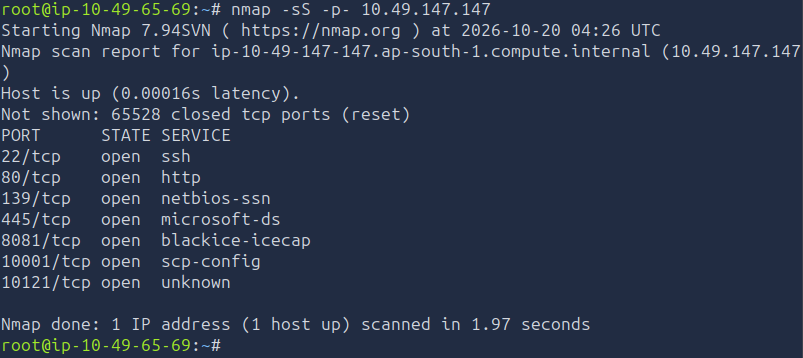
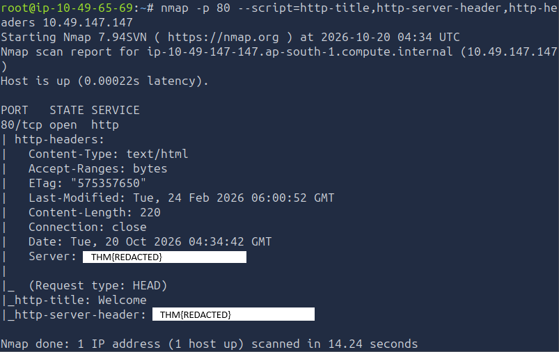
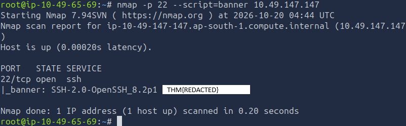
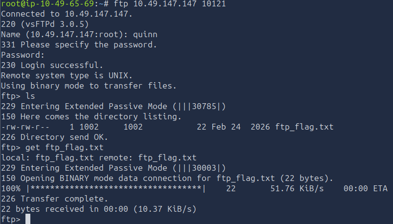
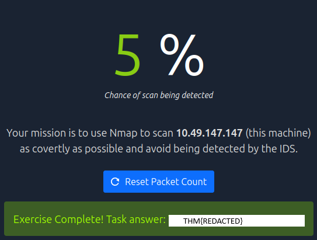

# TryHackMe — Net Sec Challenge

## Overview

**Room:** Net Sec Challenge  
**Platform:** TryHackMe  
**Difficulty:** Easy  
**Focus:** Nmap Enumeration, FTP Access, Hydra Password Cracking, TCP NULL Scanning

The objective of this challenge was to enumerate the target's exposed TCP services, identify service versions and information disclosed in service banners, recover FTP credentials using a targeted password attack, and solve a network-scanning challenge to retrieve the remaining flag.

The initial enumeration used Nmap to identify open ports. Additional service-specific checks were then used to inspect HTTP, SSH, and FTP. The FTP challenge involved the usernames `eddie` and `quinn`, with Hydra used to test them against the RockYou password list.

---

## 1. Initial Port Enumeration

### Question 1

**What is the highest port number that is open and less than 10,000?**

Run a full TCP SYN scan to identify open ports across the entire TCP port range:

```bash
nmap -sS -p- <TARGET_IP>
```

Review the results and identify the highest open port below `10000`.



### Finding

The full-port scan identifies exposed TCP services beyond Nmap's default top 1,000 ports.

### Question 2

**There is an open port outside the common 1,000 ports; it is above 10,100. What is it?**

The same full-port scan can identify this port:

```bash
nmap -sS -p- <TARGET_IP>
```

Inspect the open-port list for the port above `10100`.


### Finding

The full TCP scan reveals a nonstandard high-numbered port that requires further service identification.

### Question 3

**How many TCP ports are open?**

Count the ports reported as `open` in the full-port scan:

```bash
nmap -sS -p- <TARGET_IP>
```

Count only TCP ports with the `open` state, not ports reported as `closed` or `filtered`.


### Finding

The full-port scan provides the number of exposed TCP services and helps determine which ports require further investigation.

---

## 2. HTTP Service Enumeration

### Question 4

**On port 80, what is the service version value?**

Run service-version detection alongside HTTP-specific NSE scripts:

```bash
nmap -sV -p 80 --script=http-title,http-server-header,http-headers <TARGET_IP>
```

Inspect the output for the HTTP server's version information. The `Server` header may disclose the software name and version, while `-sV` performs service detection.



### Finding

The HTTP service may disclose identifying information through its headers or service response.

### Vulnerability

Detailed server-version disclosure can help an attacker identify the software in use and research potentially applicable vulnerabilities. Version disclosure alone does not prove that the service is vulnerable.

---

## 3. SSH Banner Enumeration

### Question 5

**What is the flag hidden in the SSH server header?**

Use Nmap's banner script against port 22:

```bash
nmap -p 22 --script=banner <TARGET_IP>
```

Inspect the banner returned by the SSH service. The challenge's flag is expected to be included in the returned information.



### Finding

The SSH banner provides information returned by the service during connection establishment.

### Vulnerability

Placing sensitive challenge information in a service banner exposes it to anyone who can connect and retrieve that banner. In a real environment, banners should not disclose secrets.

---

## 4. FTP Service Enumeration

### Question 6

**We have an FTP server listening on a nonstandard port. What is the version of the FTP server?**

The supplied notes identify port `10121` as the FTP service port. Connect to it with Telnet to inspect the server's greeting:

```bash
telnet <TARGET_IP> 10121
```

Logging in would provide the softwasre version in the terminal output

```bash
nmap -sV -p 10121 <TARGET_IP>
```

Inspect the returned service information and record the version.


### Finding

The FTP service is listening on a nonstandard port, `10121`, and its banner or service response can help identify the implementation.

### Vulnerability

Running FTP on a nonstandard port does not itself constitute a vulnerability. The important security considerations are authentication strength, access permissions, and whether credentials or data are transmitted securely.

---

## 5. FTP Credential Discovery and File Access

### Question 7

**We learned two usernames using social engineering: `eddie` and `quinn`. What is the flag hidden in one of these two account files and accessible via FTP?**

The two known usernames were saved in a file named `users.txt`. This file was used as the username list for a targeted Hydra password attack against the FTP service.

The username file contains:

```text
eddie
quinn
```

Run Hydra against FTP on port `10121` with the RockYou password list:

```bash
hydra -L users.txt -P /usr/share/wordlists/rockyou.txt -s 10121 -vV <TARGET_IP> ftp
```

Where:

- `-L users.txt` supplies the list of usernames.
- `-P` supplies the password wordlist.
- `-s 10121` specifies the nonstandard FTP port.
- `-vV` enables verbose output.

The attack identified a password for the account `quinn` (record the exact password from your Hydra output).



### Accessing the FTP server

Use the recovered credentials to authenticate to the FTP service:

```bash
ftp <TARGET_IP> 10121
```

Enter `quinn` as the username and use the password recovered by Hydra. Once authenticated, enumerate the accessible files and directories:

```text
ls
```

Download the relevant file using the FTP `get` command:

```bash
get <REMOTE_FILENAME>
```

Inspect the downloaded file and identify the flag.


### Finding

A targeted password attack against the two known usernames recovered credentials for `quinn`. The credentials enabled access to files exposed through the FTP service.

### Vulnerability

A weak account password allowed password guessing against the FTP service. The authenticated account also had access to a file containing challenge information.

Defensive measures include strong unique passwords, rate limiting or account lockout where appropriate, monitoring repeated authentication failures, and restricting FTP access to only the files and users that require it.

---

## 6. TCP NULL Scan Challenge

### Question 8

**Browsing to `http://<TARGET_IP>:8081` displays a small challenge that will give you a flag once you solve it. What is the flag?**

Open the challenge page in a browser:

```text
http://<TARGET_IP>:8081
```

The supplied notes indicate that the challenge involves setting the TCP NULL scan flag for packets. In Nmap, a NULL scan is selected with `-sN`.

Run the scan against the target:

```bash
nmap -sN <TARGET_IP>
```

A TCP NULL scan sends TCP probes with no TCP flags set. Depending on the target's TCP implementation and filtering rules, Nmap interprets the responses to classify ports.

Review the scan output and compare it with the challenge's requirements on port `8081`. Record the flag returned after the challenge is solved.



### Finding

The challenge tests understanding of TCP flag combinations and Nmap's NULL scan technique.

### Vulnerability

A NULL scan is an enumeration technique, not a vulnerability by itself. It can sometimes help identify port states or infer filtering behavior, depending on the target operating system and network configuration.

---

## Final Results

| Question | Result |
|---|---|
| 1. Highest open port below 10,000 | `[HIGHEST OPEN PORT BELOW 10000]` |
| 2. Open port above 10,100 | `[OPEN PORT ABOVE 10100]` |
| 3. Total open TCP ports | `[TOTAL OPEN TCP PORTS]` |
| 4. HTTP service version | `[HTTP SERVICE VERSION VALUE]` |
| 5. SSH banner flag | `[SSH BANNER FLAG]` |
| 6. FTP service version | `[FTP SERVER VERSION]` |
| 7. Flag from FTP-accessible account file | `[FTP FLAG]` |
| 8. TCP NULL scan challenge flag | `[TCP NULL SCAN CHALLENGE FLAG]` |

---

## Attack Chain Summary

The complete workflow followed during the challenge was:

    Full TCP port scan
            ↓
    Identify open and nonstandard ports
            ↓
    Enumerate HTTP, SSH, and FTP banners
            ↓
    Identify the FTP service on port 10121
            ↓
    Run targeted Hydra attack against eddie and quinn
            ↓
    Recover quinn's password
            ↓
    Access FTP and retrieve the flag-bearing file
            ↓
    Complete the TCP NULL scan challenge on port 8081
            ↓
    Record all eight answers

---

## Key Vulnerabilities and Security Lessons

| Weakness or technique | Impact |
|---|---|
| Exposed service banners | Can disclose software and version information |
| Weak FTP account password | Permits password guessing and unauthorized account access |
| Excessive FTP file access | May expose sensitive files to authenticated users |
| TCP NULL scan | Supports reconnaissance; it is not itself a vulnerability |

## Lessons Learned

Full TCP port scanning is important because services may be listening outside the common port range. After identifying open ports, service-specific enumeration can reveal useful details through banners, headers, and protocol responses.

The FTP portion demonstrates how a small, targeted username list combined with a common password list can expose weak credentials. Once authenticated, it is important to enumerate accessible directories and inspect relevant files rather than stopping at successful login.

Finally, understanding TCP flags and scan types helps explain how Nmap probes network services. A NULL scan sends TCP packets without flags set, but its results depend on the target's TCP stack and firewall behavior. These techniques should only be used against systems for which testing is authorized.
