# TryHackMe - Interceptor

## Overview

**Room:** Interceptor  
**Platform:** TryHackMe  
**Difficulty:** Medium  
**Focus:** Nmap Enumeration, Web Application Enumeration, Gobuster Directory Discovery, Burp Suite Request Manipulation, OTP Authentication Bypass, Server-Side Request Forgery (SSRF), Local File Retrieval

---

## Attack Path

The compromise followed this chain:

```text
Nmap service enumeration
            ↓
Web application and cookie inspection
            ↓
Gobuster directory enumeration
            ↓
Discover login.php.bak
            ↓
Recover administrator login details
            ↓
Capture and inspect OTP verification request
            ↓
Manipulate the request to bypass OTP verification
            ↓
Access the authenticated dashboard
            ↓
Abuse the fetch functionality
            ↓
Retrieve the user flag
```

---

## 1. Nmap Enumeration

The first step was to identify the services exposed by the target. Before interacting with the web application, I needed to establish which ports were open and what services were running.

I used Nmap's default scripts and service-version detection against the top 1,000 TCP ports:

```bash
nmap -sC -sV --top-ports 1000 <TARGET_IP>
```

The scan identified the following services:

- **22/tcp — SSH**
- **53/tcp — DNS**
- **80/tcp — HTTP**

The HTTP service was particularly interesting because the Nmap output indicated that the application's session cookie did not have the `HttpOnly` flag set.

The `HttpOnly` attribute prevents client-side JavaScript from reading a cookie through interfaces such as `document.cookie`. Without this attribute, a successful cross-site scripting (XSS) attack could potentially steal a session cookie. However, the missing attribute alone does not prove that XSS is present or that the cookie can be exploited.

Since HTTP was the primary web-facing service, I shifted my attention to the browser to investigate the application and its session management.

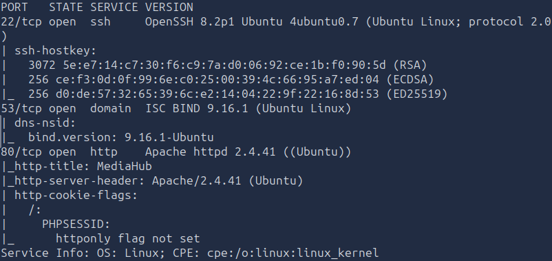

### Finding

The target exposed SSH, DNS, and HTTP. The HTTP service also indicated that its session cookie lacked the `HttpOnly` attribute.

### Vulnerability

**Missing HttpOnly Cookie Attribute**

The absence of `HttpOnly` can expose session cookies to client-side JavaScript if an attacker can execute script in the application's origin. This increases the potential impact of XSS, although a separate script-injection vulnerability would be needed to demonstrate that attack path.

---

## 2. Web Application and Cookie Inspection

### 2.1. Inspecting the Application in Developer Tools

After completing the initial scan, I opened the target website in a browser and inspected it using the developer tools.

I first reviewed the Network panel to identify requests and resources that might reveal useful endpoints or application behavior. Nothing immediately suspicious stood out, so I moved to the Storage panel to examine the cookies.

There, I confirmed that the session cookie did not have the `HttpOnly` attribute enabled.

This was useful information because cookies are often responsible for maintaining authenticated sessions. If a session identifier could be obtained or manipulated, it might provide a way to interfere with authentication. I also considered whether the application trusted client-controlled cookie data, although that would require further testing.

The next step was to examine the login process itself rather than assume that the cookie configuration could be directly exploited.

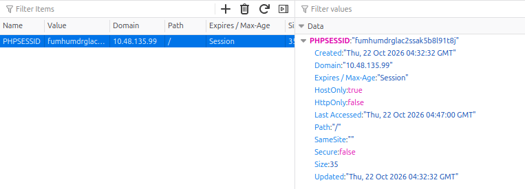

### Finding

The browser confirmed the missing `HttpOnly` attribute on the session cookie.

### Vulnerability

The cookie configuration increased the potential impact of client-side script execution. No direct session theft or cookie-forgery vulnerability had been established at this stage.

### 2.2. Capturing the Login Request with Burp Suite

I then opened Burp Suite and captured the requests generated by the login page.

The login interface was served through `login.php`, while the authentication request was handled by `api_login.php`. In the captured request, I observed a `PHPSESSID` cookie.

This gave me a clearer picture of the authentication flow: the browser interacted with the login page, submitted credentials to the API endpoint, and maintained a session using PHP's session identifier.

I initially tested a basic SQL injection authentication-bypass payload:

```text
' OR 1=1 --
```

The attempt did not work.

Rather than continuing to guess SQL injection payloads without evidence that the login endpoint was vulnerable, I decided to investigate the website's exposed files and directories. A forgotten backup or development file could reveal information about the application's authentication logic.

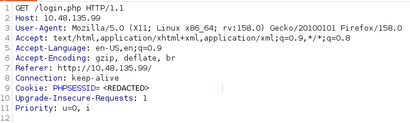

### Finding

The login flow used `login.php`, `api_login.php`, and a `PHPSESSID` session cookie. The initial SQL injection attempt did not bypass authentication.

### Vulnerability

No SQL injection vulnerability was confirmed by this test. The useful result was identifying the authentication endpoint and the session mechanism for subsequent analysis.

---

## 3. Gobuster Directory Enumeration

### 3.1. Identifying Hidden Files and Directories

After the initial login investigation failed to produce access, I returned to the terminal to enumerate the web server's content.

I used Gobuster with the common directory wordlist and included extensions that might identify PHP source backups or text files:

```bash
gobuster dir -u http://<TARGET_IP> -w /usr/share/wordlists/dirb/common.txt -x php,php.bak,txt
```

The scan did not immediately return useful directory results. Instead, Gobuster reported that a nonexistent URL returned HTTP status code `200` with a response length of `1491` bytes.

The error showed that the application responded to arbitrary paths in the same way it responded to valid-looking resources. This behavior interfered with Gobuster's ability to distinguish genuine files from nonexistent ones.

The relevant output was:

```text
Error: the server returns a status code that matches the provided options for non existing urls.
[http://10.48.135.99/976b0eb4-b3c9-45e8-b521-014bd0d97949] => 200 (Length: 1491).
To continue please exclude the status code or the length
```

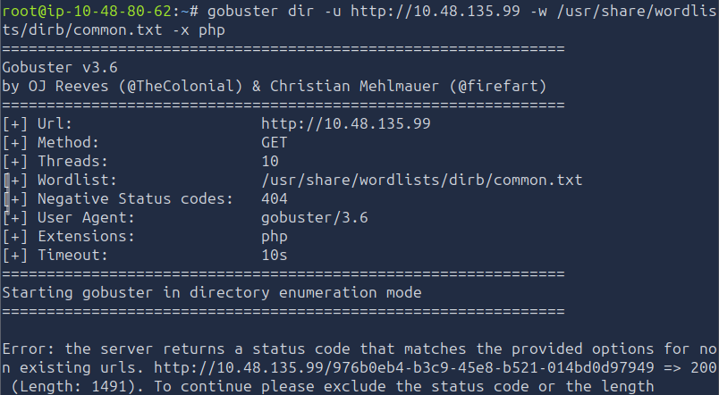

### 3.2. Filtering the Application's Generic Responses

The response length provided a practical way to filter the false positives. Since the random nonexistent path returned a response of `1491` bytes, I repeated the scan while excluding responses of that length:

```bash
gobuster dir -u http://<TARGET_IP> -w /usr/share/wordlists/dirb/common.txt -x php,php.bak,txt --exclude-length 1491
```

This allowed Gobuster to filter out responses matching the application's generic error page and made genuine discoveries easier to identify.

The scan revealed a backup file:

```text
/login.php.bak
```

The other discovered paths should be recorded from the actual Gobuster output; they were not included in the supplied notes.


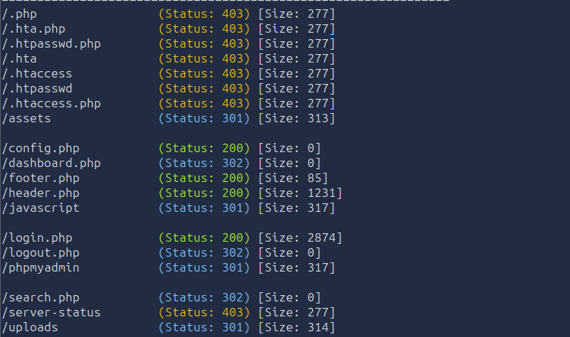

### Finding

The application returned a generic HTTP `200` response for nonexistent paths. Filtering responses by their common length allowed Gobuster to identify the accessible `login.php.bak` file.

### Vulnerability

**Information Disclosure Through an Exposed Backup File**

A backup of the login page had been left accessible through the web server. Backup files can contain developer notes, credentials, configuration details, or implementation information that should not be publicly available.

---

## 4. Recovering Administrator Login Details

### 4.1. Inspecting `login.php.bak`

After discovering the backup file, I opened it to inspect its contents.

The file contained a developer note indicating that a test administrator account had been used in a staging environment. It also disclosed the administrator's email address and a description of the password format.

The relevant section was:

```text
/*
|--------------------------------------------------------------------------
| Developer Note (temporary)
|--------------------------------------------------------------------------
| Admin test account for staging environment
| Email: <REDACTED>
|
| Password policy reminder:
| Admin password follows company format:
| <REDACTED>
|
| TODO: remove before production deployment
*/
?>
```

The supplied notes redact the actual email address and password format, so those values are not reproduced here.

The important discovery was that the developer had left authentication-related information in a publicly accessible backup. I used the exposed details to construct the administrator login credentials and attempted to sign in.

The login was accepted far enough to prompt for a one-time password (OTP).

This changed the direction of the investigation. The credentials provided a route to the second authentication stage, so I needed to understand how the application validated the OTP.

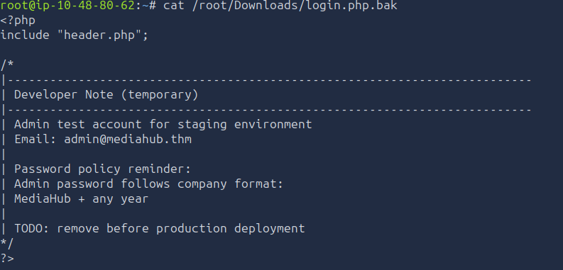

### Finding

The exposed backup file disclosed the administrator's email address and password-format information, allowing the next authentication stage to be reached.

### Vulnerability

**Exposed Developer Backup and Credential Disclosure**

The application exposed a backup containing sensitive information that should have been removed or stored outside the public web directory. This reduced the difficulty of identifying valid administrator login details.

---

## 5. OTP Verification Bypass with Burp Suite

### 5.1. Capturing an OTP Verification Request

After submitting the administrator login details, the application prompted me for an OTP.

At this point, I considered brute-forcing the OTP because I had not observed a rate limiter. However, repeated guessing would be unnecessary if the server's verification endpoint could be manipulated directly.

I entered the test value:

```text
123456
```

I intercepted the resulting request with Burp Suite and sent it to Repeater. This allowed me to modify the request and inspect the server's response without repeatedly navigating through the browser interface.

The server responded:

```JSON
{"ok":false,"error":"Invalid OTP. Try again.","is_verified":false}
```

The response was useful because it explicitly included the `is_verified` field. This suggested that the application exposed its verification state in the response. It did not, by itself, prove that the server would trust a client-supplied value, but it provided a concrete parameter to investigate.

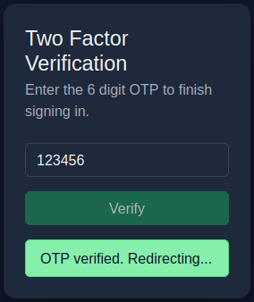

### 5.2. Manipulating the Verification Request

I then tested whether the server-side verification endpoint relied on a client-controlled parameter.

In Burp Repeater, I modified the request so that the parameter name was changed from `OTP` to `is_verified`, and the submitted value was changed from `123456` to the Boolean value `true`.

The altered request was accepted, and the server returned:

```JSON
{"ok":true,"message":"OTP verified. Redirecting..."}
```

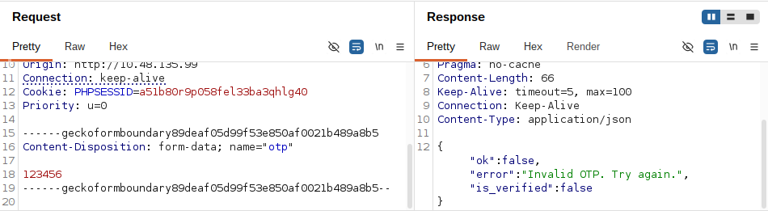

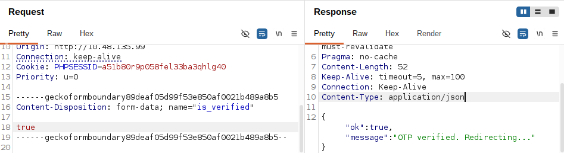

This response indicated that the application had accepted the manipulated verification request. I returned to the browser, forwarded any remaining intercepted requests, disabled interception, and refreshed the page. The dashboard then appeared as an authenticated user.

The key insight was that I did not need to brute-force the OTP. By inspecting the API request and testing the server's trust in client-controlled input, I found a way to bypass the intended verification step.

### Finding

Changing the submitted parameter from `OTP` to `is_verified` and supplying `true` resulted in a successful verification response and access to the dashboard.

### Vulnerability

**Improper Server-Side OTP Validation**

The OTP verification endpoint accepted a manipulated request that bypassed the expected verification process. Authentication state must be established and validated on the server; a client must not be able to declare itself verified by submitting a Boolean value.

The application should validate the OTP against the expected value, associate the result with the correct authentication session, and reject unexpected parameters or altered verification states.

---

## 6. Dashboard Enumeration and File Retrieval

### 6.1. Inspecting the Authenticated Dashboard

After refreshing the browser, I confirmed that I had access to the dashboard.

The dashboard provided two functionalities. I focused on the fetch functionality because it allowed a supplied resource to be retrieved and displayed in the application.

This was an important point to investigate: a server-side fetch feature may make requests from the server itself, meaning that the application could potentially reach destinations unavailable directly from the attacking machine.

I first tested the loopback address:

```text
http://127.0.0.1
```

This returned an error. Rather than immediately abandoning the feature, I considered whether the input was being parsed or validated in a way that affected the accepted URL format.

### 6.2. Testing an Alternative Loopback Representation

I then tried a shortened loopback representation:

```text
http://127.0.1
```

This worked.

The successful response suggested that the fetch functionality accepted an alternative representation of the local host. It also indicated that the application was likely making the request from its own server environment, rather than simply retrieving a resource from the attacker's browser.

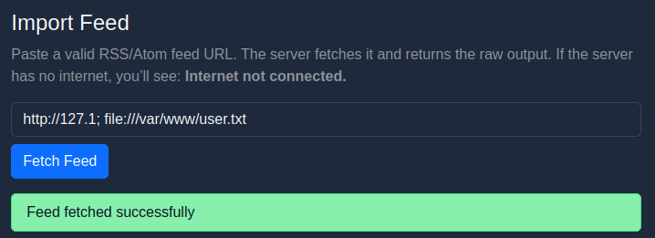

### 6.3. Retrieving the User Flag

With the fetch functionality working against the local host, I tested whether the same input could be used to access a local file.

The input recorded in my notes was:

```text
http://127.1; file:///var/www/user.txt
```

This resulted in the flag being displayed on the dashboard.

The supplied notes do not include the literal flag value, so it should be copied from the captured result into the final result section below.

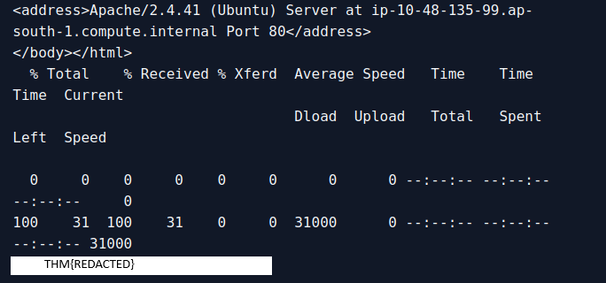

### Finding

The dashboard's fetch functionality accepted an alternative loopback address and was subsequently used to retrieve the local file `/var/www/user.txt`.

### Vulnerability

**Server-Side Request Forgery (SSRF) / Unsafe Fetch Functionality**

The fetch feature allowed attacker-controlled input to influence a request originating from the server. This can potentially expose internal services or resources that are not directly accessible to an external user.

The exact underlying implementation is not established by the supplied notes. The use of a `file://` URI alongside a semicolon-separated input suggests that local file access or input-handling behavior may also be involved. Therefore, the finding is best described as unsafe server-side fetching with local-file retrieval; the precise combination of SSRF, local file inclusion, or command/input injection would require inspecting the server-side implementation to confirm.

Recommended mitigations include strict destination allowlisting, blocking loopback and private network addresses where they are not required, rejecting unsupported URI schemes, and avoiding shell or command interpretation of user-supplied input.


---

## Attack Chain Summary

The complete attack path followed during the Interceptor room was:

```text
Nmap enumeration
            ↓
Identify HTTP service and inspect cookie attributes
            ↓
Capture login request with Burp Suite
            ↓
Initial SQL injection attempt fails
            ↓
Gobuster discovers exposed login.php.bak
            ↓
Recover administrator login details
            ↓
Capture OTP verification request
            ↓
Manipulate is_verified parameter
            ↓
Bypass OTP verification
            ↓
Access authenticated dashboard
            ↓
Test fetch functionality with loopback addresses
            ↓
Retrieve /var/www/user.txt
            ↓
Recover user flag
```

---

## Key Vulnerabilities

| Vulnerability | Impact |
|---|---|
| Missing `HttpOnly` cookie attribute | Could increase session-cookie exposure if XSS were present |
| Exposed `login.php.bak` | Disclosed administrator account information and password-format details |
| Improper OTP verification | Allowed authentication-stage bypass through request manipulation |
| Unsafe server-side fetch functionality | Allowed access to a local resource through attacker-controlled input |
| Insufficient input and destination validation | Allowed unexpected URL representations and local-resource access |

---

## Lessons Learned

The initial Nmap scan established the exposed services, while browser developer tools and Burp Suite provided insight into the web application's cookies and authentication flow. The failed SQL injection attempt was useful because it prevented me from assuming that every login endpoint was vulnerable to SQL injection and encouraged a different enumeration approach.

Gobuster then exposed a backup file that contained sensitive developer notes. This demonstrated the value of testing common backup extensions and understanding how generic web-server responses can interfere with directory enumeration. Excluding the repeated response length made the genuine file easier to identify.

The OTP stage reinforced the importance of inspecting API requests and responses rather than immediately resorting to brute force. The `is_verified` response field suggested a useful test, and modifying the verification request exposed a server-side authentication weakness. Verification decisions must be enforced by the server, not by values that a client can freely submit.

Finally, the dashboard's fetch feature demonstrated why server-side retrieval functionality deserves careful testing. The alternative loopback representation worked when the original address did not, and further input testing resulted in access to a local flag file. In real applications, URL parsing, destination validation, URI scheme restrictions, and local-file access controls must be implemented defensively.
